# Chapter 11 Solutions and Colloids

Source: OpenStax Chemistry 2e, CC BY 4.0. Access for free at https://openstax.org/books/chemistry-2e/

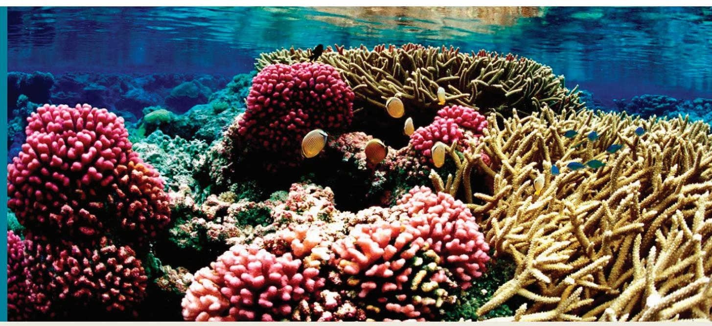
**Figure 11.1** Coral reefs, such as this one at the Palmyra Atoll National Wildlife Refuge, are vital to the ecosystem of earth’s oceans. The health of coral reefs and all marine life depends on the specific chemical composition of the complex mixture known as seawater. (credit: modification of work by “USFWS – Pacific Region”/Wikimedia Commons)

**CHAPTER OUTLINE**

11.1 The Dissolution Process  
11.2 Electrolytes  
11.3 Solubility  
11.4 Colligative Properties  
11.5 Colloids

**INTRODUCTION** Coral reefs are home to about 25% of all marine species. They are being threatened by climate change, oceanic acidification, and water pollution, all of which change the composition of the solution known as seawater. Dissolved oxygen in seawater is critical for sea creatures, but as the oceans warm, oxygen becomes less soluble. As the concentration of carbon dioxide in the atmosphere increases, the concentration of carbon dioxide in the oceans increases, contributing to oceanic acidification. Coral reefs are particularly sensitive to the acidification of the ocean, since the exoskeletons of the coral polyps are soluble in acidic solutions. Humans contribute to the changing of seawater composition by allowing agricultural runoff and other forms of pollution to affect our oceans.

Solutions are crucial to the processes that sustain life and to many other processes involving chemical reactions. This chapter considers the nature of solutions and examines factors that determine whether a solution will form and what properties it may have. The properties of colloids—mixtures containing dispersed particles larger than the molecules and ions of typical solutions—are also discussed.

## 11.1 The Dissolution Process

**LEARNING OBJECTIVES**

By the end of this section, you will be able to:

-   Describe the basic properties of solutions and how they form
-   Predict whether a given mixture will yield a solution based on molecular properties of its components
-   Explain why some solutions either produce or absorb heat when they form

An earlier chapter of this text introduced solutions, defined as homogeneous mixtures of two or more substances. Often, one component of a solution is present at a significantly greater concentration, in which case it is called the solvent. The other components of the solution present in relatively lesser concentrations are called solutes. Sugar is a covalent solid composed of sucrose molecules, C₁₂H₂₂O₁₁. When this compound dissolves in water, its molecules become uniformly distributed among the molecules of water:

$$\text{C}_{12}\text{H}_{22}\text{O}_{11}(s) \longrightarrow \text{C}_{12}\text{H}_{22}\text{O}_{11}(aq)$$

The subscript “aq” in the equation signifies that the sucrose molecules are solutes and are therefore individually dispersed throughout the aqueous solution (water is the solvent). Although sucrose molecules are heavier than water molecules, they remain dispersed throughout the solution; gravity does not cause them to “settle out” over time.

Potassium dichromate, K₂Cr₂O₇, is an ionic compound composed of colorless potassium ions, K⁺, and orange dichromate ions, Cr₂O₇²⁻. When a small amount of solid potassium dichromate is added to water, the compound dissolves and dissociates to yield potassium ions and dichromate ions uniformly distributed throughout the mixture (Figure 11.2), as indicated in this equation:

$$\text{K}_2\text{Cr}_2\text{O}_7(s) \longrightarrow 2\text{K}^+(aq) + \text{Cr}_2\text{O}_7^{2-}(aq)$$

As with the mixture of sugar and water, this mixture is also an aqueous solution. Its solutes, potassium and dichromate ions, remain individually dispersed among the solvent (water) molecules.

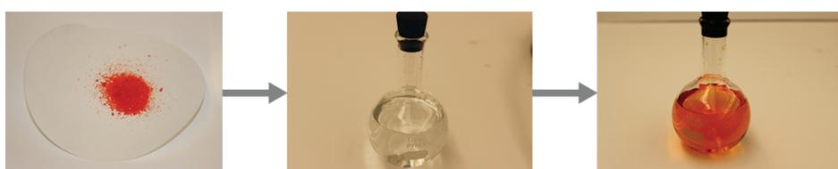
**Figure 11.2** When potassium dichromate (K₂Cr₂O₇) is mixed with water, it forms a homogeneous orange solution. (credit: modification of work by Mark Ott)

**LINK TO LEARNING**

Visit this virtual lab (http://openstax.org/l/16Phetsugar) to view simulations of the dissolution of common covalent and ionic substances (sugar and salt) in water.

Water is used so often as a solvent that the word solution has come to imply an aqueous solution to many people. However, almost any gas, liquid, or solid can act as a solvent. Many **alloys** are solid solutions of one metal dissolved in another; for example, US five-cent coins contain nickel dissolved in copper. Air is a gaseous solution, a homogeneous mixture of nitrogen, oxygen, and several other gases. Oxygen (a gas), alcohol (a liquid), and sugar (a solid) all dissolve in water (a liquid) to form liquid solutions. Table 11.1 gives examples of several different solutions and the phases of the solutes and solvents.

**Different Types of Solutions**

| Solution | Solute | Solvent |
|---|---|---|
| air | O₂(g) | N₂(g) |
| soft drinks¹ | CO₂(g) | H₂O(l) |
| hydrogen in palladium | H₂(g) | Pd(s) |
| rubbing alcohol | H₂O(l) | C₃H₈O(l) (2-propanol) |
| saltwater | NaCl(s) | H₂O(l) |
| brass | Zn(s) | Cu(s) |

¹ If bubbles of gas are observed within the liquid, the mixture is not homogeneous and, thus, not a solution.

Solutions exhibit these defining traits:

-   They are homogeneous; after a solution is mixed, it has the same composition at all points throughout (its composition is uniform).
-   The physical state of a solution—solid, liquid, or gas—is typically the same as that of the solvent, as demonstrated by the examples in Table 11.1.
-   The components of a solution are dispersed on a molecular scale; they consist of a mixture of separated solute particles (molecules, atoms, and/or ions) each closely surrounded by solvent species.
-   The dissolved solute in a solution will not settle out or separate from the solvent.
-   The composition of a solution, or the concentrations of its components, can be varied continuously (within limits determined by the solubility of the components, discussed in detail later in this chapter).

### The Formation of Solutions

The formation of a solution is an example of a **spontaneous process**, a process that occurs under specified conditions without the requirement of energy from some external source. Sometimes a mixture is stirred to speed up the dissolution process, but this is not necessary; a homogeneous solution will form eventually. The topic of spontaneity is critically important to the study of chemical thermodynamics and is treated more thoroughly in a later chapter of this text. For purposes of this chapter’s discussion, it will suffice to consider two criteria that favor, but do not guarantee, the spontaneous formation of a solution:

1.  a decrease in the internal energy of the system (an exothermic change, as discussed in the previous chapter on thermochemistry)
2.  an increased dispersal of matter in the system (which indicates an increase in the entropy of the system, as you will learn about in the later chapter on thermodynamics)

In the process of dissolution, an internal energy change often, but not always, occurs as heat is absorbed or evolved. An increase in matter dispersal always results when a solution forms from the uniform distribution of solute molecules throughout a solvent.

When the strengths of the intermolecular forces of attraction between solute and solvent species in a solution are no different than those present in the separated components, the solution is formed with no accompanying energy change. Such a solution is called an **ideal solution**. A mixture of ideal gases (or gases such as helium and argon, which closely approach ideal behavior) is an example of an ideal solution, since the entities comprising these gases experience no significant intermolecular attractions.

When containers of helium and argon are connected, the gases spontaneously mix due to diffusion and form a solution (Figure 11.3). The formation of this solution clearly involves an increase in matter dispersal, since the helium and argon atoms occupy a volume twice as large as that which each occupied before mixing.

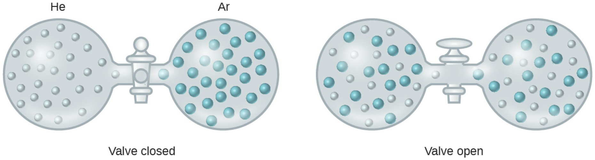
**Figure 11.3** Samples of helium and argon spontaneously mix to give a solution.

Ideal solutions may also form when structurally similar liquids are mixed. For example, mixtures of the alcohols methanol (CH₃OH) and ethanol (C₂H₅OH) form ideal solutions, as do mixtures of the hydrocarbons pentane, C₅H₁₂, and hexane, C₆H₁₄. Placing methanol and ethanol, or pentane and hexane, in the bulbs shown in Figure 11.3 will result in the same diffusion and subsequent mixing of these liquids as is observed for the He and Ar gases (although at a much slower rate), yielding solutions with no significant change in energy. Unlike a mixture of gases, however, the components of these liquid-liquid solutions do, indeed, experience intermolecular attractive forces. But since the molecules of the two substances being mixed are structurally very similar, the intermolecular attractive forces between like and unlike molecules are essentially the same, and the dissolution process, therefore, does not entail any appreciable increase or decrease in energy. These examples illustrate how increased matter dispersal alone can provide the driving force required to cause the spontaneous formation of a solution. In some cases, however, the relative magnitudes of intermolecular forces of attraction between solute and solvent species may prevent dissolution.

Three types of intermolecular attractive forces are relevant to the dissolution process: solute-solute, solvent-solvent, and solute-solvent. As illustrated in Figure 11.4, the formation of a solution may be viewed as a stepwise process in which energy is consumed to overcome solute-solute and solvent-solvent attractions (endothermic processes) and released when solute-solvent attractions are established (an exothermic process referred to as **solvation**). The relative magnitudes of the energy changes associated with these stepwise processes determine whether the dissolution process overall will release or absorb energy. In some cases, solutions do not form because the energy required to separate solute and solvent species is so much greater than the energy released by solvation.

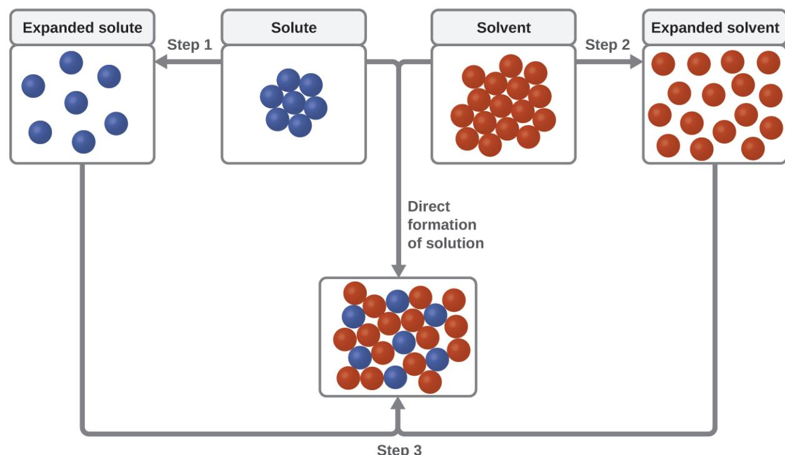
**Figure 11.4** This schematic represents the direct formation of a solution as a hypothetical stepwise process. Steps 1 and 2 involve separation/expansion of the solute and solvent molecules, both of which require an input of energy to overcome intermolecular attractions and are thus endothermic. Step 3 involves establishing intermolecular attractive forces between solute and solvent molecules (solvation), and is thus exothermic.

Consider the example of an ionic compound dissolving in water. Formation of the solution requires the electrostatic forces between the cations and anions of the compound (solute–solute) be overcome completely as attractive forces are established between these ions and water molecules (solute–solvent). Hydrogen bonding between a relatively small fraction of the water molecules must also be overcome to accommodate any dissolved solute. If the solute’s electrostatic forces are significantly greater than the solvation forces, the dissolution process is significantly endothermic and the compound may not dissolve to an appreciable extent. Calcium carbonate, the major component of coral reefs, is one example of such an “insoluble” ionic compound (see Figure 11.1). On the other hand, if the solvation forces are much stronger than the compound’s electrostatic forces, the dissolution is significantly exothermic and the compound may be highly soluble. A common example of this type of ionic compound is sodium hydroxide, commonly known as lye.

As noted at the beginning of this module, spontaneous solution formation is favored, but not guaranteed, by exothermic dissolution processes. While many soluble compounds do, indeed, dissolve with the release of heat, some dissolve endothermically. Ammonium nitrate (NH₄NO₃) is one such example and is used to make instant cold packs, like the one pictured in Figure 11.5, which are used for treating injuries. A thin-walled plastic bag of water is sealed inside a larger bag with solid NH₄NO₃. When the smaller bag is broken, a solution of NH₄NO₃ forms, absorbing heat from the surroundings (the injured area to which the pack is applied) and providing a cold compress that decreases swelling. Endothermic dissolutions such as this one require a greater energy input to separate the solute species than is recovered when the solutes are solvated, but they are spontaneous nonetheless due to the increase in disorder that accompanies formation of the solution.

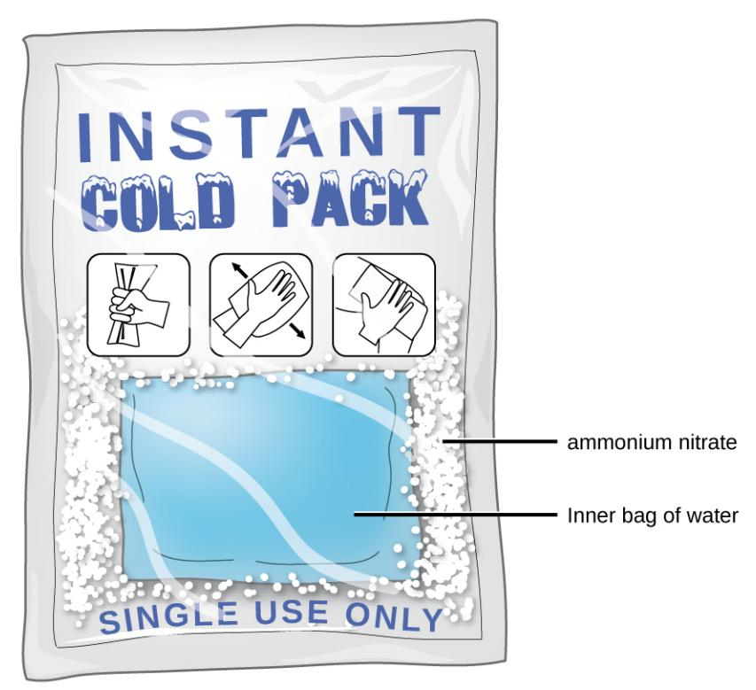
**Figure 11.5** An instant cold pack gets cold when certain salts, such as ammonium nitrate, dissolve in water—an endothermic process.

**LINK TO LEARNING**

Watch this brief video (http://openstax.org/l/16endoexo) illustrating endothermic and exothermic dissolution processes.

## 11.2 Electrolytes

**LEARNING OBJECTIVES**

By the end of this section, you will be able to:

-   Define and give examples of electrolytes
-   Distinguish between the physical and chemical changes that accompany dissolution of ionic and covalent electrolytes
-   Relate electrolyte strength to solute-solvent attractive forces

When some substances are dissolved in water, they undergo either a physical or a chemical change that yields ions in solution. These substances constitute an important class of compounds called **electrolytes**. Substances that do not yield ions when dissolved are called **nonelectrolytes**. If the physical or chemical process that generates the ions is essentially 100% efficient (all of the dissolved compound yields ions), then the substance is known as a **strong electrolyte**. If only a relatively small fraction of the dissolved substance undergoes the ion-producing process, it is called a **weak electrolyte**.

Substances may be identified as strong, weak, or nonelectrolytes by measuring the electrical conductance of an aqueous solution containing the substance. To conduct electricity, a substance must contain freely mobile, charged species. Most familiar is the conduction of electricity through metallic wires, in which case the mobile, charged entities are electrons. Solutions may also conduct electricity if they contain dissolved ions, with conductivity increasing as ion concentration increases. Applying a voltage to electrodes immersed in a solution permits assessment of the relative concentration of dissolved ions, either quantitatively, by measuring the electrical current flow, or qualitatively, by observing the brightness of a light bulb included in the circuit (Figure 11.6).

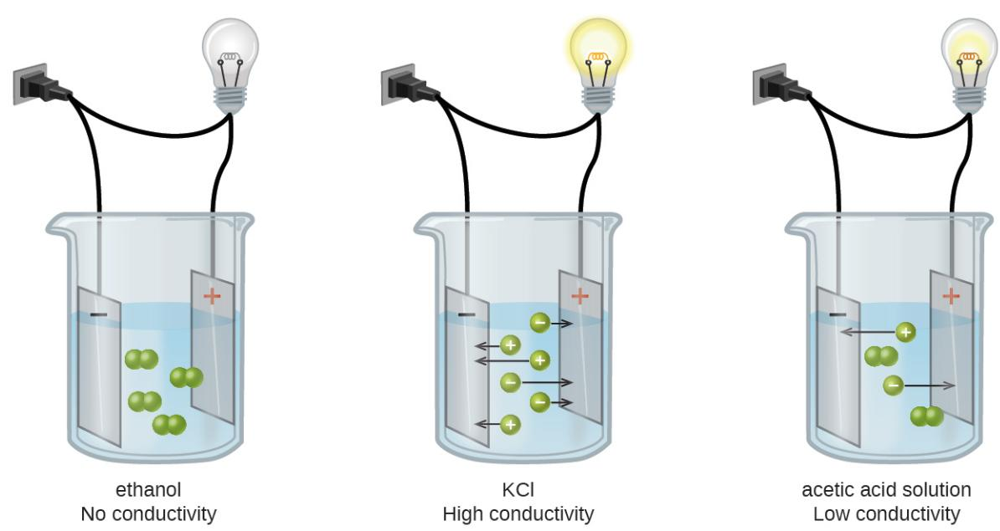
**Figure 11.6** Solutions of nonelectrolytes such as ethanol do not contain dissolved ions and cannot conduct electricity. Solutions of electrolytes contain ions that permit the passage of electricity. The conductivity of an electrolyte solution is related to the strength of the electrolyte.

### Ionic Electrolytes

Water and other polar molecules are attracted to ions, as shown in Figure 11.7. The electrostatic attraction between an ion and a molecule with a dipole is called an **ion-dipole attraction**. These attractions play an important role in the dissolution of ionic compounds in water.

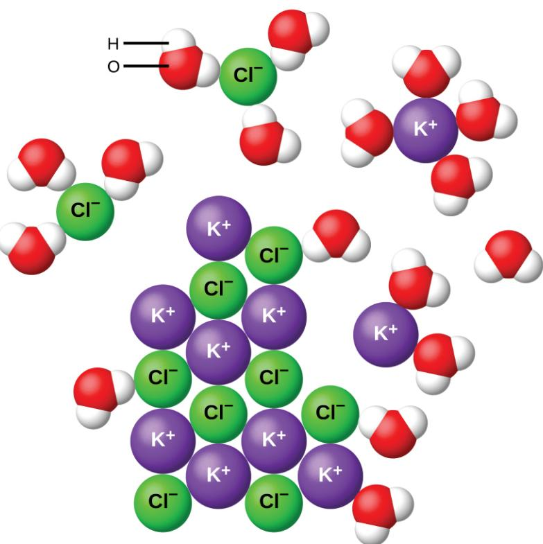
**Figure 11.7** As potassium chloride (KCl) dissolves in water, the ions are hydrated. The polar water molecules are attracted by the charges on the K⁺ and Cl⁻ ions. Water molecules in front of and behind the ions are not shown.

When ionic compounds dissolve in water, the ions in the solid separate and disperse uniformly throughout the solution because water molecules surround and solvate the ions, reducing the strong electrostatic forces between them. This process represents a physical change known as **dissociation**. Under most conditions, ionic compounds will dissociate nearly completely when dissolved, and so they are classified as strong electrolytes. Even sparingly, soluble ionic compounds are strong electrolytes, since the small amount that does dissolve will dissociate completely.

Consider what happens at the microscopic level when solid KCl is added to water. Ion-dipole forces attract the positive (hydrogen) end of the polar water molecules to the negative chloride ions at the surface of the solid, and they attract the negative (oxygen) ends to the positive potassium ions. The water molecules surround individual K⁺ and Cl⁻ ions, reducing the strong interionic forces that bind the ions together and letting them move off into solution as solvated ions, as Figure 11.7 shows. Overcoming the electrostatic attraction permits the independent motion of each hydrated ion in a dilute solution as the ions transition from fixed positions in the undissolved compound to widely dispersed, solvated ions in solution.

### Covalent Electrolytes

Pure water is an extremely poor conductor of electricity because it is only very slightly ionized—only about two out of every 1 billion molecules ionize at 25 °C. Water ionizes when one molecule of water gives up a proton (H⁺ ion) to another molecule of water, yielding hydronium and hydroxide ions.

$$\text{H}_2\text{O}(l) + \text{H}_2\text{O}(l) \rightleftharpoons \text{H}_3\text{O}^+(aq) + \text{OH}^-(aq)$$

In some cases, solutions prepared from covalent compounds conduct electricity because the solute molecules react chemically with the solvent to produce ions. For example, pure hydrogen chloride is a gas consisting of covalent HCl molecules. This gas contains no ions. However, an aqueous solution of HCl is a very good conductor, indicating that an appreciable concentration of ions exists within the solution.

Because HCl is an acid, its molecules react with water, transferring H⁺ ions to form hydronium ions (H₃O⁺) and chloride ions (Cl⁻):

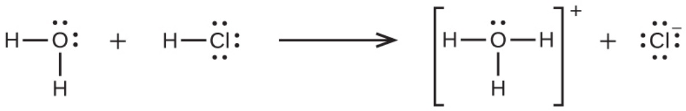

This reaction is essentially 100% complete for HCl (i.e., it is a strong acid and, consequently, a strong electrolyte). Likewise, weak acids and bases that only react partially generate relatively low concentrations of ions when dissolved in water and are classified as weak electrolytes. The reader may wish to review the discussion of strong and weak acids provided in the earlier chapter of this text on reaction classes and stoichiometry.

## 11.3 Solubility

**LEARNING OBJECTIVES**

By the end of this section, you will be able to:

-   Describe the effects of temperature and pressure on solubility
-   State Henry’s law and use it in calculations involving the solubility of a gas in a liquid
-   Explain the degrees of solubility possible for liquid-liquid solutions

Imagine adding a small amount of sugar to a glass of water, stirring until all the sugar has dissolved, and then adding a bit more. You can repeat this process until the sugar concentration of the solution reaches its natural limit, a limit determined primarily by the relative strengths of the solute-solute, solute-solvent, and solvent-solvent attractive forces discussed in the previous two modules of this chapter. You can be certain that you have reached this limit because, no matter how long you stir the solution, undissolved sugar remains. The concentration of sugar in the solution at this point is known as its solubility.

The **solubility** of a solute in a particular solvent is the maximum concentration that may be achieved under given conditions when the dissolution process is at equilibrium.

When a solute’s concentration is equal to its solubility, the solution is said to be **saturated** with that solute. If the solute’s concentration is less than its solubility, the solution is said to be **unsaturated**. A solution that contains a relatively low concentration of solute is called dilute, and one with a relatively high concentration is called concentrated.

**LINK TO LEARNING**

Use this interactive simulation (http://openstax.org/l/16Phetsoluble) to prepare various saturated solutions.

Solutions may be prepared in which a solute concentration exceeds its solubility. Such solutions are said to be **supersaturated**, and they are interesting examples of nonequilibrium states (a detailed treatment of this important concept is provided in the text chapters on equilibrium). For example, the carbonated beverage in an open container that has not yet “gone flat” is supersaturated with carbon dioxide gas; given time, the CO₂ concentration will decrease until it reaches its solubility.

**LINK TO LEARNING**

Watch this impressive video (http://openstax.org/l/16NaAcetate) showing the precipitation of sodium acetate from a supersaturated solution.

### Solutions of Gases in Liquids

As for any solution, the solubility of a gas in a liquid is affected by the intermolecular attractive forces between solute and solvent species. Unlike solid and liquid solutes, however, there is no solute-solute intermolecular attraction to overcome when a gaseous solute dissolves in a liquid solvent (see Figure 11.4) since the atoms or molecules comprising a gas are far separated and experience negligible interactions. Consequently, solute-solvent interactions are the sole energetic factor affecting solubility. For example, the water solubility of oxygen is approximately three times greater than that of helium (there are greater dispersion forces between water and the larger oxygen molecules) but 100 times less than the solubility of chloroform, CHCl₃ (polar chloroform molecules experience dipole–dipole attraction to polar water molecules). Likewise note the solubility of oxygen in hexane, C₆H₁₄, is approximately 20 times greater than it is in water because greater dispersion forces exist between oxygen and the larger hexane molecules.

Temperature is another factor affecting solubility, with gas solubility typically decreasing as temperature increases (Figure 11.8). This inverse relation between temperature and dissolved gas concentration is responsible for one of the major impacts of thermal pollution in natural waters.

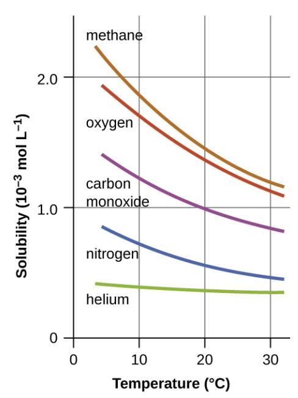
**Figure 11.8** The solubilities of these gases in water decrease as the temperature increases. All solubilities were measured with a constant pressure of 101.3 kPa (1 atm) of gas above the solutions.

When the temperature of a river, lake, or stream is raised, the solubility of oxygen in the water is decreased. Decreased levels of dissolved oxygen may have serious consequences for the health of the water’s ecosystems and, in severe cases, can result in large-scale fish kills (Figure 11.9).

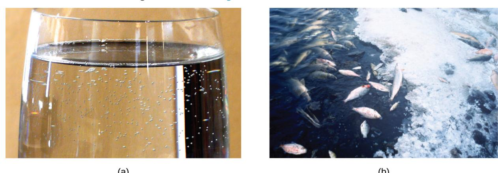
**Figure 11.9** (a) The small bubbles of air in this glass of chilled water formed when the water warmed to room temperature and the solubility of its dissolved air decreased. (b) The decreased solubility of oxygen in natural waters subjected to thermal pollution can result in large-scale fish kills. (credit a: modification of work by Liz West; credit b: modification of work by U.S. Fish and Wildlife Service)

The solubility of a gaseous solute is also affected by the partial pressure of solute in the gas to which the solution is exposed. Gas solubility increases as the pressure of the gas increases. Carbonated beverages provide a nice illustration of this relationship. The carbonation process involves exposing the beverage to a relatively high pressure of carbon dioxide gas and then sealing the beverage container, thus saturating the beverage with CO₂ at this pressure. When the beverage container is opened, a familiar hiss is heard as the carbon dioxide gas pressure is released, and some of the dissolved carbon dioxide is typically seen leaving solution in the form of small bubbles (Figure 11.10). At this point, the beverage is supersaturated with carbon dioxide and, with time, the dissolved carbon dioxide concentration will decrease to its equilibrium value and the beverage will become “flat.”

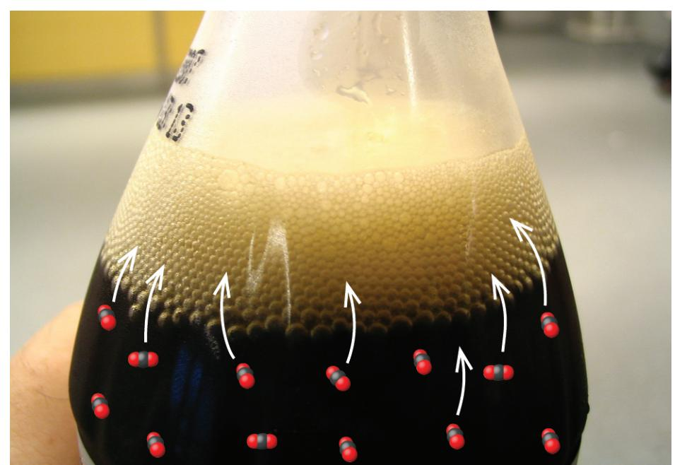
**Figure 11.10** Opening the bottle of carbonated beverage reduces the pressure of the gaseous carbon dioxide above the beverage. The solubility of CO₂ is thus lowered, and some dissolved carbon dioxide may be seen leaving the solution as small gas bubbles. (credit: modification of work by Derrick Coetzee)

For many gaseous solutes, the relation between solubility, $C_g$, and partial pressure, $P_g$, is a proportional one:

$$C_g = kP_g$$

where k is a proportionality constant that depends on the identity of the gaseous solute, the identity of the solvent, and the solution temperature. This is a mathematical statement of **Henry’s law**: The quantity of an ideal gas that dissolves in a definite volume of liquid is directly proportional to the pressure of the gas.

### Example 11.1 Application of Henry’s Law

At 20 °C, the concentration of dissolved oxygen in water exposed to gaseous oxygen at a partial pressure of 101.3 kPa is 1.38 × 10⁻³ mol L⁻¹. Use Henry’s law to determine the solubility of oxygen when its partial pressure is 20.7 kPa, the approximate pressure of oxygen in earth’s atmosphere.

**Solution**

According to Henry’s law, for an ideal solution the solubility, $C_g$, of a gas (1.38 × 10⁻³ mol L⁻¹, in this case) is directly proportional to the pressure, $P_g$, of the undissolved gas above the solution (101.3 kPa in this case). Because both $C_g$ and $P_g$ are known, this relation can be rearranged and used to solve for k.

$$\begin{aligned} C_g &= kP_g \\ k &= \frac{C_g}{P_g} \\ &= \frac{1.38 \times 10^{-3}\ \text{mol L}^{-1}}{101.3\ \text{kPa}} \\ &= 1.36 \times 10^{-5}\ \text{mol L}^{-1}\ \text{kPa}^{-1} \end{aligned}$$

Now, use k to find the solubility at the lower pressure.

$$\begin{aligned} C_g &= kP_g \\ &= 1.36 \times 10^{-5}\ \text{mol L}^{-1}\ \text{kPa}^{-1} \times 20.7\ \text{kPa} \\ &= 2.82 \times 10^{-4}\ \text{mol L}^{-1} \end{aligned}$$

Note that various units may be used to express the quantities involved in these sorts of computations. Any combination of units that yield to the constraints of dimensional analysis are acceptable.

**Check Your Learning**

Exposing a 100.0 mL sample of water at 0 °C to an atmosphere containing a gaseous solute at 152 torr resulted in the dissolution of 1.45 × 10⁻³ g of the solute. Use Henry’s law to determine the solubility of this gaseous solute when its pressure is 760 torr.

**Answer:**

7.25 × 10⁻³ in 100.0 mL or 0.0725 g/L

### Example 11.2 Thermal Pollution and Oxygen Solubility

A certain species of freshwater trout requires a dissolved oxygen concentration of 7.5 mg/L. Could these fish thrive in a thermally polluted mountain stream (water temperature is 30.0 °C, partial pressure of atmospheric oxygen is 0.17 atm)? Use the data in Figure 11.8 to estimate a value for the Henry’s law constant at this temperature.

**Solution**

First, estimate the Henry’s law constant for oxygen in water at the specified temperature of 30.0 °C (Figure 11.8 indicates the solubility at this temperature is approximately 1.2 × 10⁻³ mol/L).

$$k = \frac{C_g}{P_g} = 1.2 \times 10^{-3}\ \text{mol/L/1.00 atm} = 1.2 \times 10^{-3}\ \text{mol/L atm}$$

Then, use this k value to compute the oxygen solubility at the specified oxygen partial pressure, 0.17 atm.

$$C_g = kP_g = (1.2 \times 10^{-3}\ \text{mol/L atm})(0.17\ \text{atm}) = 2.0 \times 10^{-4}\ \text{mol/L}$$

Finally, convert this dissolved oxygen concentration from mol/L to mg/L.

$$(2.0 \times 10^{-4}\ \text{mol/L})(32.0\ \text{g/1 mol})(1000\ \text{mg/g}) = 6.4\ \text{mg/L}.$$

This concentration is lesser than the required minimum value of 7.5 mg/L, and so these trout would likely not thrive in the polluted stream.

**Check Your Learning**

What dissolved oxygen concentration is expected for the stream above when it returns to a normal summer time temperature of 15 °C?

**Answer:**

8.2 mg/L

### CHEMISTRY IN EVERYDAY LIFE
**Decompression Sickness or “The Bends”**

Decompression sickness (DCS), or “the bends,” is an effect of the increased pressure of the air inhaled by scuba divers when swimming underwater at considerable depths. In addition to the pressure exerted by the atmosphere, divers are subjected to additional pressure due to the water above them, experiencing an increase of approximately 1 atm for each 10 m of depth. Therefore, the air inhaled by a diver while submerged contains gases at the corresponding higher ambient pressure, and the concentrations of the gases dissolved in the diver’s blood are proportionally higher per Henry’s law.

As the diver ascends to the surface of the water, the ambient pressure decreases and the dissolved gases become less soluble. If the ascent is too rapid, the gases escaping from the diver’s blood may form bubbles that can cause a variety of symptoms ranging from rashes and joint pain to paralysis and death. To avoid DCS, divers must ascend from depths at relatively slow speeds (10 or 20 m/min) or otherwise make several decompression stops, pausing for several minutes at given depths during the ascent. When these preventive measures are unsuccessful, divers with DCS are often provided hyperbaric oxygen therapy in pressurized vessels called decompression (or recompression) chambers (Figure 11.11). Researchers are also investigating related body reactions and defenses in order to develop better testing and treatment for decompression sickness. For example, Ingrid Eftedal, a barophysiologist specializing in bodily reactions to diving, has shown that white blood cells undergo chemical and genetic changes as a result of the condition; these can potentially be used to create biomarker tests and other methods to manage decompression sickness.

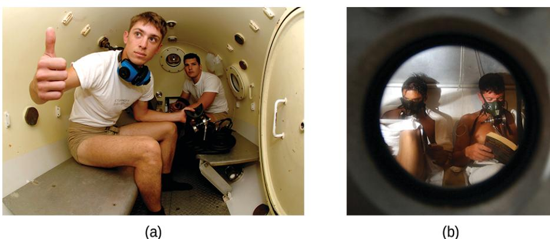
**Figure 11.11** (a) US Navy divers undergo training in a recompression chamber. (b) Divers receive hyperbaric oxygen therapy.

Deviations from Henry’s law are observed when a chemical reaction takes place between the gaseous solute and the solvent. Thus, for example, the solubility of ammonia in water increases more rapidly with increasing pressure than predicted by the law because ammonia, being a base, reacts to some extent with water to form ammonium ions and hydroxide ions.

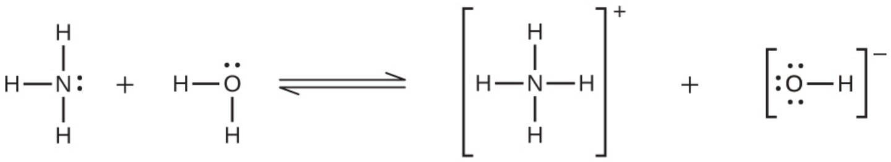

Gases can form supersaturated solutions. If a solution of a gas in a liquid is prepared either at low temperature or under pressure (or both), then as the solution warms or as the gas pressure is reduced, the solution may become supersaturated. In 1986, more than 1700 people in Cameroon were killed when a cloud of gas, almost certainly carbon dioxide, bubbled from Lake Nyos (Figure 11.12), a deep lake in a volcanic crater. The water at the bottom of Lake Nyos is saturated with carbon dioxide by volcanic activity beneath the lake. It is believed that the lake underwent a turnover due to gradual heating from below the lake, and the warmer, less-dense water saturated with carbon dioxide reached the surface. Consequently, tremendous quantities of dissolved CO₂ were released, and the colorless gas, which is denser than air, flowed down the valley below the lake and suffocated humans and animals living in the valley.

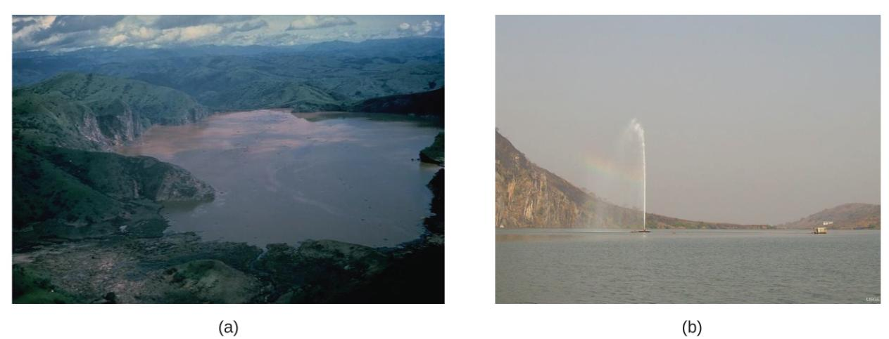
**Figure 11.12** (a) It is believed that the 1986 disaster that killed more than 1700 people near Lake Nyos in Cameroon resulted when a large volume of carbon dioxide gas was released from the lake. (b) A CO₂ vent has since been installed to help outgas the lake in a slow, controlled fashion and prevent a similar catastrophe from happening in the future. (credit a: modification of work by Jack Lockwood; credit b: modification of work by Bill Evans)

### Solutions of Liquids in Liquids

Some liquids may be mixed in any proportions to yield solutions; in other words, they have infinite mutual solubility and are said to be **miscible**. Ethanol, sulfuric acid, and ethylene glycol (popular for use as antifreeze, pictured in Figure 11.13) are examples of liquids that are completely miscible with water. Two-cycle motor oil is miscible with gasoline, mixtures of which are used as lubricating fuels for various types of outdoor power equipment (chainsaws, leaf blowers, and so on).

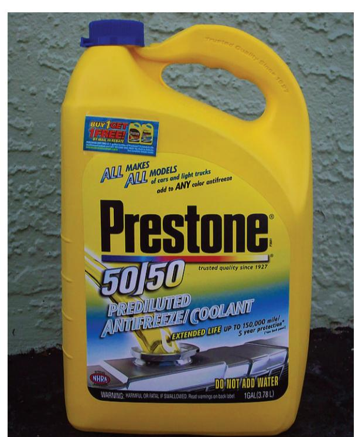
**Figure 11.13** Water and antifreeze are miscible; mixtures of the two are homogeneous in all proportions. (credit: “dno1967”/Wikimedia commons)

Miscible liquids are typically those with very similar polarities. Consider, for example, liquids that are polar or capable of hydrogen bonding. For such liquids, the dipole-dipole attractions (or hydrogen bonding) of the solute molecules with the solvent molecules are at least as strong as those between molecules in the pure solute or in the pure solvent. Hence, the two kinds of molecules mix easily. Likewise, nonpolar liquids are miscible with each other because there is no appreciable difference in the strengths of solute-solute, solvent-solvent, and solute-solvent intermolecular attractions. The solubility of polar molecules in polar solvents and of nonpolar molecules in nonpolar solvents is, again, an illustration of the chemical axiom “like dissolves like.”

Two liquids that do not mix to an appreciable extent are called **immiscible**. Separate layers are formed when immiscible liquids are poured into the same container. Gasoline, oil (Figure 11.14), benzene, carbon tetrachloride, some paints, and many other nonpolar liquids are immiscible with water. Relatively weak attractive forces between the polar water molecules and the nonpolar liquid molecules are not adequate to overcome much stronger hydrogen bonding between water molecules. The distinction between immiscibility and miscibility is really one of extent, so that miscible liquids are of infinite mutual solubility, while liquids said to be immiscible are of very low (though not zero) mutual solubility.

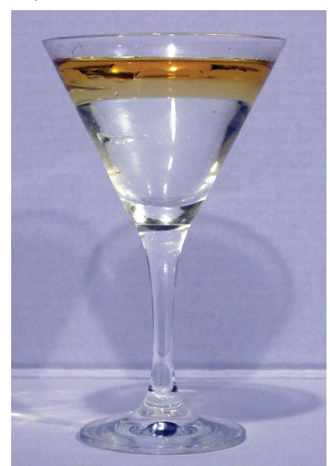
**Figure 11.14** Water and oil are immiscible. Mixtures of these two substances will form two separate layers with the less dense oil floating on top of the water. (credit: “Yortw”/Flickr)

Two liquids, such as bromine and water, that are of moderate mutual solubility are said to be **partially miscible**. Two partially miscible liquids usually form two layers when mixed. In the case of the bromine and water mixture, the upper layer is water, saturated with bromine, and the lower layer is bromine saturated with water. Since bromine is nonpolar, and, thus, not very soluble in water, the water layer is only slightly discolored by the bright orange bromine dissolved in it. Since the solubility of water in bromine is very low, there is no noticeable effect on the dark color of the bromine layer (Figure 11.15).

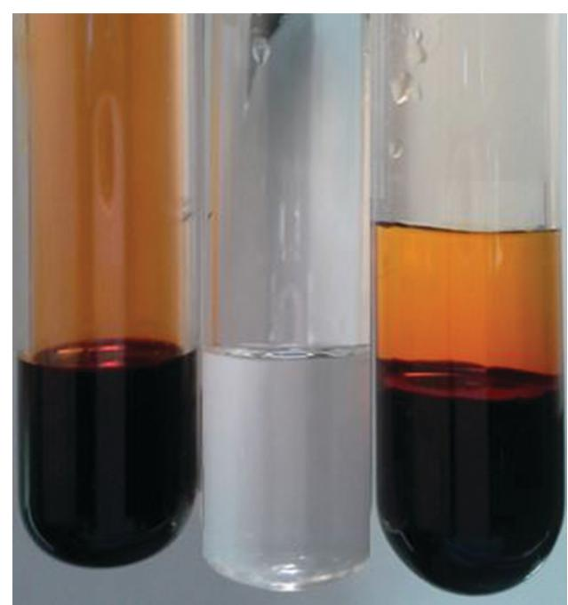
**Figure 11.15** Bromine (the deep orange liquid on the left) and water (the clear liquid in the middle) are partially miscible. The top layer in the mixture on the right is a saturated solution of bromine in water; the bottom layer is a saturated solution of water in bromine. (credit: Paul Flowers)

### Solutions of Solids in Liquids

The dependence of solubility on temperature for a number of solids in water is shown by the solubility curves in Figure 11.16. Reviewing these data indicates a general trend of increasing solubility with temperature, although there are exceptions, as illustrated by the ionic compound cerium sulfate.

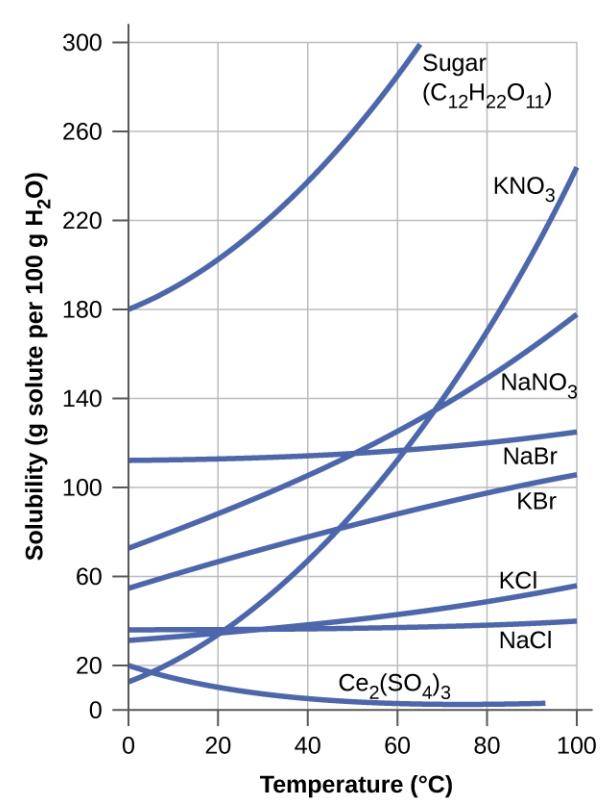
**Figure 11.16** This graph shows how the solubility of several solids changes with temperature.

The temperature dependence of solubility can be exploited to prepare supersaturated solutions of certain compounds. A solution may be saturated with the compound at an elevated temperature (where the solute is more soluble) and subsequently cooled to a lower temperature without precipitating the solute. The resultant solution contains solute at a concentration greater than its equilibrium solubility at the lower temperature (i.e., it is supersaturated) and is relatively stable. Precipitation of the excess solute can be initiated by adding a seed crystal (see the video in the Link to Learning earlier in this module) or by mechanically agitating the solution. Some hand warmers, such as the one pictured in Figure 11.17, take advantage of this behavior.

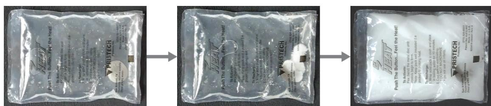
**Figure 11.17** This hand warmer produces heat when the sodium acetate in a supersaturated solution precipitates. Precipitation of the solute is initiated by a mechanical shockwave generated when the flexible metal disk within the solution is “clicked.” (credit: modification of work by “Velela”/Wikimedia Commons)

**LINK TO LEARNING**

This video (http://openstax.org/l/16handwarmer) shows the crystallization process occurring in a hand warmer.

## 11.4 Colligative Properties

**LEARNING OBJECTIVES**

By the end of this section, you will be able to:

-   Express concentrations of solution components using mole fraction and molality
-   Describe the effect of solute concentration on various solution properties (vapor pressure, boiling point, freezing point, and osmotic pressure)
-   Perform calculations using the mathematical equations that describe these various colligative effects
-   Describe the process of distillation and its practical applications
-   Explain the process of osmosis and describe how it is applied industrially and in nature

The properties of a solution are different from those of either the pure solute(s) or solvent. Many solution properties are dependent upon the chemical identity of the solute. Compared to pure water, a solution of hydrogen chloride is more acidic, a solution of ammonia is more basic, a solution of sodium chloride is more dense, and a solution of sucrose is more viscous. There are a few solution properties, however, that depend only upon the total concentration of solute species, regardless of their identities. These **colligative properties** include vapor pressure lowering, boiling point elevation, freezing point depression, and osmotic pressure. This small set of properties is of central importance to many natural phenomena and technological applications, as will be described in this module.

### Mole Fraction and Molality

Several units commonly used to express the concentrations of solution components were introduced in an earlier chapter of this text, each providing certain benefits for use in different applications. For example, molarity (M) is a convenient unit for use in stoichiometric calculations, since it is defined in terms of the molar amounts of solute species:

$$M = \frac{\text{mol solute}}{\text{L solution}}$$

Because solution volumes vary with temperature, molar concentrations will likewise vary. When expressed as molarity, the concentration of a solution with identical numbers of solute and solvent species will be different at different temperatures, due to the contraction/expansion of the solution. More appropriate for calculations involving many colligative properties are mole-based concentration units whose values are not dependent on temperature. Two such units are mole fraction (introduced in the previous chapter on gases) and molality.

The mole fraction, X, of a component is the ratio of its molar amount to the total number of moles of all solution components:

$$X_A = \frac{\text{mol A}}{\text{total mol of all components}}$$

By this definition, the sum of mole fractions for all solution components (the solvent and all solutes) is equal to one.

**Molality** is a concentration unit defined as the ratio of the numbers of moles of solute to the mass of the solvent in kilograms:

$$m = \frac{\text{mol solute}}{\text{kg solvent}}$$

Since these units are computed using only masses and molar amounts, they do not vary with temperature and, thus, are better suited for applications requiring temperature-independent concentrations, including several colligative properties, as will be described in this chapter module.

### Example 11.3 Calculating Mole Fraction and Molality

The antifreeze in most automobile radiators is a mixture of equal volumes of ethylene glycol and water, with minor amounts of other additives that prevent corrosion. What are the (a) mole fraction and (b) molality of ethylene glycol, C₂H₄(OH)₂, in a solution prepared from 2.22 × 10³ g of ethylene glycol and 2.00 × 10³ g of water (approximately 2 L of glycol and 2 L of water)?

**Solution**

(a) The mole fraction of ethylene glycol may be computed by first deriving molar amounts of both solution components and then substituting these amounts into the definition of mole fraction.

$$\begin{aligned} \text{mol C}_2\text{H}_4(\text{OH})_2 &= 2.22 \times 10^3\ \text{g} \times \frac{1\ \text{mol C}_2\text{H}_4(\text{OH})_2}{62.07\ \text{g C}_2\text{H}_4(\text{OH})_2} = 35.8\ \text{mol C}_2\text{H}_4(\text{OH})_2 \\ \text{mol H}_2\text{O} &= 2.00 \times 10^3\ \text{g} \times \frac{1\ \text{mol H}_2\text{O}}{18.02\ \text{g H}_2\text{O}} = 111\ \text{mol H}_2\text{O} \\ X_{\text{ethylene glycol}} &= \frac{35.8\ \text{mol C}_2\text{H}_4(\text{OH})_2}{(35.8+111)\ \text{mol total}} = 0.244 \end{aligned}$$

Notice that mole fraction is a dimensionless property, being the ratio of properties with identical units (moles).

(b) Derive moles of solute and mass of solvent (in kg).

First, use the given mass of ethylene glycol and its molar mass to find the moles of solute:

$$2.22 \times 10^3\ \text{g C}_2\text{H}_4(\text{OH})_2 \left(\frac{\text{mol C}_2\text{H}_4(\text{OH})_2}{62.07\ \text{g}}\right) = 35.8\ \text{mol C}_2\text{H}_4(\text{OH})_2$$

Then, convert the mass of the water from grams to kilograms:

$$2.00 \times 10^3\ \text{g H}_2\text{O} \left(\frac{1\ \text{kg}}{1000\ \text{g}}\right) = 2.00\ \text{kg H}_2\text{O}$$

Finally, calculate molality per its definition:

$$\begin{aligned} \text{molality} &= \frac{\text{mol solute}}{\text{kg solvent}} \\ \text{molality} &= \frac{35.8\ \text{mol C}_2\text{H}_4(\text{OH})_2}{2\ \text{kg H}_2\text{O}} \\ \text{molality} &= 17.9\ m \end{aligned}$$

**Check Your Learning**

What are the mole fraction and molality of a solution that contains 0.850 g of ammonia, NH₃, dissolved in 125 g of water?

**Answer:**

7.14 × 10⁻³; 0.399 m

### Example 11.4 Converting Mole Fraction and Molal Concentrations

Calculate the mole fraction of solute and solvent in a 3.0 m solution of sodium chloride.

**Solution**

Converting from one concentration unit to another is accomplished by first comparing the two unit definitions. In this case, both units have the same numerator (moles of solute) but different denominators. The provided molal concentration may be written as:

$$\frac{3.0\ \text{mol NaCl}}{1\ \text{kg H}_2\text{O}}$$

The numerator for this solution’s mole fraction is, therefore, 3.0 mol NaCl. The denominator may be computed by deriving the molar amount of water corresponding to 1.0 kg

$$1.0\ \text{kg H}_2\text{O} \left(\frac{1000\ \text{g}}{1\ \text{kg}}\right) \left(\frac{\text{mol H}_2\text{O}}{18.02\ \text{g}}\right) = 55\ \text{mol H}_2\text{O}$$

and then substituting these molar amounts into the definition for mole fraction.

$$\begin{aligned} X_{\text{H}_2\text{O}} &= \frac{\text{mol H}_2\text{O}}{\text{mol NaCl}+\text{mol H}_2\text{O}} \\ X_{\text{H}_2\text{O}} &= \frac{55\ \text{mol H}_2\text{O}}{3.0\ \text{mol NaCl}+55\ \text{mol H}_2\text{O}} \\ X_{\text{H}_2\text{O}} &= 0.95 \\ X_{\text{NaCl}} &= \frac{\text{mol NaCl}}{\text{mol NaCl}+\text{mol H}_2\text{O}} \\ X_{\text{NaCl}} &= \frac{3.0\ \text{mol NaCl}}{3.0\ \text{mol NaCl}+55\ \text{mol H}_2\text{O}} \\ X_{\text{NaCl}} &= 0.052 \end{aligned}$$

**Check Your Learning**

The mole fraction of iodine, I₂, dissolved in dichloromethane, CH₂Cl₂, is 0.115. What is the molal concentration, m, of iodine in this solution?

**Answer:**

1.53 m

### Example 11.5 Molality and Molarity Conversions

Intravenous infusion of a 0.556 M aqueous solution of glucose (density of 1.04 g/mL) is part of some post-operative recovery therapies. What is the molal concentration of glucose in this solution?

**Solution**

The provided molar concentration may be explicitly written as:

$$M = 0.556\ \text{mol glucose/1 L solution}$$

Consider the definition of molality:

$$m = \text{mol solute/kg solvent}$$

The amount of glucose in 1-L of this solution is 0.556 mol, so the mass of water in this volume of solution is needed.

First, compute the mass of 1.00 L of the solution:

$$(1.0\ \text{L soln})(1.04\ \text{g/mL})(1000\ \text{mL/1 L})(1\ \text{kg/1000 g}) = 1.04\ \text{kg soln}$$

This is the mass of both the water and its solute, glucose, and so the mass of glucose must be subtracted. Compute the mass of glucose from its molar amount:

$$(0.556\ \text{mol glucose})(180.2\ \text{g/1 mol}) = 100.2\ \text{g or}\ 0.1002\ \text{kg}$$

Subtracting the mass of glucose yields the mass of water in the solution:

$$1.04\ \text{kg solution} - 0.1002\ \text{kg glucose} = 0.94\ \text{kg water}$$

Finally, the molality of glucose in this solution is computed as:

$$m = 0.556\ \text{mol glucose/0.94 kg water} = 0.59\ m$$

**Check Your Learning**

Nitric acid, HNO₃(aq), is commercially available as a 33.7 m aqueous solution (density = 1.35 g/mL). What is the molarity of this solution?

**Answer:**

14.6 M

### Vapor Pressure Lowering

As described in the chapter on liquids and solids, the equilibrium vapor pressure of a liquid is the pressure exerted by its gaseous phase when vaporization and condensation are occurring at equal rates:

$$\text{liquid} \rightleftharpoons \text{gas}$$

Dissolving a nonvolatile substance in a volatile liquid results in a lowering of the liquid’s vapor pressure. This phenomenon can be rationalized by considering the effect of added solute molecules on the liquid’s vaporization and condensation processes. To vaporize, solvent molecules must be present at the surface of the solution. The presence of solute decreases the surface area available to solvent molecules and thereby reduces the rate of solvent vaporization. Since the rate of condensation is unaffected by the presence of solute, the net result is that the vaporization-condensation equilibrium is achieved with fewer solvent molecules in the vapor phase (i.e., at a lower vapor pressure) (Figure 11.18). While this interpretation is useful, it does not account for several important aspects of the colligative nature of vapor pressure lowering. A more rigorous explanation involves the property of entropy, a topic of discussion in a later text chapter on thermodynamics. For purposes of understanding the lowering of a liquid’s vapor pressure, it is adequate to note that the more dispersed nature of matter in a solution, compared to separate solvent and solute phases, serves to effectively stabilize the solvent molecules and hinder their vaporization. A lower vapor pressure results, and a correspondingly higher boiling point as described in the next section of this module.

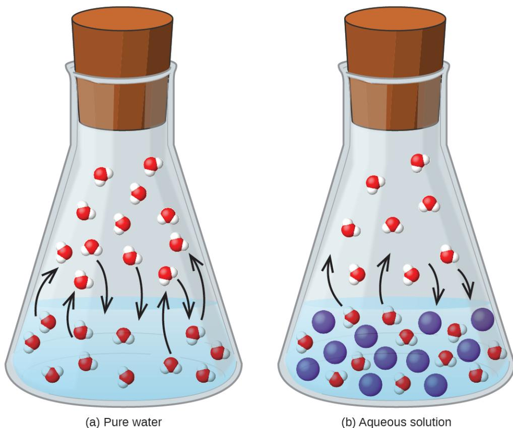
**Figure 11.18** The presence of nonvolatile solutes lowers the vapor pressure of a solution by impeding the evaporation of solvent molecules.

The relationship between the vapor pressures of solution components and the concentrations of those components is described by **Raoult’s law**: The partial pressure exerted by any component of an ideal solution is equal to the vapor pressure of the pure component multiplied by its mole fraction in the solution.

$$P_A = X_A P_A^*$$

where $P_A$ is the partial pressure exerted by component A in the solution, $P_A^{*}$ is the vapor pressure of pure A, and $X_A$ is the mole fraction of A in the solution.

Recalling that the total pressure of a gaseous mixture is equal to the sum of partial pressures for all its components (Dalton’s law of partial pressures), the total vapor pressure exerted by a solution containing i components is

$$P_{\text{solution}} = \sum_i P_i = \sum_i X_i P_i^*$$

A nonvolatile substance is one whose vapor pressure is negligible (P\* ≈ 0), and so the vapor pressure above a solution containing only nonvolatile solutes is due only to the solvent:

$$P_{\text{solution}} = X_{\text{solvent}} P_{\text{solvent}}^*$$

### Example 11.6 Calculation of a Vapor Pressure

Compute the vapor pressure of an ideal solution containing 92.1 g of glycerin, C₃H₅(OH)₃, and 184.4 g of ethanol, C₂H₅OH, at 40 °C. The vapor pressure of pure ethanol is 0.178 atm at 40 °C. Glycerin is essentially nonvolatile at this temperature.

**Solution**

Since the solvent is the only volatile component of this solution, its vapor pressure may be computed per Raoult’s law as:

$$P_{\text{solution}} = X_{\text{solvent}} P_{\text{solvent}}^*$$

First, calculate the molar amounts of each solution component using the provided mass data.

$$\begin{aligned} 92.1\ \cancel{\text{g C}_3\text{H}_5(\text{OH})_3} \times \frac{1\ \text{mol C}_3\text{H}_5(\text{OH})_3}{92.094\ \cancel{\text{g C}_3\text{H}_5(\text{OH})_3}} &= 1.00\ \text{mol C}_3\text{H}_5(\text{OH})_3 \\ 184.4\ \cancel{\text{g C}_2\text{H}_5\text{OH}} \times \frac{1\ \text{mol C}_2\text{H}_5\text{OH}}{46.069\ \cancel{\text{g C}_2\text{H}_5\text{OH}}} &= 4.000\ \text{mol C}_2\text{H}_5\text{OH} \end{aligned}$$

Next, calculate the mole fraction of the solvent (ethanol) and use Raoult’s law to compute the solution’s vapor pressure.

$$\begin{aligned} X_{\text{C}_2\text{H}_5\text{OH}} &= \frac{4.000\ \text{mol}}{(1.00\ \text{mol}+4.000\ \text{mol})} = 0.800 \\ P_{\text{solv}} &= X_{\text{solv}} P_{\text{solv}}^* = 0.800 \times 0.178\ \text{atm} = 0.142\ \text{atm} \end{aligned}$$

**Check Your Learning**

A solution contains 5.00 g of urea, CO(NH₂)₂ (a nonvolatile solute) and 0.100 kg of water. If the vapor pressure of pure water at 25 °C is 23.7 torr, what is the vapor pressure of the solution assuming ideal behavior?

**Answer:**

23.4 torr

### Distillation of Solutions

Solutions whose components have significantly different vapor pressures may be separated by a selective vaporization process known as distillation. Consider the simple case of a mixture of two volatile liquids, A and B, with A being the more volatile liquid. Raoult’s law can be used to show that the vapor above the solution is enriched in component A, that is, the mole fraction of A in the vapor is greater than the mole fraction of A in the liquid (see end-of-chapter Exercise 65). By appropriately heating the mixture, component A may be vaporized, condensed, and collected—effectively separating it from component B.

Distillation is widely applied in both laboratory and industrial settings, being used to refine petroleum, to isolate fermentation products, and to purify water. A typical apparatus for laboratory-scale distillations is shown in Figure 11.19.

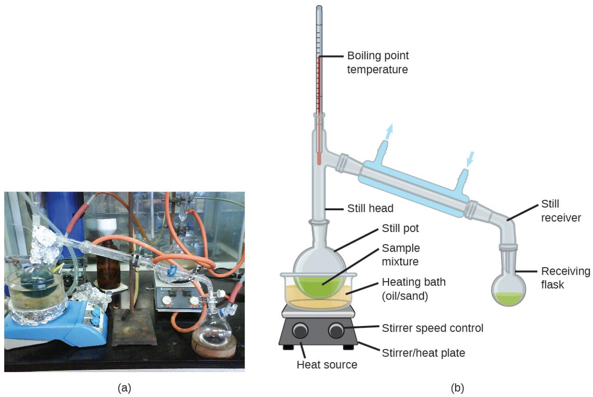
**Figure 11.19** A typical laboratory distillation unit is shown in (a) a photograph and (b) a schematic diagram of the components. (credit a: modification of work by “Rifleman82”/Wikimedia commons; credit b: modification of work by “Slashme”/Wikimedia Commons)

Oil refineries use large-scale fractional distillation to separate the components of crude oil. The crude oil is heated to high temperatures at the base of a tall fractionating column, vaporizing many of the components that rise within the column. As vaporized components reach adequately cool zones during their ascent, they condense and are collected. The collected liquids are simpler mixtures of hydrocarbons and other petroleum compounds that are of appropriate composition for various applications (e.g., diesel fuel, kerosene, gasoline), as depicted in Figure 11.20.

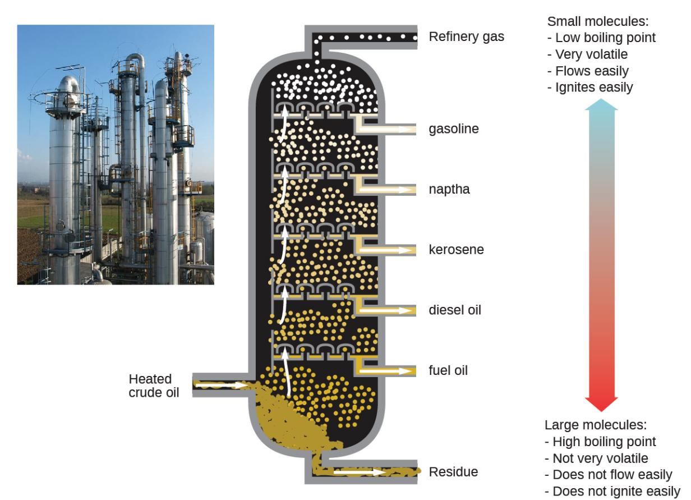
**Figure 11.20** Crude oil is a complex mixture that is separated by large-scale fractional distillation to isolate various simpler mixtures.

### Boiling Point Elevation

As described in the chapter on liquids and solids, the boiling point of a liquid is the temperature at which its vapor pressure is equal to ambient atmospheric pressure. Since the vapor pressure of a solution is lowered due to the presence of nonvolatile solutes, it stands to reason that the solution’s boiling point will subsequently be increased. Vapor pressure increases with temperature, and so a solution will require a higher temperature than will pure solvent to achieve any given vapor pressure, including one equivalent to that of the surrounding atmosphere. The increase in boiling point observed when nonvolatile solute is dissolved in a solvent, $\Delta T_b$, is called **boiling point elevation** and is directly proportional to the molal concentration of solute species:

$$\Delta T_b = K_b m$$

where $K_b$ is the **boiling point elevation constant**, or the ebullioscopic constant and m is the molal concentration (molality) of all solute species.

Boiling point elevation constants are characteristic properties that depend on the identity of the solvent. Values of $K_b$ for several solvents are listed in Table 11.2.

**Boiling Point Elevation and Freezing Point Depression Constants for Several Solvents**

| Solvent | Boiling Point (°C at 1 atm) | $K_b$ (°C $m^{-1}$) | Freezing Point (°C at 1 atm) | $K_f$ (°C $m^{-1}$) |
|---|---|---|---|---|
| water | 100.0 | 0.512 | 0.0 | 1.86 |
| hydrogen acetate (glacial acetic acid) | 118.1 | 3.07 | 16.6 | 3.9 |
| benzene | 80.1 | 2.53 | 5.5 | 5.12 |
| chloroform | 61.26 | 3.63 | −63.5 | 4.68 |
| nitrobenzene | 210.9 | 5.24 | 5.67 | 8.1 |

The extent to which the vapor pressure of a solvent is lowered and the boiling point is elevated depends on the total number of solute particles present in a given amount of solvent, not on the mass or size or chemical identities of the particles. A 1 m aqueous solution of sucrose (342 g/mol) and a 1 m aqueous solution of ethylene glycol (62 g/mol) will exhibit the same boiling point because each solution has one mole of solute particles (molecules) per kilogram of solvent.

### Example 11.7 Calculating the Boiling Point of a Solution

Assuming ideal solution behavior, what is the boiling point of a 0.33 m solution of a nonvolatile solute in benzene?

**Solution**

Use the equation relating boiling point elevation to solute molality to solve this problem in two steps.

1.  Step 1. Calculate the change in boiling point.

$$\Delta T_b = K_b m = 2.53\ ^\circ\text{C}\ m^{-1} \times 0.33\ m = 0.83\ ^\circ\text{C}$$

2.  Step 2. Add the boiling point elevation to the pure solvent’s boiling point.

$$\text{Boiling temperature} = 80.1\ ^\circ\text{C} + 0.83\ ^\circ\text{C} = 80.9\ ^\circ\text{C}$$

**Check Your Learning**

Assuming ideal solution behavior, what is the boiling point of the antifreeze described in Example 11.3?

**Answer:**

109.2 °C

### Example 11.8 The Boiling Point of an Iodine Solution

Find the boiling point of a solution of 92.1 g of iodine, I₂, in 800.0 g of chloroform, CHCl₃, assuming that the iodine is nonvolatile and that the solution is ideal.

**Solution**

A four-step approach to solving this problem is outlined below.

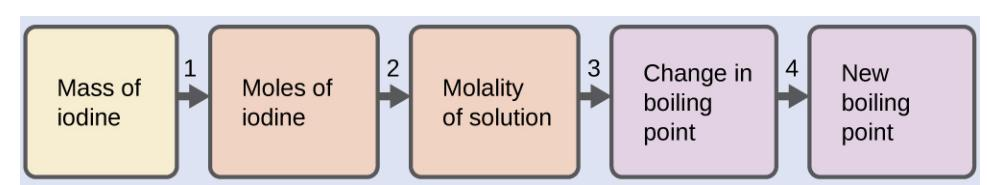

1.  Step 1. Convert from grams to moles of I₂ using the molar mass of I₂ in the unit conversion factor. Result: 0.363 mol
2.  Step 2. Determine the molality of the solution from the number of moles of solute and the mass of solvent, in kilograms. Result: 0.454 m
3.  Step 3. Use the direct proportionality between the change in boiling point and molal concentration to determine how much the boiling point changes. Result: 1.65 °C
4.  Step 4. Determine the new boiling point from the boiling point of the pure solvent and the change. Result: 62.91 °C Check each result as a self-assessment.

**Check Your Learning**

What is the boiling point of a solution of 1.0 g of glycerin, C₃H₅(OH)₃, in 47.8 g of water? Assume an ideal solution.

**Answer:**

100.12 °C

### Freezing Point Depression

Solutions freeze at lower temperatures than pure liquids. This phenomenon is exploited in “de-icing” schemes that use salt (Figure 11.21), calcium chloride, or urea to melt ice on roads and sidewalks, and in the use of ethylene glycol as an “antifreeze” in automobile radiators. Seawater freezes at a lower temperature than fresh water, and so the Arctic and Antarctic oceans remain unfrozen even at temperatures below 0 °C (as do the body fluids of fish and other cold-blooded sea animals that live in these oceans).

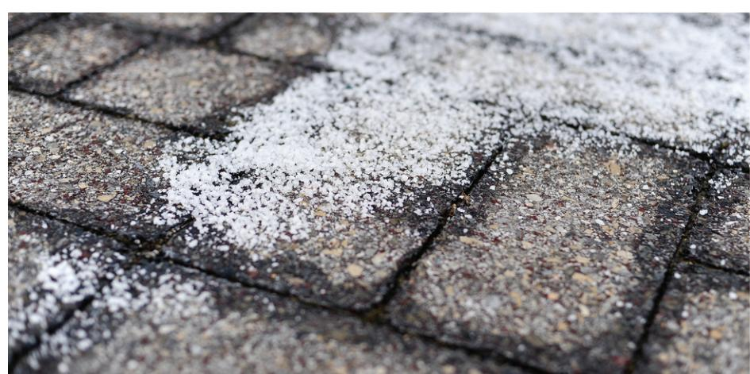
**Figure 11.21** Rock salt (NaCl), calcium chloride (CaCl₂), or a mixture of the two are used to melt ice. (credit: modification of work by Eddie Welker)

The decrease in freezing point of a dilute solution compared to that of the pure solvent, $\Delta T_f$, is called the **freezing point depression** and is directly proportional to the molal concentration of the solute

$$\Delta T_f = K_f m$$

where m is the molal concentration of the solute and $K_f$ is called the **freezing point depression constant** (or cryoscopic constant). Just as for boiling point elevation constants, these are characteristic properties whose values depend on the chemical identity of the solvent. Values of $K_f$ for several solvents are listed in Table 11.2.

### Example 11.9 Calculation of the Freezing Point of a Solution

Assuming ideal solution behavior, what is the freezing point of the 0.33 m solution of a nonvolatile nonelectrolyte solute in benzene described in Example 11.7?

**Solution**

Use the equation relating freezing point depression to solute molality to solve this problem in two steps.

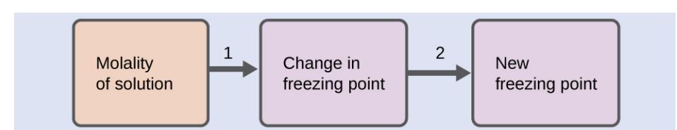

1.  Step 1. Calculate the change in freezing point.

$$\Delta T_f = K_f m = 5.12\ ^\circ\text{C}\ m^{-1} \times 0.33\ m = 1.7\ ^\circ\text{C}$$

2.  Step 2. Subtract the freezing point change observed from the pure solvent’s freezing point.

$$\text{Freezing Temperature} = 5.5\ ^\circ\text{C} - 1.7\ ^\circ\text{C} = 3.8\ ^\circ\text{C}$$

**Check Your Learning**

Assuming ideal solution behavior, what is the freezing point of a 1.85 m solution of a nonvolatile nonelectrolyte solute in nitrobenzene?

**Answer:**

−9.3 °C

### CHEMISTRY IN EVERYDAY LIFE
**Colligative Properties and De-Icing**

Sodium chloride and its group 2 analogs calcium and magnesium chloride are often used to de-ice roadways and sidewalks, due to the fact that a solution of any one of these salts will have a freezing point lower than 0 °C, the freezing point of pure water. The group 2 metal salts are frequently mixed with the cheaper and more readily available sodium chloride (“rock salt”) for use on roads, since they tend to be somewhat less corrosive than the NaCl, and they provide a larger depression of the freezing point, since they dissociate to yield three particles per formula unit, rather than two particles like the sodium chloride.

Because these ionic compounds tend to hasten the corrosion of metal, they would not be a wise choice to use in antifreeze for the radiator in your car or to de-ice a plane prior to takeoff. For these applications, covalent compounds, such as ethylene or propylene glycol, are often used. The glycols used in radiator fluid not only lower the freezing point of the liquid, but they elevate the boiling point, making the fluid useful in both winter and summer. Heated glycols are often sprayed onto the surface of airplanes prior to takeoff in inclement weather in the winter to remove ice that has already formed and prevent the formation of more ice, which would be particularly dangerous if formed on the control surfaces of the aircraft (Figure 11.22).

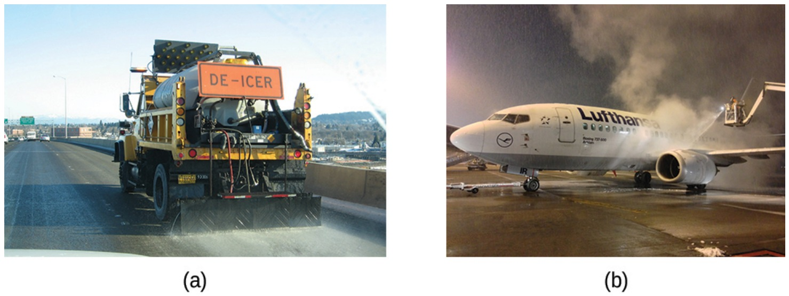
**Figure 11.22** Freezing point depression is exploited to remove ice from (a) roadways and (b) the control surfaces of aircraft.

### Phase Diagram for a Solution

The colligative effects on vapor pressure, boiling point, and freezing point described in the previous section are conveniently summarized by comparing the phase diagrams for a pure liquid and a solution derived from that liquid (Figure 11.23).

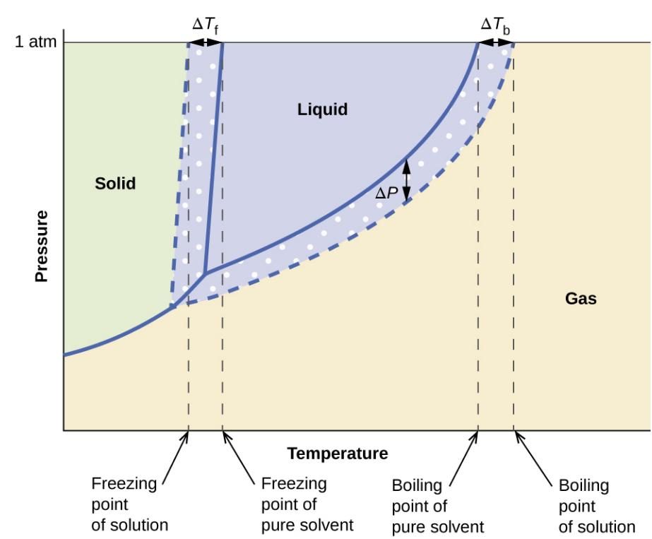
**Figure 11.23** Phase diagrams for a pure solvent (solid curves) and a solution formed by dissolving nonvolatile solute in the solvent (dashed curves).

The liquid-vapor curve for the solution is located beneath the corresponding curve for the solvent, depicting the vapor pressure lowering, ΔP, that results from the dissolution of nonvolatile solute. Consequently, at any given pressure, the solution’s boiling point is observed at a higher temperature than that for the pure solvent, reflecting the boiling point elevation, $\Delta T_b$, associated with the presence of nonvolatile solute. The solid-liquid curve for the solution is displaced left of that for the pure solvent, representing the freezing point depression, $\Delta T_f$, that accompanies solution formation. Finally, notice that the solid-gas curves for the solvent and its solution are identical. This is the case for many solutions comprising liquid solvents and nonvolatile solutes. Just as for vaporization, when a solution of this sort is frozen, it is actually just the solvent molecules that undergo the liquid-to-solid transition, forming pure solid solvent that excludes solute species. The solid and gaseous phases, therefore, are composed of solvent only, and so transitions between these phases are not subject to colligative effects.

### Osmosis and Osmotic Pressure of Solutions

A number of natural and synthetic materials exhibit selective permeation, meaning that only molecules or ions of a certain size, shape, polarity, charge, and so forth, are capable of passing through (permeating) the material. Biological cell membranes provide elegant examples of selective permeation in nature, while dialysis tubing used to remove metabolic wastes from blood is a more simplistic technological example. Regardless of how they may be fabricated, these materials are generally referred to as **semipermeable membranes**.

Consider the apparatus illustrated in Figure 11.24, in which samples of pure solvent and a solution are separated by a membrane that only solvent molecules may permeate. Solvent molecules will diffuse across the membrane in both directions. Since the concentration of solvent is greater in the pure solvent than the solution, these molecules will diffuse from the solvent side of the membrane to the solution side at a faster rate than they will in the reverse direction. The result is a net transfer of solvent molecules from the pure solvent to the solution. Diffusion-driven transfer of solvent molecules through a semipermeable membrane is a process known as **osmosis**.

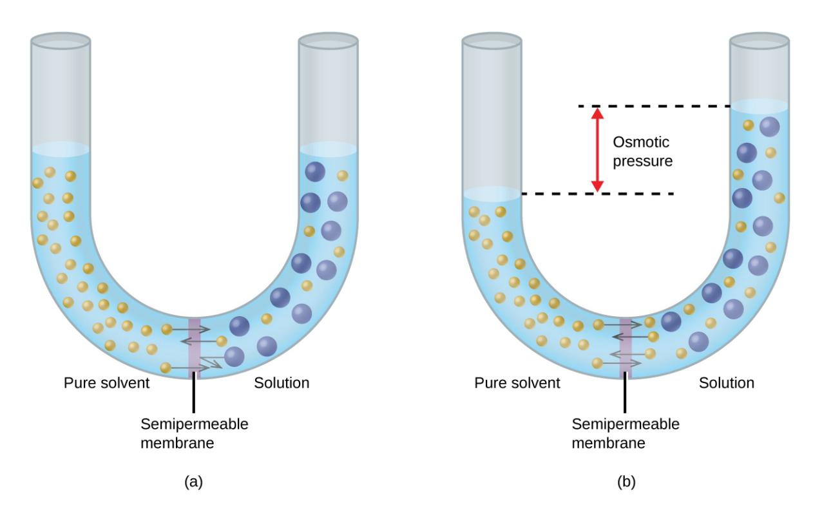
**Figure 11.24** (a) A solution and pure solvent are initially separated by an osmotic membrane. (b) Net transfer of solvent molecules to the solution occurs until its osmotic pressure yields equal rates of transfer in both directions.

When osmosis is carried out in an apparatus like that shown in Figure 11.24, the volume of the solution increases as it becomes diluted by accumulation of solvent. This causes the level of the solution to rise, increasing its hydrostatic pressure (due to the weight of the column of solution in the tube) and resulting in a faster transfer of solvent molecules back to the pure solvent side. When the pressure reaches a value that yields a reverse solvent transfer rate equal to the osmosis rate, bulk transfer of solvent ceases. This pressure is called the **osmotic pressure (Π)** of the solution. The osmotic pressure of a dilute solution is related to its solute molarity, M, and absolute temperature, T, according to the equation

$$\Pi = MRT$$

where R is the universal gas constant.

### Example 11.10 Calculation of Osmotic Pressure

Assuming ideal solution behavior, what is the osmotic pressure (atm) of a 0.30 M solution of glucose in water that is used for intravenous infusion at body temperature, 37 °C?

**Solution**

Find the osmotic pressure, Π, using the formula Π = MRT, where T is on the Kelvin scale (310 K) and the value of R is expressed in appropriate units (0.08206 L atm/mol K).

$$\begin{aligned} \Pi &= MRT \\ &= 0.30\ \text{mol/L} \times 0.08206\ \text{L atm/mol K} \times 310\ \text{K} \\ &= 7.6\ \text{atm} \end{aligned}$$

**Check Your Learning**

Assuming ideal solution behavior, what is the osmotic pressure (atm) a solution with a volume of 0.750 L that contains 5.0 g of methanol, CH₃OH, in water at 37 °C?

**Answer:**

5.3 atm

If a solution is placed in an apparatus like the one shown in Figure 11.25, applying pressure greater than the osmotic pressure of the solution reverses the osmosis and pushes solvent molecules from the solution into the pure solvent. This technique of reverse osmosis is used for large-scale desalination of seawater and on smaller scales to produce high-purity tap water for drinking.

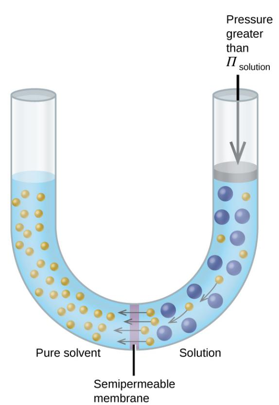
**Figure 11.25** Applying a pressure greater than the osmotic pressure of a solution will reverse osmosis. Solvent molecules from the solution are pushed into the pure solvent.

### CHEMISTRY IN EVERYDAY LIFE
**Reverse Osmosis Water Purification**

In the process of osmosis, diffusion serves to move water through a semipermeable membrane from a less concentrated solution to a more concentrated solution. Osmotic pressure is the amount of pressure that must be applied to the more concentrated solution to cause osmosis to stop. If greater pressure is applied, the water will go from the more concentrated solution to a less concentrated (more pure) solution. This is called reverse osmosis. Reverse osmosis (RO) is used to purify water in many applications, from desalination plants in coastal cities, to water-purifying machines in grocery stores (Figure 11.26), and smaller reverse-osmosis household units. With a hand-operated pump, small RO units can be used in third-world countries, disaster areas, and in lifeboats. Our military forces have a variety of generator-operated RO units that can be transported in vehicles to remote locations.

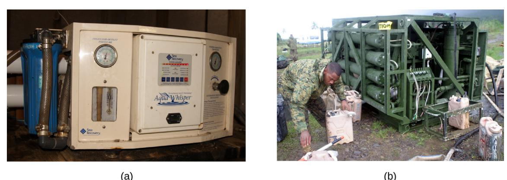
**Figure 11.26** Reverse osmosis systems for purifying drinking water are shown here on (a) small and (b) large scales. (credit a: modification of work by Jerry Kirkhart; credit b: modification of work by Willard J. Lathrop)

Examples of osmosis are evident in many biological systems because cells are surrounded by semipermeable membranes. Carrots and celery that have become limp because they have lost water can be made crisp again by placing them in water. Water moves into the carrot or celery cells by osmosis. A cucumber placed in a concentrated salt solution loses water by osmosis and absorbs some salt to become a pickle. Osmosis can also affect animal cells. Solute concentrations are particularly important when solutions are injected into the body. Solutes in body cell fluids and blood serum give these solutions an osmotic pressure of approximately 7.7 atm. Solutions injected into the body must have the same osmotic pressure as blood serum; that is, they should be **isotonic** with blood serum. If a less concentrated solution, a **hypotonic** solution, is injected in sufficient quantity to dilute the blood serum, water from the diluted serum passes into the blood cells by osmosis, causing the cells to expand and rupture. This process is called **hemolysis**. When a more concentrated solution, a **hypertonic** solution, is injected, the cells lose water to the more concentrated solution, shrivel, and possibly die in a process called **crenation**. These effects are illustrated in Figure 11.27.

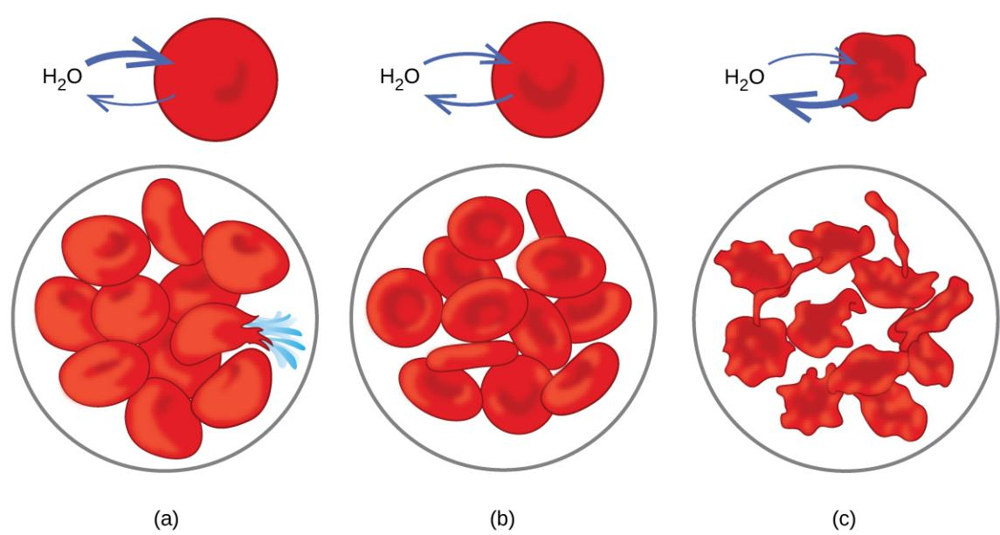
**Figure 11.27** Red blood cell membranes are water permeable and will (a) swell and possibly rupture in a hypotonic solution; (b) maintain normal volume and shape in an isotonic solution; and (c) shrivel and possibly die in a hypertonic solution. (credit a/b/c: modifications of work by “LadyofHats”/Wikimedia commons)

### Determination of Molar Masses

Osmotic pressure and changes in freezing point, boiling point, and vapor pressure are directly proportional to the number of solute species present in a given amount of solution. Consequently, measuring one of these properties for a solution prepared using a known mass of solute permits determination of the solute’s molar mass.

### Example 11.11 Determination of a Molar Mass from a Freezing Point Depression

A solution of 4.00 g of a nonelectrolyte dissolved in 55.0 g of benzene is found to freeze at 2.32 °C. Assuming ideal solution behavior, what is the molar mass of this compound?

**Solution**

Solve this problem using the following steps.

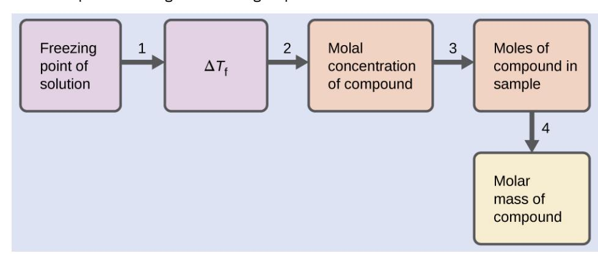

1.  Step 1. Determine the change in freezing point from the observed freezing point and the freezing point of pure benzene (Table 11.2).

$$\Delta T_f = 5.5\ ^\circ\text{C} - 2.32\ ^\circ\text{C} = 3.2\ ^\circ\text{C}$$

2.  Step 2. Determine the molal concentration from $K_f$, the freezing point depression constant for benzene (Table 11.2), and $\Delta T_f$.

$$\begin{aligned} \Delta T_f &= K_f m \\ m &= \frac{\Delta T_f}{K_f} = \frac{3.2\ ^\circ\text{C}}{5.12\ ^\circ\text{C}\ m^{-1}} = 0.63\ m \end{aligned}$$

3.  Step 3. Determine the number of moles of compound in the solution from the molal concentration and the mass of solvent used to make the solution.

$$\text{Moles of solute} = \frac{0.63\ \text{mol solute}}{1.00\ \cancel{\text{kg solvent}}} \times 0.0550\ \cancel{\text{kg solvent}} = 0.035\ \text{mol}$$

4.  Step 4. Determine the molar mass from the mass of the solute and the number of moles in that mass.

$$\text{Molar mass} = \frac{4.00\ \text{g}}{0.035\ \text{mol}} = 1.1 \times 10^2\ \text{g/mol}$$

**Check Your Learning**

A solution of 35.7 g of a nonelectrolyte in 220.0 g of chloroform has a boiling point of 64.5 °C. Assuming ideal solution behavior, what is the molar mass of this compound?

**Answer:**

1.8 × 10² g/mol

### Example 11.12 Determination of a Molar Mass from Osmotic Pressure

A 0.500 L sample of an aqueous solution containing 10.0 g of hemoglobin has an osmotic pressure of 5.9 torr at 22 °C. Assuming ideal solution behavior, what is the molar mass of hemoglobin?

**Solution**

Here is one set of steps that can be used to solve the problem:

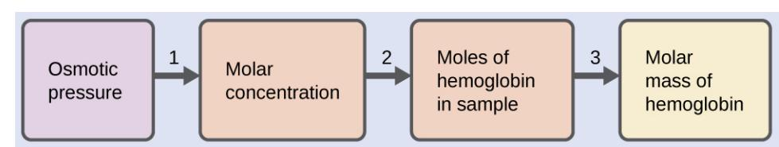

1.  Step 1. Convert the osmotic pressure to atmospheres, then determine the molar concentration from the osmotic pressure.

$$\Pi = \frac{5.9\ \text{torr} \times 1\ \text{atm}}{760\ \text{torr}} = 7.8 \times 10^{-3}\ \text{atm}$$

$$\Pi = MRT$$

$$M = \frac{\Pi}{RT} = \frac{7.8 \times 10^{-3}\ \text{atm}}{(0.08206\ \text{L atm/mol K})(295\ \text{K})} = 3.2 \times 10^{-4}\ \text{M}$$

2.  Step 2. Determine the number of moles of hemoglobin in the solution from the concentration and the volume of the solution.

$$\text{moles of hemoglobin} = \frac{3.2 \times 10^{-4}\ \text{mol}}{1\ \cancel{\text{L solution}}} \times 0.500\ \cancel{\text{L solution}} = 1.6 \times 10^{-4}\ \text{mol}$$

3.  Step 3. Determine the molar mass from the mass of hemoglobin and the number of moles in that mass.

$$\text{molar mass} = \frac{10.0\ \text{g}}{1.6 \times 10^{-4}\ \text{mol}} = 6.2 \times 10^4\ \text{g/mol}$$

**Check Your Learning**

Assuming ideal solution behavior, what is the molar mass of a protein if a solution of 0.02 g of the protein in 25.0 mL of solution has an osmotic pressure of 0.56 torr at 25 °C?

**Answer:**

3 × 10⁴ g/mol

### Colligative Properties of Electrolytes

As noted previously in this module, the colligative properties of a solution depend only on the number, not on the identity, of solute species dissolved. The concentration terms in the equations for various colligative properties (freezing point depression, boiling point elevation, osmotic pressure) pertain to all solute species present in the solution. For the solutions considered thus far in this chapter, the solutes have been nonelectrolytes that dissolve physically without dissociation or any other accompanying process. Each molecule that dissolves yields one dissolved solute molecule. The dissolution of an electrolyte, however, is not this simple, as illustrated by the two common examples below:

| | |
|---|---|
| *dissociation* | $\text{NaCl}(s) \longrightarrow \text{Na}^+(aq) + \text{Cl}^-(aq)$ |
| *ionization* | $\text{HCl}(aq) + \text{H}_2\text{O}(l) \longrightarrow \text{Cl}^-(aq) + \text{H}_3\text{O}^+(aq)$ |

Considering the first of these examples, and assuming complete dissociation, a 1.0 m aqueous solution of NaCl contains 2.0 mole of ions (1.0 mol Na⁺ and 1.0 mol Cl⁻) per each kilogram of water, and its freezing point depression is expected to be

$$\Delta T_f = 2.0\ \text{mol ions/kg water} \times 1.86\ ^\circ\text{C kg water/mol ion} = 3.7\ ^\circ\text{C}.$$

When this solution is actually prepared and its freezing point depression measured, however, a value of 3.4 °C is obtained. Similar discrepancies are observed for other ionic compounds, and the differences between the measured and expected colligative property values typically become more significant as solute concentrations increase. These observations suggest that the ions of sodium chloride (and other strong electrolytes) are not completely dissociated in solution.

To account for this and avoid the errors accompanying the assumption of total dissociation, an experimentally measured parameter named in honor of Nobel Prize-winning Dutch chemist Jacobus Henricus van’t Hoff is used. The **van’t Hoff factor (i)** is defined as the ratio of solute particles in solution to the number of formula units dissolved:

$$i = \frac{\text{moles of particles in solution}}{\text{moles of formula units dissolved}}$$

Values for measured van’t Hoff factors for several solutes, along with predicted values assuming complete dissociation, are shown in Table 11.3.

**Predicted and Measured van’t Hoff Factors for Several 0.050 *m* Aqueous Solutions**

| Formula unit | Classification | Dissolution products | *i* (predicted) | *i* (measured) |
|---|---|---|---|---|
| C₁₂H₂₂O₁₁ (sucrose) | Nonelectrolyte | C₁₂H₂₂O₁₁ | 1 | 1.0 |
| NaCl | Strong electrolyte | Na⁺, Cl⁻ | 2 | 1.9 |
| HCl | Strong electrolyte (acid) | H₃O⁺, Cl⁻ | 2 | 1.9 |
| MgSO₄ | Strong electrolyte | Mg²⁺, SO₄²⁻ | 2 | 1.3 |
| MgCl₂ | Strong electrolyte | Mg²⁺, 2Cl⁻ | 3 | 2.7 |
| FeCl₃ | Strong electrolyte | Fe³⁺, 3Cl⁻ | 4 | 3.4 |

In 1923, the chemists Peter Debye and Erich Hückel proposed a theory to explain the apparent incomplete ionization of strong electrolytes. They suggested that although interionic attraction in an aqueous solution is very greatly reduced by solvation of the ions and the insulating action of the polar solvent, it is not completely nullified. The residual attractions prevent the ions from behaving as totally independent particles (Figure 11.28). In some cases, a positive and negative ion may actually touch, giving a solvated unit called an ion pair. Thus, the **activity**, or the effective concentration, of any particular kind of ion is less than that indicated by the actual concentration. Ions become more and more widely separated the more dilute the solution, and the residual interionic attractions become less and less. Thus, in extremely dilute solutions, the effective concentrations of the ions (their activities) are essentially equal to the actual concentrations. Note that the van’t Hoff factors for the electrolytes in Table 11.3 are for 0.05 m solutions, at which concentration the value of i for NaCl is 1.9, as opposed to an ideal value of 2.

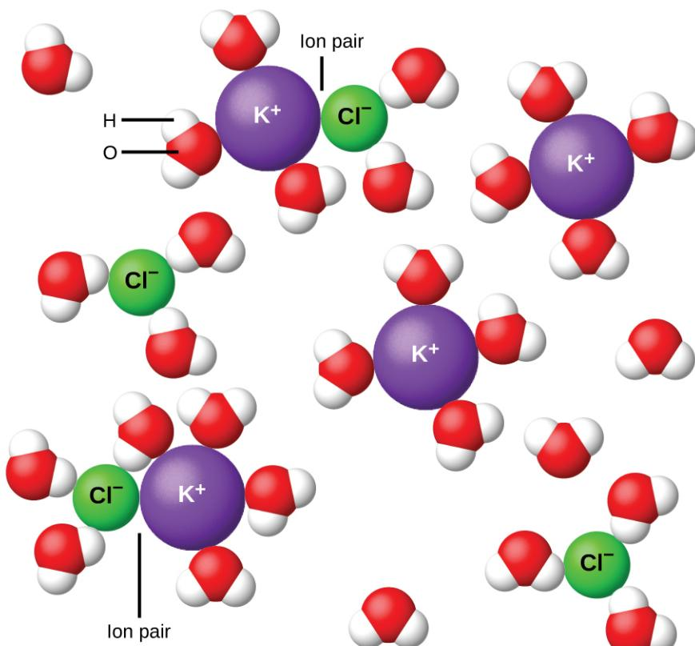
**Figure 11.28** Dissociation of ionic compounds in water is not always complete due to the formation of ion pairs.

### Example 11.13 The Freezing Point of a Solution of an Electrolyte

The concentration of ions in seawater is approximately the same as that in a solution containing 4.2 g of NaCl dissolved in 125 g of water. Use this information and a predicted value for the van’t Hoff factor (Table 11.3) to determine the freezing temperature of the solution (assume ideal solution behavior).

**Solution**

Solve this problem using the following series of steps.

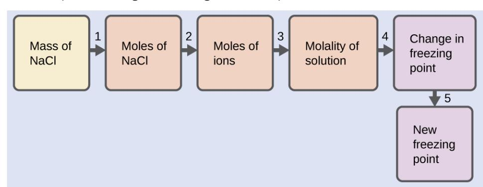

1.  Step 1. Convert from grams to moles of NaCl using the molar mass of NaCl in the unit conversion factor. Result: 0.072 mol NaCl
2.  Step 2. Determine the number of moles of ions present in the solution using the number of moles of ions in 1 mole of NaCl as the conversion factor (2 mol ions/1 mol NaCl). Result: 0.14 mol ions
3.  Step 3. Determine the molality of the ions in the solution from the number of moles of ions and the mass of solvent, in kilograms. Result: 1.2 m
4.  Step 4. Use the direct proportionality between the change in freezing point and molal concentration to determine how much the freezing point changes. Result: 2.1 °C
5.  Step 5. Determine the new freezing point from the freezing point of the pure solvent and the change. Result: −2.1 °C Check each result as a self-assessment, taking care to avoid rounding errors by retaining guard digits in each step’s result for computing the next step’s result.

**Check Your Learning**

Assuming complete dissociation and ideal solution behavior, calculate the freezing point of a solution of 0.724 g of CaCl₂ in 175 g of water.

**Answer:**

−0.208 °C

## 11.5 Colloids

**LEARNING OBJECTIVES**

By the end of this section, you will be able to:

-   Describe the composition and properties of colloidal dispersions
-   List and explain several technological applications of colloids

As a child, you may have made suspensions such as mixtures of mud and water, flour and water, or a suspension of solid pigments in water, known as tempera paint. These **suspensions** are heterogeneous mixtures composed of relatively large particles that are visible (or that can be seen with a magnifying glass). They are cloudy, and the suspended particles settle out after mixing. On the other hand, a solution is a homogeneous mixture in which no settling occurs and in which the dissolved species are molecules or ions. Solutions exhibit completely different behavior from suspensions. A solution may be colored, but it is transparent, the molecules or ions are invisible, and they do not settle out on standing. Another class of mixtures called **colloids** (or **colloidal dispersions**) exhibit properties intermediate between those of suspensions and solutions (Figure 11.29). The particles in a colloid are larger than most simple molecules; however, colloidal particles are small enough that they do not settle out upon standing.

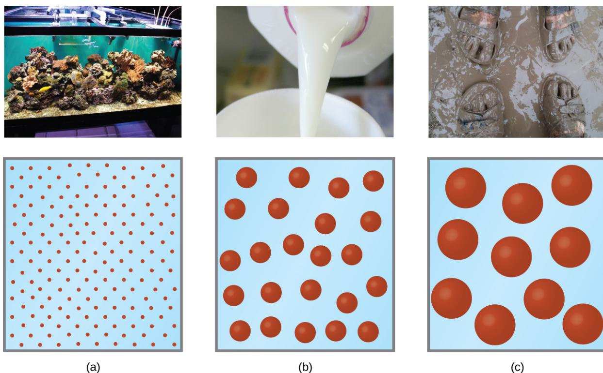
**Figure 11.29** (a) A solution is a homogeneous mixture that appears clear, such as the saltwater in this aquarium. (b) In a colloid, such as milk, the particles are much larger but remain dispersed and do not settle. (c) A suspension, such as mud, is a heterogeneous mixture of suspended particles that appears cloudy and in which the particles can settle. (credit a photo: modification of work by Adam Wimsatt; credit b photo: modification of work by Melissa Wiese; credit c photo: modification of work by Peter Burgess)

The particles in a colloid are large enough to scatter light, a phenomenon called the **Tyndall effect**. This can make colloidal mixtures appear cloudy or opaque, such as the searchlight beams shown in Figure 11.30. Clouds are colloidal mixtures. They are composed of water droplets that are much larger than molecules, but that are small enough that they do not settle out.

**Figure 11.30** The paths of searchlight beams are made visible when light is scattered by colloidal-size particles in the air (fog, smoke, etc.). (credit: “Bahman”/Wikimedia Commons)

The term “colloid”—from the Greek words kolla, meaning “glue,” and eidos, meaning “like”—was first used in 1861 by Thomas Graham to classify mixtures such as starch in water and gelatin. Many colloidal particles are aggregates of hundreds or thousands of molecules, but others (such as proteins and polymer molecules) consist of a single extremely large molecule. The protein and synthetic polymer molecules that form colloids may have molecular masses ranging from a few thousand to many million atomic mass units.

Analogous to the identification of solution components as “solute” and “solvent,” the components of a colloid are likewise classified according to their relative amounts. The particulate component typically present in a relatively minor amount is called the **dispersed phase** and the substance or solution throughout which the particulate is dispersed is called the **dispersion medium**. Colloids may involve virtually any combination of physical states (gas in liquid, liquid in solid, solid in gas, etc.), as illustrated by the examples of colloidal systems given in Table 11.4.

**Examples of Colloidal Systems**

| Dispersed Phase | Dispersion Medium | Common Examples | Name |
|---|---|---|---|
| solid | gas | smoke, dust | — |
| solid | liquid | starch in water, some inks, paints, milk of magnesia | sol |
| solid | solid | some colored gems, some alloys | — |
| liquid | gas | clouds, fogs, mists, sprays | aerosol |
| liquid | liquid | milk, mayonnaise, butter | emulsion |
| liquid | solid | jellies, gels, pearl, opal (H₂O in SiO₂) | gel |
| gas | liquid | foams, whipped cream, beaten egg whites | foam |
| gas | solid | pumice, floating soaps | — |

### Preparation of Colloidal Systems

Colloids are prepared by producing particles of colloidal dimensions and distributing these particles throughout a dispersion medium. Particles of colloidal size are formed by two methods:

1.  Dispersion methods: breaking down larger particles. For example, paint pigments are produced by dispersing large particles by grinding in special mills.
2.  Condensation methods: growth from smaller units, such as molecules or ions. For example, clouds form when water molecules condense and form very small droplets.

A few solid substances, when brought into contact with water, disperse spontaneously and form colloidal systems. Gelatin, glue, starch, and dehydrated milk powder behave in this manner. The particles are already of colloidal size; the water simply disperses them. Powdered milk particles of colloidal size are produced by dehydrating milk spray. Some atomizers produce colloidal dispersions of a liquid in air.

An **emulsion** may be prepared by shaking together or blending two immiscible liquids. This breaks one liquid into droplets of colloidal size, which then disperse throughout the other liquid. Oil spills in the ocean may be difficult to clean up, partly because wave action can cause the oil and water to form an emulsion. In many emulsions, however, the dispersed phase tends to coalesce, form large drops, and separate. Therefore, emulsions are usually stabilized by an **emulsifying agent**, a substance that inhibits the coalescence of the dispersed liquid. For example, a little soap will stabilize an emulsion of kerosene in water. Milk is an emulsion of butterfat in water, with the protein casein serving as the emulsifying agent. Mayonnaise is an emulsion of oil in vinegar, with egg yolk components as the emulsifying agents.

Condensation methods form colloidal particles by aggregation of molecules or ions. If the particles grow beyond the colloidal size range, drops or precipitates form, and no colloidal system results. Clouds form when water molecules aggregate and form colloid-sized particles. If these water particles coalesce to form adequately large water drops of liquid water or crystals of solid water, they settle from the sky as rain, sleet, or snow. Many condensation methods involve chemical reactions. A red colloidal suspension of iron(III) hydroxide may be prepared by mixing a concentrated solution of iron(III) chloride with hot water:

$$\text{Fe}^{3+}(aq) + 3\text{Cl}^-(aq) + 6\text{H}_2\text{O}(l) \longrightarrow \text{Fe(OH)}_3(s) + \text{H}_3\text{O}^+(aq) + 3\text{Cl}^-(aq).$$

A colloidal gold sol results from the reduction of a very dilute solution of gold(III) chloride by a reducing agent such as formaldehyde, tin(II) chloride, or iron(II) sulfate:

$$\text{Au}^{3+} + 3e^- \longrightarrow \text{Au}$$

Some gold sols prepared in 1857 are still intact (the particles have not coalesced and settled), illustrating the long-term stability of many colloids.

### Soaps and Detergents

Pioneers made soap by boiling fats with a strongly basic solution made by leaching potassium carbonate, K₂CO₃, from wood ashes with hot water. Animal fats contain polyesters of fatty acids (long-chain carboxylic acids). When animal fats are treated with a base like potassium carbonate or sodium hydroxide, glycerol and salts of fatty acids such as palmitic, oleic, and stearic acid are formed. The salts of fatty acids are called soaps. The sodium salt of stearic acid, sodium stearate, has the formula C₁₇H₃₅CO₂Na and contains an uncharged nonpolar hydrocarbon chain, the C₁₇H₃₅— unit, and an ionic carboxylate group, the —CO₂⁻ unit (Figure 11.31).

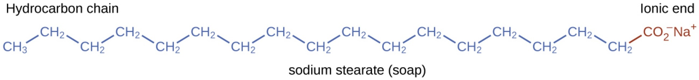
**Figure 11.31** Soaps contain a nonpolar hydrocarbon end (blue) and an ionic end (red). The ionic end is a carboxylate group. The length of the hydrocarbon end can vary from soap to soap.

Detergents (soap substitutes) also contain nonpolar hydrocarbon chains, such as C₁₂H₂₅—, and an ionic group, such as a sulfate—OSO₃⁻ or a sulfonate—SO₃⁻ (Figure 11.32). Soaps form insoluble calcium and magnesium compounds in hard water; detergents form water-soluble products—a definite advantage for detergents.

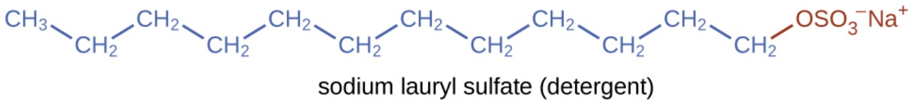
**Figure 11.32** Detergents contain a nonpolar hydrocarbon end (blue) and an ionic end (red). The ionic end can be either a sulfate or a sulfonate. The length of the hydrocarbon end can vary from detergent to detergent.

The cleaning action of soaps and detergents can be explained in terms of the structures of the molecules involved. The hydrocarbon (nonpolar) end of a soap or detergent molecule dissolves in, or is attracted to, nonpolar substances such as oil, grease, or dirt particles. The ionic end is attracted by water (polar), illustrated in Figure 11.33. As a result, the soap or detergent molecules become oriented at the interface between the dirt particles and the water so they act as a kind of bridge between two different kinds of matter, nonpolar and polar. Molecules such as this are termed **amphiphilic** since they have both a hydrophobic (“water-fearing”) part and a hydrophilic (“water-loving”) part. As a consequence, dirt particles become suspended as colloidal particles and are readily washed away.

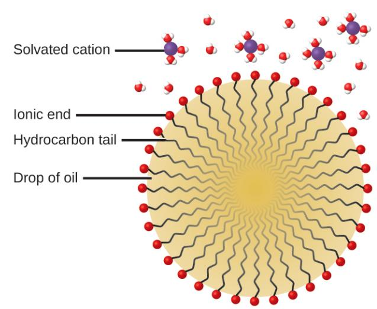
**Figure 11.33** This diagrammatic cross section of an emulsified drop of oil in water shows how soap or detergent acts as an emulsifier.

### CHEMISTRY IN EVERYDAY LIFE
**Deepwater Horizon Oil Spill**

The blowout of the Deepwater Horizon oil drilling rig on April 20, 2010, in the Gulf of Mexico near Mississippi began the largest marine oil spill in the history of the petroleum industry. In the 87 days following the blowout, an estimated 4.9 million barrels (210 million gallons) of oil flowed from the ruptured well 5000 feet below the water’s surface. The well was finally declared sealed on September 19, 2010.

Crude oil is immiscible with and less dense than water, so the spilled oil rose to the surface of the water. Floating booms, skimmer ships, and controlled burns were used to remove oil from the water’s surface in an attempt to protect beaches and wetlands along the Gulf coast. In addition to removal of the oil, attempts were also made to lessen its environmental impact by rendering it “soluble” (in the loose sense of the term) and thus allowing it to be diluted to hopefully less harmful levels by the vast volume of ocean water. This approach used 1.84 million gallons of the oil dispersant Corexit 9527, most of which was injected underwater at the site of the leak, with small amounts being sprayed on top of the spill. Corexit 9527 contains 2-butoxyethanol (C₆H₁₄O₂), an amphiphilic molecule whose polar and nonpolar ends are useful for emulsifying oil into small droplets, increasing the surface area of the oil and making it more available to marine bacteria for digestion (Figure 11.34). While this approach avoids many of the immediate hazards that bulk oil poses to marine and coastal ecosystems, it introduces the possibility of long-term effects resulting from the introduction of the complex and potential toxic components of petroleum into the ocean’s food chain. A number of organizations are involved in monitoring the extended impact of this oil spill, including the National Oceanic and Atmospheric Administration (visit this website (http://openstax.org/l/16gulfspill) for additional details).

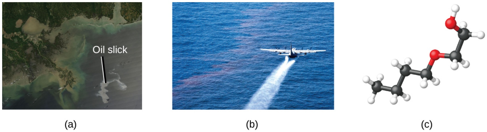
**Figure 11.34** (a) This NASA satellite image shows the oil slick from the Deepwater Horizon spill. (b) A US Air Force plane sprays Corexit, a dispersant. (c) The molecular structure of 2-butoxyethanol is shown. (credit a: modification of work by “NASA, FT₂, demis.nl”/Wikimedia Commons; credit b: modification of work by “NASA/MODIS Rapid Response Team”/Wikimedia Commons)

### Electrical Properties of Colloidal Particles

Dispersed colloidal particles are often electrically charged. A colloidal particle of iron(III) hydroxide, for example, does not contain enough hydroxide ions to compensate exactly for the positive charges on the iron(III) ions. Thus, each individual colloidal particle bears a positive charge, and the colloidal dispersion consists of charged colloidal particles and some free hydroxide ions, which keep the dispersion electrically neutral. Most metal hydroxide colloids have positive charges, whereas most metals and metal sulfides form negatively charged dispersions. All colloidal particles in any one system have charges of the same sign. This helps keep them dispersed because particles containing like charges repel each other.

The charged nature of some colloidal particles may be exploited to remove them from a variety of mixtures. For example, the particles comprising smoke are often colloidally dispersed and electrically charged. Frederick Cottrell, an American chemist, developed a process to remove these particles. The charged particles are attracted to highly charged electrodes, where they are neutralized and deposited as dust (Figure 11.36). This is one of the important methods used to clean up the smoke from a variety of industrial processes. The process is also important in the recovery of valuable products from the smoke and flue dust of smelters, furnaces, and kilns. There are also similar electrostatic air filters designed for home use to improve indoor air quality.

### PORTRAIT OF A CHEMIST
**Frederick Gardner Cottrell**

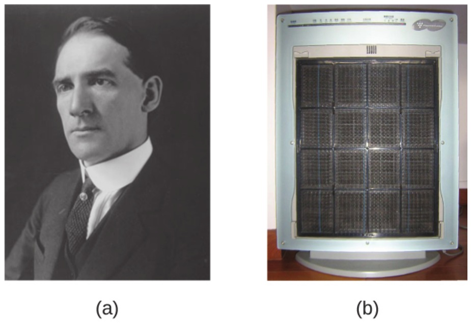
**Figure 11.35** (a) Frederick Cottrell developed (b) the electrostatic precipitator, a device designed to curb air pollution by removing colloidal particles from air. (credit b: modification of work by “SpLot”/Wikimedia Commons)

Born in Oakland, CA, in 1877, Frederick Cottrell devoured textbooks as if they were novels and graduated from high school at the age of 16. He then entered the University of California (UC), Berkeley, completing a Bachelor’s degree in three years. He saved money from his \$1200 annual salary as a chemistry teacher at Oakland High School to fund his studies in chemistry in Berlin with Nobel prize winner Jacobus Henricus van’t Hoff, and in Leipzig with Wilhelm Ostwald, another Nobel awardee. After earning his PhD in physical chemistry, he returned to the United States to teach at UC Berkeley. He also consulted for the DuPont Company, where he developed the electrostatic precipitator, a device designed to curb air pollution by removing colloidal particles from air. Cottrell used the proceeds from his invention to fund a nonprofit research corporation to finance scientific research.

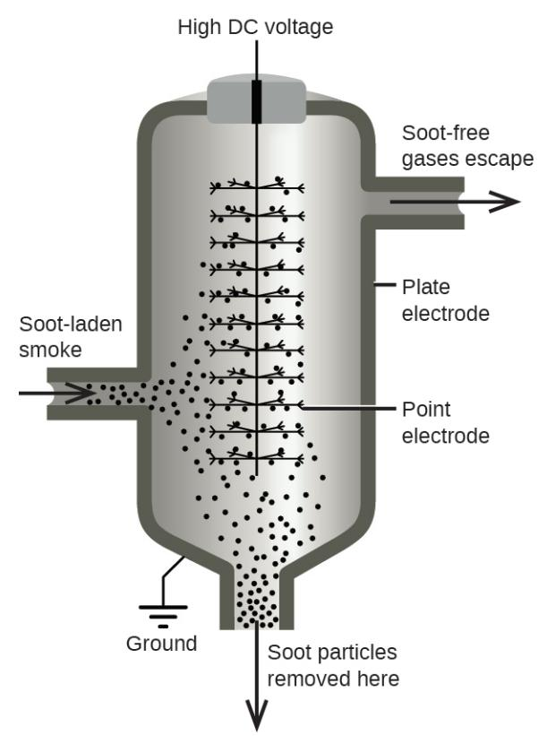
**Figure 11.36** In a Cottrell precipitator, positively and negatively charged particles are attracted to highly charged electrodes, where they are neutralized and deposited as dust.

### Gels

Gelatin desserts, such as Jell-O, are a type of colloid (Figure 11.37). Gelatin sets on cooling because the hot aqueous mixture of gelatin coagulates as it cools, yielding an extremely viscous body known as a **gel**. A gel is a colloidal dispersion of a liquid phase throughout a solid phase. It appears that the fibers of the dispersing medium form a complex three-dimensional network, the interstices being filled with the liquid medium or a dilute solution of the dispersing medium.

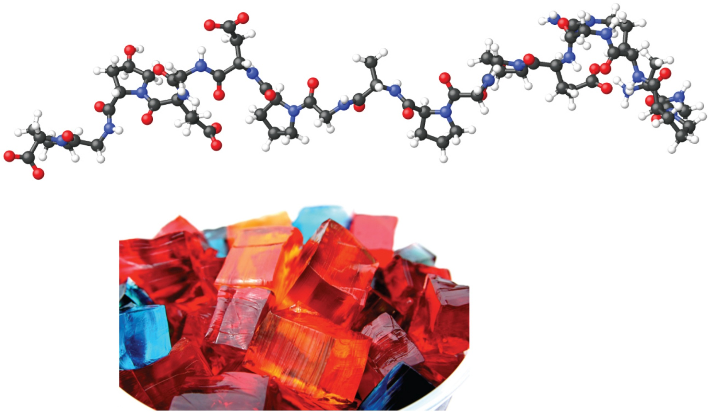
**Figure 11.37** Gelatin desserts are colloids in which an aqueous solution of sweeteners and flavors is dispersed throughout a medium of solid proteins. (credit photo: modification of work by Steven Depolo)

Pectin, a carbohydrate from fruit juices, is a gel-forming substance important in jelly making. Silica gel, a colloidal dispersion of hydrated silicon dioxide, is formed when dilute hydrochloric acid is added to a dilute solution of sodium silicate. Canned Heat is a flammable gel made by mixing alcohol and a saturated aqueous solution of calcium acetate.

## Key Terms

**alloy** solid mixture of a metallic element and one or more additional elements

**amphiphilic** molecules possessing both hydrophobic (nonpolar) and a hydrophilic (polar) parts

**boiling point elevation** elevation of the boiling point of a liquid by addition of a solute

**boiling point elevation constant** the proportionality constant in the equation relating boiling point elevation to solute molality; also known as the ebullioscopic constant

**colligative property** property of a solution that depends only on the concentration of a solute species

**colloid** (also, colloidal dispersion) mixture in which relatively large solid or liquid particles are dispersed uniformly throughout a gas, liquid, or solid

**crenation** process whereby biological cells become shriveled due to loss of water by osmosis

**dispersed phase** substance present as relatively large solid or liquid particles in a colloid

**dispersion medium** solid, liquid, or gas in which colloidal particles are dispersed

**dissociation** physical process accompanying the dissolution of an ionic compound in which the compound’s constituent ions are solvated and dispersed throughout the solution

**electrolyte** substance that produces ions when dissolved in water

**emulsifying agent** amphiphilic substance used to stabilize the particles of some emulsions

**emulsion** colloid formed from immiscible liquids

**freezing point depression** lowering of the freezing point of a liquid by addition of a solute

**freezing point depression constant** (also, cryoscopic constant) proportionality constant in the equation relating freezing point depression to solute molality

**gel** colloidal dispersion of a liquid in a solid

**hemolysis** rupture of red blood cells due to the accumulation of excess water by osmosis

**Henry’s law** the proportional relationship between the concentration of dissolved gas in a solution and the partial pressure of the gas in contact with the solution

**hypertonic** of greater osmotic pressure

**hypotonic** of less osmotic pressure

**ideal solution** solution that forms with no accompanying energy change

**immiscible** of negligible mutual solubility; typically refers to liquid substances

**ion pair** solvated anion/cation pair held together by moderate electrostatic attraction

**ion-dipole attraction** electrostatic attraction between an ion and a polar molecule

**isotonic** of equal osmotic pressure

**miscible** mutually soluble in all proportions; typically refers to liquid substances

**molality (m)** a concentration unit defined as the ratio of the numbers of moles of solute to the mass of the solvent in kilograms

**nonelectrolyte** substance that does not produce ions when dissolved in water

**osmosis** diffusion of solvent molecules through a semipermeable membrane

**osmotic pressure (Π)** opposing pressure required to prevent bulk transfer of solvent molecules through a semipermeable membrane

**partially miscible** of moderate mutual solubility; typically refers to liquid substances

**Raoult’s law** the relationship between a solution’s vapor pressure and the vapor pressures and concentrations of its components

**saturated** of concentration equal to solubility; containing the maximum concentration of solute possible for a given temperature and pressure

**semipermeable membrane** a membrane that selectively permits passage of certain ions or molecules

**solubility** extent to which a solute may be dissolved in water, or any solvent

**solvation** exothermic process in which intermolecular attractive forces between the solute and solvent in a solution are established

**spontaneous process** physical or chemical change that occurs without the addition of energy from an external source

**strong electrolyte** substance that dissociates or ionizes completely when dissolved in water

**supersaturated** of concentration that exceeds solubility; a nonequilibrium state

**suspension** heterogeneous mixture in which relatively large component particles are temporarily dispersed but settle out over time

**Tyndall effect** scattering of visible light by a colloidal dispersion

**unsaturated** of concentration less than solubility

**van’t Hoff factor (i)** the ratio of the number of moles of particles in a solution to the number of moles of formula units dissolved in the solution

**weak electrolyte** substance that ionizes only partially when dissolved in water

## Key Equations

$$C_g = kP_g$$

$$(P_A = X_A P_A^*)$$

$$P_{\text{solution}} = \sum_i P_i = \sum_i X_i P_i^*$$

$$P_{\text{solution}} = X_{\text{solvent}} P_{\text{solvent}}^*$$

$$\Delta T_b = K_b m$$

$$\Delta T_f = K_f m$$

$$\Pi = MRT$$

## Summary

### 11.1 The Dissolution Process

A solution forms when two or more substances combine physically to yield a mixture that is homogeneous at the molecular level. The solvent is the most concentrated component and determines the physical state of the solution. The solutes are the other components typically present at concentrations less than that of the solvent. Solutions may form endothermically or exothermically, depending upon the relative magnitudes of solute and solvent intermolecular attractive forces. Ideal solutions form with no appreciable change in energy.

### 11.2 Electrolytes

Substances that dissolve in water to yield ions are called electrolytes. Electrolytes may be covalent compounds that chemically react with water to produce ions (for example, acids and bases), or they may be ionic compounds that dissociate to yield their constituent cations and anions, when dissolved. Dissolution of an ionic compound is facilitated by ion-dipole attractions between the ions of the compound and the polar water molecules. Soluble ionic substances and strong acids ionize completely and are strong electrolytes, while weak acids and bases ionize to only a small extent and are weak electrolytes. Nonelectrolytes are substances that do not produce ions when dissolved in water.

### 11.3 Solubility

The extent to which one substance will dissolve in another is determined by several factors, including the types and relative strengths of intermolecular attractive forces that may exist between the substances’ atoms, ions, or molecules. This tendency to dissolve is quantified as a substance’s solubility, its maximum concentration in a solution at equilibrium under specified conditions. A saturated solution contains solute at a concentration equal to its solubility. A supersaturated solution is one in which a solute’s concentration exceeds its solubility—a nonequilibrium (unstable) condition that will result in solute precipitation when the solution is appropriately perturbed. Miscible liquids are soluble in all proportions, and immiscible liquids exhibit very low mutual solubility. Solubilities for gaseous solutes decrease with increasing temperature, while those for most, but not all, solid solutes increase with temperature. The concentration of a gaseous solute in a solution is proportional to the partial pressure of the gas to which the solution is exposed, a relation known as Henry’s law.

### 11.4 Colligative Properties

Properties of a solution that depend only on the concentration of solute particles are called colligative properties. They include changes in the vapor pressure, boiling point, and freezing point of the solvent in the solution. The magnitudes of these properties depend only on the total concentration of solute particles in solution, not on the type of particles. The total concentration of solute particles in a solution also determines its osmotic pressure. This is the pressure that must be applied to the solution to prevent diffusion of molecules of pure solvent through a semipermeable membrane into the solution. Ionic compounds may not completely dissociate in solution due to activity effects, in which case observed colligative effects may be less than predicted.

### 11.5 Colloids

Colloids are mixtures in which one or more substances are dispersed as relatively large solid particles or liquid droplets throughout a solid, liquid, or gaseous medium. The particles of a colloid remain dispersed and do not settle due to gravity, and they are often electrically charged. Colloids are widespread in nature and are involved in many technological applications.

## Exercises

### 11.1 The Dissolution Process

**1.** How do solutions differ from compounds? From other mixtures?

**2.** Which of the principal characteristics of solutions are evident in the solutions of K₂Cr₂O₇ shown in Figure 11.2?

**3.** When KNO₃ is dissolved in water, the resulting solution is significantly colder than the water was originally.
  - (a) Is the dissolution of KNO₃ an endothermic or an exothermic process?
  - (b) What conclusions can you draw about the intermolecular attractions involved in the process?
  - (c) Is the resulting solution an ideal solution?

**4.** Give an example of each of the following types of solutions:
  - (a) a gas in a liquid
  - (b) a gas in a gas
  - (c) a solid in a solid

**5.** Indicate the most important types of intermolecular attractions in each of the following solutions:
  - (a) The solution in Figure 11.2.
  - (b) NO(l) in CO(l)
  - (c) Cl₂(g) in Br₂(l)
  - (d) HCl(g) in benzene C₆H₆(l)
  - (e) Methanol CH₃OH(l) in H₂O(l)

**6.** Predict whether each of the following substances would be more soluble in water (polar solvent) or in a hydrocarbon such as heptane (C₇H₁₆, nonpolar solvent):
  - (a) vegetable oil (nonpolar)
  - (b) isopropyl alcohol (polar)
  - (c) potassium bromide (ionic)

**7.** Heat is released when some solutions form; heat is absorbed when other solutions form. Provide a molecular explanation for the difference between these two types of spontaneous processes.

**8.** Solutions of hydrogen in palladium may be formed by exposing Pd metal to H₂ gas. The concentration of hydrogen in the palladium depends on the pressure of H₂ gas applied, but in a more complex fashion than can be described by Henry’s law. Under certain conditions, 0.94 g of hydrogen gas is dissolved in 215 g of palladium metal (solution density = 10.8 g cm⁻³).
  - (a) Determine the molarity of this solution.
  - (b) Determine the molality of this solution.
  - (c) Determine the percent by mass of hydrogen atoms in this solution.

### 11.2 Electrolytes

**9.** Explain why the ions Na⁺ and Cl⁻ are strongly solvated in water but not in hexane, a solvent composed of nonpolar molecules.

**10.** Explain why solutions of HBr in benzene (a nonpolar solvent) are nonconductive, while solutions in water (a polar solvent) are conductive.

**11.** Consider the solutions presented:
  - (a) Which of the following sketches best represents the ions in a solution of Fe(NO₃)₃(aq)?

  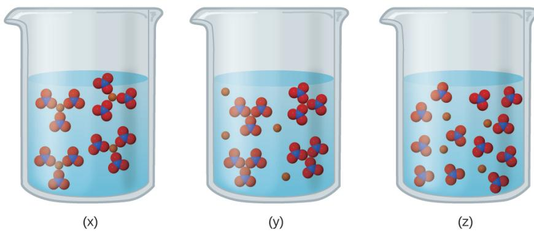

  - (b) Write a balanced chemical equation showing the products of the dissolution of Fe(NO₃)₃.

**12.** Compare the processes that occur when methanol (CH₃OH), hydrogen chloride (HCl), and sodium hydroxide (NaOH) dissolve in water. Write equations and prepare sketches showing the form in which each of these compounds is present in its respective solution.

**13.** What is the expected electrical conductivity of the following solutions?
  - (a) NaOH(aq)
  - (b) HCl(aq)
  - (c) C₆H₁₂O₆(aq) (glucose)
  - (d) NH₃(aq)

**14.** Why are most solid ionic compounds electrically nonconductive, whereas aqueous solutions of ionic compounds are good conductors? Would you expect a liquid (molten) ionic compound to be electrically conductive or nonconductive? Explain.

**15.** Indicate the most important type of intermolecular attraction responsible for solvation in each of the following solutions:
  - (a) the solutions in Figure 11.7
  - (b) methanol, CH₃OH, dissolved in ethanol, C₂H₅OH
  - (c) methane, CH₄, dissolved in benzene, C₆H₆
  - (d) the polar halocarbon CF₂Cl₂ dissolved in the polar halocarbon CF₂ClCFCl₂
  - (e) O₂(l) in N₂(l)

### 11.3 Solubility

**16.** Suppose you are presented with a clear solution of sodium thiosulfate, Na₂S₂O₃. How could you determine whether the solution is unsaturated, saturated, or supersaturated?

**17.** Supersaturated solutions of most solids in water are prepared by cooling saturated solutions. Supersaturated solutions of most gases in water are prepared by heating saturated solutions. Explain the reasons for the difference in the two procedures.

**18.** Suggest an explanation for the observations that ethanol, C₂H₅OH, is completely miscible with water and that ethanethiol, C₂H₅SH, is soluble only to the extent of 1.5 g per 100 mL of water.

**19.** Calculate the percent by mass of KBr in a saturated solution of KBr in water at 10 °C. See Figure 11.16 for useful data, and report the computed percentage to one significant digit.

**20.** Which of the following gases is expected to be most soluble in water? Explain your reasoning.
  - (a) CH₄
  - (b) CCl₄
  - (c) CHCl₃

**21.** At 0 °C and 1.00 atm, as much as 0.70 g of O₂ can dissolve in 1 L of water. At 0 °C and 4.00 atm, how many grams of O₂ dissolve in 1 L of water?

**22.** Refer to Figure 11.10.
  - (a) How did the concentration of dissolved CO₂ in the beverage change when the bottle was opened?
  - (b) What caused this change?
  - (c) Is the beverage unsaturated, saturated, or supersaturated with CO₂?

**23.** The Henry’s law constant for CO₂ is $3.4 \times 10^{-2}$ *M*/atm at 25 °C. Assuming ideal solution behavior, what pressure of carbon dioxide is needed to maintain a CO₂ concentration of 0.10 *M* in a can of lemon-lime soda?

**24.** The Henry’s law constant for O₂ is $1.3 \times 10^{-3}$ *M*/atm at 25 °C. Assuming ideal solution behavior, what mass of oxygen would be dissolved in a 40-L aquarium at 25 °C, assuming an atmospheric pressure of 1.00 atm, and that the partial pressure of O₂ is 0.21 atm?

**25.** Assuming ideal solution behavior, how many liters of HCl gas, measured at 30.0 °C and 745 torr, are required to prepare 1.25 L of a 3.20-*M* solution of hydrochloric acid?

### 11.4 Colligative Properties

**26.** Which is/are part of the macroscopic domain of solutions and which is/are part of the microscopic domain: boiling point elevation, Henry’s law, hydrogen bond, ion-dipole attraction, molarity, nonelectrolyte, nonstoichiometric compound, osmosis, solvated ion?

**27.** What is the microscopic explanation for the macroscopic behavior illustrated in Figure 11.14?

**28.** Sketch a qualitative graph of the pressure versus time for water vapor above a sample of pure water and a sugar solution, as the liquids evaporate to half their original volume.

**29.** A solution of potassium nitrate, an electrolyte, and a solution of glycerin (C₃H₅(OH)₃), a nonelectrolyte, both boil at 100.3 °C. What other physical properties of the two solutions are identical?

**30.** What are the mole fractions of H₃PO₄ and water in a solution of 14.5 g of H₃PO₄ in 125 g of water?
  - (a) Outline the steps necessary to answer the question.
  - (b) Answer the question.

**31.** What are the mole fractions of HNO₃ and water in a concentrated solution of nitric acid (68.0% HNO₃ by mass)?
  - (a) Outline the steps necessary to answer the question.
  - (b) Answer the question.

**32.** Calculate the mole fraction of each solute and solvent:
  - (a) 583 g of H₂SO₄ in 1.50 kg of water—the acid solution used in an automobile battery
  - (b) 0.86 g of NaCl in $1.00 \times 10^{2}$ g of water—a solution of sodium chloride for intravenous injection
  - (c) 46.85 g of codeine, C₁₈H₂₁NO₃, in 125.5 g of ethanol, C₂H₅OH
  - (d) 25 g of I₂ in 125 g of ethanol, C₂H₅OH

**33.** Calculate the mole fraction of each solute and solvent:
  - (a) 0.710 kg of sodium carbonate (washing soda), Na₂CO₃, in 10.0 kg of water—a saturated solution at 0 °C
  - (b) 125 g of NH₄NO₃ in 275 g of water—a mixture used to make an instant ice pack
  - (c) 25 g of Cl₂ in 125 g of dichloromethane, CH₂Cl₂
  - (d) 0.372 g of tetrahydropyridine, C₅H₉N, in 125 g of chloroform, CHCl₃

**34.** Calculate the mole fractions of methanol, CH₃OH; ethanol, C₂H₅OH; and water in a solution that is 40% methanol, 40% ethanol, and 20% water by mass. (Assume the data are good to two significant figures.)

**35.** What is the difference between a 1 *M* solution and a 1 *m* solution?

**36.** What is the molality of phosphoric acid, H₃PO₄, in a solution of 14.5 g of H₃PO₄ in 125 g of water?
  - (a) Outline the steps necessary to answer the question.
  - (b) Answer the question.

**37.** What is the molality of nitric acid in a concentrated solution of nitric acid (68.0% HNO₃ by mass)?
  - (a) Outline the steps necessary to answer the question.
  - (b) Answer the question.

**38.** Calculate the molality of each of the following solutions:
  - (a) 583 g of H₂SO₄ in 1.50 kg of water—the acid solution used in an automobile battery
  - (b) 0.86 g of NaCl in $1.00 \times 10^{2}$ g of water—a solution of sodium chloride for intravenous injection
  - (c) 46.85 g of codeine, C₁₈H₂₁NO₃, in 125.5 g of ethanol, C₂H₅OH
  - (d) 25 g of I₂ in 125 g of ethanol, C₂H₅OH

**39.** Calculate the molality of each of the following solutions:
  - (a) 0.710 kg of sodium carbonate (washing soda), Na₂CO₃, in 10.0 kg of water—a saturated solution at 0°C
  - (b) 125 g of NH₄NO₃ in 275 g of water—a mixture used to make an instant ice pack
  - (c) 25 g of Cl₂ in 125 g of dichloromethane, CH₂Cl₂
  - (d) 0.372 g of tetrahydropyridine, C₅H₉N, in 125 g of chloroform, CHCl₃

**40.** The concentration of glucose, C₆H₁₂O₆, in normal spinal fluid is $\frac{75\ \text{mg}}{100\ \text{g}}$. What is the molality of the solution?

**41.** A 13.0% solution of K₂CO₃ by mass has a density of 1.09 g/cm³. Calculate the molality of the solution.

**42.** Why does 1 mol of sodium chloride depress the freezing point of 1 kg of water almost twice as much as 1 mol of glycerin?

**43.** Assuming ideal solution behavior, what is the boiling point of a solution of 115.0 g of nonvolatile sucrose, C₁₂H₂₂O₁₁, in 350.0 g of water?
  - (a) Outline the steps necessary to answer the question
  - (b) Answer the question

**44.** Assuming ideal solution behavior, what is the boiling point of a solution of 9.04 g of I₂ in 75.5 g of benzene, assuming the I₂ is nonvolatile?
  - (a) Outline the steps necessary to answer the question.
  - (b) Answer the question.

**45.** Assuming ideal solution behavior, what is the freezing temperature of a solution of 115.0 g of sucrose, C₁₂H₂₂O₁₁, in 350.0 g of water?
  - (a) Outline the steps necessary to answer the question.
  - (b) Answer the question.

**46.** Assuming ideal solution behavior, what is the freezing point of a solution of 9.04 g of I₂ in 75.5 g of benzene?
  - (a) Outline the steps necessary to answer the following question.
  - (b) Answer the question.

**47.** Assuming ideal solution behavior, what is the osmotic pressure of an aqueous solution of 1.64 g of Ca(NO₃)₂ in water at 25 °C? The volume of the solution is 275 mL.
  - (a) Outline the steps necessary to answer the question.
  - (b) Answer the question.

**48.** Assuming ideal solution behavior, what is osmotic pressure of a solution of bovine insulin (molar mass, 5700 g mol⁻¹) at 18 °C if 100.0 mL of the solution contains 0.103 g of the insulin?
  - (a) Outline the steps necessary to answer the question.
  - (b) Answer the question.

**49.** A solution containing 5.00 g of a compound dissolved in 25.00 g of carbon tetrachloride (bp 76.8 °C; $K_{b}$ = 5.02 °C/m) exhibits a normal boiling point of 81.5 °C. Assuming ideal solution behavior, what is the molar mass of the compound?
  - (a) Outline the steps necessary to answer the question.
  - (b) Solve the problem.

**50.** A sample of an organic compound (a nonelectrolyte) weighing 1.35 g lowered the freezing point of 10.0 g of benzene by 3.66 °C. Assuming ideal solution behavior, calculate the molar mass of the compound.

**51.** A 1.0 *m* solution of HCl in benzene has a freezing point of 0.4 °C. Is HCl an electrolyte in benzene? Explain.

**52.** A solution contains 5.00 g of urea, CO(NH₂)₂, a nonvolatile compound, dissolved in 0.100 kg of water. If the vapor pressure of pure water at 25 °C is 23.7 torr, what is the vapor pressure of the solution (assuming ideal solution behavior)?

**53.** A 12.0-g sample of a nonelectrolyte is dissolved in 80.0 g of water. The solution freezes at −1.94 °C. Assuming ideal solution behavior, calculate the molar mass of the substance.

**54.** Arrange the following solutions in order by their decreasing freezing points: 0.1 *m* Na₃PO₄, 0.1 *m* C₂H₅OH, 0.01 *m* CO₂, 0.15 *m* NaCl, and 0.2 *m* CaCl₂.

**55.** Calculate the boiling point elevation of 0.100 kg of water containing 0.010 mol of NaCl, 0.020 mol of Na₂SO₄, and 0.030 mol of MgCl₂, assuming complete dissociation of these electrolytes and ideal solution behavior.

**56.** How could you prepare a 3.08 *m* aqueous solution of glycerin, C₃H₈O₃? Assuming ideal solution behavior, what is the freezing point of this solution?

**57.** A sample of sulfur weighing 0.210 g was dissolved in 17.8 g of carbon disulfide, CS₂ ($K_{b}$ = 2.34 °C/m). If the boiling point elevation was 0.107 °C, what is the formula of a sulfur molecule in carbon disulfide (assuming ideal solution behavior)?

**58.** In a significant experiment performed many years ago, 5.6977 g of cadmium iodide in 44.69 g of water raised the boiling point 0.181 °C. What does this suggest about the nature of a solution of CdI₂?

**59.** Lysozyme is an enzyme that cleaves cell walls. A 0.100-L sample of a solution of lysozyme that contains 0.0750 g of the enzyme exhibits an osmotic pressure of $1.32 \times 10^{-3}$ atm at 25 °C. Assuming ideal solution behavior, what is the molar mass of lysozyme?

**60.** The osmotic pressure of a solution containing 7.0 g of insulin per liter is 23 torr at 25 °C. Assuming ideal solution behavior, what is the molar mass of insulin?

**61.** The osmotic pressure of human blood is 7.6 atm at 37 °C. What mass of glucose, C₆H₁₂O₆, is required to make 1.00 L of aqueous solution for intravenous feeding if the solution must have the same osmotic pressure as blood at body temperature, 37 °C (assuming ideal solution behavior)?

**62.** Assuming ideal solution behavior, what is the freezing point of a solution of dibromobenzene, C₆H₄Br₂, in 0.250 kg of benzene, if the solution boils at 83.5 °C?

**63.** Assuming ideal solution behavior, what is the boiling point of a solution of NaCl in water if the solution freezes at −0.93 °C?

**64.** The sugar fructose contains 40.0% C, 6.7% H, and 53.3% O by mass. A solution of 11.7 g of fructose in 325 g of ethanol has a boiling point of 78.59 °C. The boiling point of ethanol is 78.35 °C, and $K_{b}$ for ethanol is 1.20 °C/m. Assuming ideal solution behavior, what is the molecular formula of fructose?

**65.** The vapor pressure of methanol, CH₃OH, is 94 torr at 20 °C. The vapor pressure of ethanol, C₂H₅OH, is 44 torr at the same temperature.
  - (a) Calculate the mole fraction of methanol and of ethanol in a solution of 50.0 g of methanol and 50.0 g of ethanol.
  - (b) Ethanol and methanol form a solution that behaves like an ideal solution. Calculate the vapor pressure of methanol and of ethanol above the solution at 20 °C.
  - (c) Calculate the mole fraction of methanol and of ethanol in the vapor above the solution.

**66.** The triple point of air-free water is defined as 273.16 K. Why is it important that the water be free of air?

**67.** Meat can be classified as fresh (not frozen) even though it is stored at −1 °C. Why wouldn’t meat freeze at this temperature?

**68.** An organic compound has a composition of 93.46% C and 6.54% H by mass. A solution of 0.090 g of this compound in 1.10 g of camphor melts at 158.4 °C. The melting point of pure camphor is 178.4 °C. $K_{f}$ for camphor is 37.7 °C/m. Assuming ideal solution behavior, what is the molecular formula of the solute? Show your calculations.

**69.** A sample of HgCl₂ weighing 9.41 g is dissolved in 32.75 g of ethanol, C₂H₅OH ($K_{b}$ = 1.20 °C/m). The boiling point elevation of the solution is 1.27 °C. Is HgCl₂ an electrolyte in ethanol? Show your calculations.

**70.** A salt is known to be an alkali metal fluoride. A quick approximate determination of freezing point indicates that 4 g of the salt dissolved in 100 g of water produces a solution that freezes at about −1.4 °C. Assuming ideal solution behavior, what is the formula of the salt? Show your calculations.

### 11.5 Colloids

**71.** Identify the dispersed phase and the dispersion medium in each of the following colloidal systems: starch dispersion, smoke, fog, pearl, whipped cream, floating soap, jelly, milk, and ruby.

**72.** Distinguish between dispersion methods and condensation methods for preparing colloidal systems.

**73.** How do colloids differ from solutions with regard to dispersed particle size and homogeneity?

**74.** Explain the cleansing action of soap.

**75.** How can it be demonstrated that colloidal particles are electrically charged?
