# Chapter 12 Kinetics

Source: OpenStax Chemistry 2e, CC BY 4.0. Access for free at https://openstax.org/books/chemistry-2e/

**Figure 12.1** An agama lizard basks in the sun. As its body warms, the chemical reactions of its metabolism speed up.

**CHAPTER OUTLINE**
12.1 Chemical Reaction Rates  
12.2 Factors Affecting Reaction Rates  
12.3 Rate Laws  
12.4 Integrated Rate Laws  
12.5 Collision Theory  
12.6 Reaction Mechanisms  
12.7 Catalysis

**INTRODUCTION** The lizard in the photograph is not simply enjoying the sunshine or working on its tan. The heat from the sun’s rays is critical to the lizard’s survival. A warm lizard can move faster than a cold one because the chemical reactions that allow its muscles to move occur more rapidly at higher temperatures. A cold lizard is a slower lizard and an easier meal for predators.

From baking a cake to determining the useful lifespan of a bridge, rates of chemical reactions play important roles in our understanding of processes that involve chemical changes. Two questions are typically posed when planning to carry out a chemical reaction. The first is: “Will the reaction produce the desired products in useful quantities?” The second question is: “How rapidly will the reaction occur?” A third question is often asked when investigating reactions in greater detail: “What specific molecular-level processes take place as the reaction occurs?” Knowing the answer to this question is of practical importance when the yield or rate of a reaction needs to be controlled.

The study of chemical kinetics concerns the second and third questions—that is, the rate at which a reaction yields products and the molecular-scale means by which a reaction occurs. This chapter examines the factors that influence the rates of chemical reactions, the mechanisms by which reactions proceed, and the quantitative techniques used to describe the rates at which reactions occur.

## 12.1 Chemical Reaction Rates

**LEARNING OBJECTIVES**

By the end of this section, you will be able to:

-   Define chemical reaction rate
-   Derive rate expressions from the balanced equation for a given chemical reaction
-   Calculate reaction rates from experimental data

A rate is a measure of how some property varies with time. Speed is a familiar rate that expresses the distance traveled by an object in a given amount of time. Wage is a rate that represents the amount of money earned by a person working for a given amount of time. Likewise, the rate of a chemical reaction is a measure of how much reactant is consumed, or how much product is produced, by the reaction in a given amount of time.

The **rate of reaction** is the change in the amount of a reactant or product per unit time. Reaction rates are therefore determined by measuring the time dependence of some property that can be related to reactant or product amounts. Rates of reactions that consume or produce gaseous substances, for example, are conveniently determined by measuring changes in volume or pressure. For reactions involving one or more colored substances, rates may be monitored via measurements of light absorption. For reactions involving aqueous electrolytes, rates may be measured via changes in a solution’s conductivity.

For reactants and products in solution, their relative amounts (concentrations) are conveniently used for purposes of expressing reaction rates. For example, the concentration of hydrogen peroxide, H₂O₂, in an aqueous solution changes slowly over time as it decomposes according to the equation:

$$\text{2H}_{2}\text{O}_{2}\text{(aq)} \longrightarrow \text{2H}_{2}\text{O(l)} + \text{O}_{2}\text{(g)}$$

The rate at which the hydrogen peroxide decomposes can be expressed in terms of the rate of change of its concentration, as shown here:

$$\text{rate of decomposition of } H_2O_2 = -\dfrac{\text{change in concentration of reactant}}{\text{time interval}} = -\dfrac{[H_2O_2]_{t_2} - [H_2O_2]_{t_1}}{t_2 - t_1} = -\dfrac{\Delta[H_2O_2]}{\Delta t}$$

This mathematical representation of the change in species concentration over time is the **rate expression** for the reaction. The brackets indicate molar concentrations, and the symbol delta (Δ) indicates “change in.” Thus, \[H₂O₂\]ₜ₁ represents the molar concentration of hydrogen peroxide at some time t1; likewise, \[H₂O₂\]ₜ₂ represents the molar concentration of hydrogen peroxide at a later time t2; and Δ\[H₂O₂\] represents the change in molar concentration of hydrogen peroxide during the time interval Δ*t* (that is, *t*2 − t1). Since the reactant concentration decreases as the reaction proceeds, Δ\[H₂O₂\] is a negative quantity. Reaction rates are, by convention, positive quantities, and so this negative change in concentration is multiplied by −1. Figure 12.2 provides an example of data collected during the decomposition of H₂O₂.

| Time (h) | [H₂O₂] (mol L⁻¹) | Δ[H₂O₂] (mol L⁻¹) | Δt (h) | Rate of Decomposition (mol L⁻¹ h⁻¹) |
|---|---|---|---|---|
| 0.00 | 1.000 | — | — | — |
| 6.00 | 0.500 | −0.500 | 6.00 | 0.0833 |
| 12.00 | 0.250 | −0.250 | 6.00 | 0.0417 |
| 18.00 | 0.125 | −0.125 | 6.00 | 0.0208 |
| 24.00 | 0.0625 | −0.062 | 6.00 | 0.010 |

**Figure 12.2** The rate of decomposition of H₂O₂ in an aqueous solution decreases as the concentration of H₂O₂ decreases.

To obtain the tabulated results for this decomposition, the concentration of hydrogen peroxide was measured every 6 hours over the course of a day at a constant temperature of 40 °C. Reaction rates were computed for each time interval by dividing the change in concentration by the corresponding time increment, as shown here for the first 6-hour period:

$$\dfrac{-\Delta[H_2O_2]}{\Delta t} = \dfrac{-(0.500\ mol/L - 1.000\ mol/L)}{(6.00\ h - 0.00\ h)} = 0.0833\ mol\ L^{-1}\ h^{-1}$$

Notice that the reaction rates vary with time, decreasing as the reaction proceeds. Results for the last 6-hour period yield a reaction rate of:

$$\dfrac{-\Delta[H_2O_2]}{\Delta t} = \dfrac{-(0.0625\ mol/L - 0.125\ mol/L)}{(24.00\ h - 18.00\ h)} = 0.010\ mol\ L^{-1}\ h^{-1}$$

This behavior indicates the reaction continually slows with time. Using the concentrations at the beginning and end of a time period over which the reaction rate is changing results in the calculation of an **average rate** for the reaction over this time interval. At any specific time, the rate at which a reaction is proceeding is known as its **instantaneous rate**. The instantaneous rate of a reaction at “time zero,” when the reaction commences, is its **initial rate**. Consider the analogy of a car slowing down as it approaches a stop sign. The vehicle’s initial rate—analogous to the beginning of a chemical reaction—would be the speedometer reading at the moment the driver begins pressing the brakes (t0). A few moments later, the instantaneous rate at a specific moment—call it t1—would be somewhat slower, as indicated by the speedometer reading at that point in time. As time passes, the instantaneous rate will continue to fall until it reaches zero, when the car (or reaction) stops. Unlike instantaneous speed, the car’s average speed is not indicated by the speedometer; but it can be calculated as the ratio of the distance traveled to the time required to bring the vehicle to a complete stop (Δt). Like the decelerating car, the average rate of a chemical reaction will fall somewhere between its initial and final rates.

The instantaneous rate of a reaction may be determined one of two ways. If experimental conditions permit the measurement of concentration changes over very short time intervals, then average rates computed as described earlier provide reasonably good approximations of instantaneous rates. Alternatively, a graphical procedure may be used that, in effect, yields the results that would be obtained if short time interval measurements were possible. In a plot of the concentration of hydrogen peroxide against time, the instantaneous rate of decomposition of H₂O₂ at any time *t* is given by the slope of a straight line that is tangent to the curve at that time (Figure 12.3). These tangent line slopes may be evaluated using calculus, but the procedure for doing so is beyond the scope of this chapter.

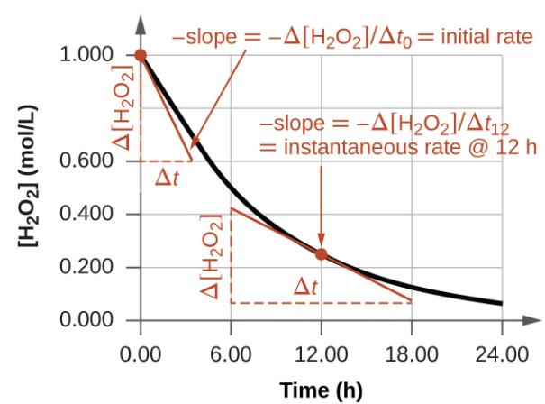
**Figure 12.3** This graph shows a plot of concentration versus time for a 1.000 M solution of H₂O₂. The rate at any time is equal to the negative of the slope of a line tangent to the curve at that time. Tangents are shown at t = 0 h (“initial rate”) and at t = 12 h (“instantaneous rate” at 12 h).

### CHEMISTRY IN EVERYDAY LIFE
**Reaction Rates in Analysis: Test Strips for Urinalysis**

Physicians often use disposable test strips to measure the amounts of various substances in a patient’s urine (Figure 12.4). These test strips contain various chemical reagents, embedded in small pads at various locations along the strip, which undergo changes in color upon exposure to sufficient concentrations of specific substances. The usage instructions for test strips often stress that proper read time is critical for optimal results. This emphasis on read time suggests that kinetic aspects of the chemical reactions occurring on the test strip are important considerations.

The test for urinary glucose relies on a two-step process represented by the chemical equations shown here:

$$\text{C}_{6}\text{H}_{12}\text{O}_{6} + \text{O}_{2} \xrightarrow{\text{catalyst}} \text{C}_{6}\text{H}_{10}\text{O}_{6} + \text{H}_{2}\text{O}_{2}$$

$$\text{H}_{2}\text{O}_{2} + \text{2I}^{-} + \text{2H}^{+} \xrightarrow{\text{catalyst}} \text{2H}_{2}\text{O} + \text{I}_{2}$$

The first equation depicts the oxidation of glucose in the urine to yield glucolactone and hydrogen peroxide. The hydrogen peroxide produced subsequently oxidizes colorless iodide ion to yield brown iodine, which may be visually detected. Some strips include an additional substance that reacts with iodine to produce a more distinct color change.

The two test reactions shown above are inherently very slow, but their rates are increased by special enzymes embedded in the test strip pad. This is an example of *catalysis*, a topic discussed later in this chapter. A typical glucose test strip for use with urine requires approximately 30 seconds for completion of the color-forming reactions. Reading the result too soon might lead one to conclude that the glucose concentration of the urine sample is lower than it actually is (a *false-negative* result). Waiting too long to assess the color change can lead to a *false positive* due to the slower (not catalyzed) oxidation of iodide ion by other substances found in urine.

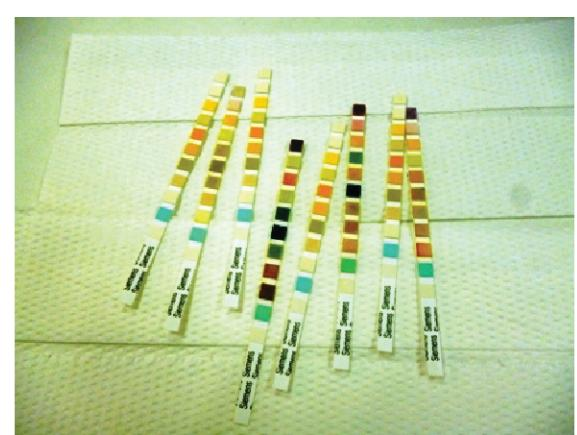
**Figure 12.4** Test strips are commonly used to detect the presence of specific substances in a person’s urine. Many test strips have several pads containing various reagents to permit the detection of multiple substances on a single strip. (credit: Iqbal Osman)

### Relative Rates of Reaction

The rate of a reaction may be expressed as the change in concentration of any reactant or product. For any given reaction, these rate expressions are all related simply to one another according to the reaction stoichiometry. The rate of the general reaction

$$\text{aA} \longrightarrow \text{bB}$$

can be expressed in terms of the decrease in the concentration of A or the increase in the concentration of B. These two rate expressions are related by the stoichiometry of the reaction:

$$rate = -\left(\dfrac{1}{a}\right)\left(\dfrac{\Delta A}{\Delta t}\right) = \left(\dfrac{1}{b}\right)\left(\dfrac{\Delta B}{\Delta t}\right)$$

Consider the reaction represented by the following equation:

$$\text{2NH}_{3}\text{(g)} \longrightarrow \text{N}_{2}\text{(g)} + \text{3H}_{2}\text{(g)}$$

The relation between the reaction rates expressed in terms of nitrogen production and ammonia consumption, for example, is:

$$-\dfrac{\Delta\ mol\ NH_3}{\Delta t} \times \dfrac{1\ mol\ N_2}{2\ mol\ NH_3} = \dfrac{\Delta\ mol\ N_2}{\Delta t}$$

This may be represented in an abbreviated format by omitting the units of the stoichiometric factor:

$$-\dfrac{1}{2}\dfrac{\Delta\ mol\ NH_3}{\Delta t} = \dfrac{\Delta\ mol\ N_2}{\Delta t}$$

Note that a negative sign has been included as a factor to account for the opposite signs of the two amount changes (the reactant amount is decreasing while the product amount is increasing). For homogeneous reactions, both the reactants and products are present in the same solution and thus occupy the same volume, so the molar amounts may be replaced with molar concentrations:

$$-\dfrac{1}{2}\dfrac{\Delta[NH_3]}{\Delta t} = \dfrac{\Delta[N_2]}{\Delta t}$$

Similarly, the rate of formation of H₂ is three times the rate of formation of N₂ because three moles of H₂ are produced for each mole of N₂ produced.

$$\dfrac{1}{3}\dfrac{\Delta[H_2]}{\Delta t} = \dfrac{\Delta[N_2]}{\Delta t}$$

Figure 12.5 illustrates the change in concentrations over time for the decomposition of ammonia into nitrogen and hydrogen at 1100 °C. Slopes of the tangent lines at *t* = 500 s show that the instantaneous rates derived from all three species involved in the reaction are related by their stoichiometric factors. The rate of hydrogen production, for example, is observed to be three times greater than that for nitrogen production:

$$\dfrac{2.91\times10^{-6}\ M/s}{9.70\times10^{-7}\ M/s} \approx 3$$

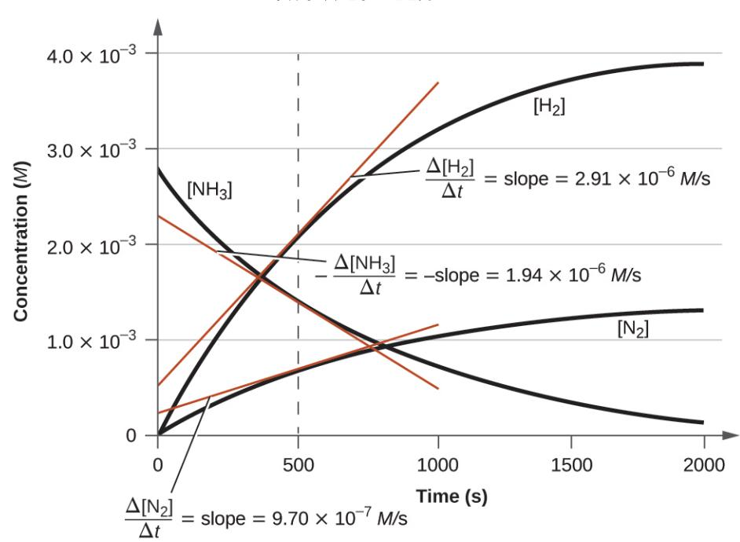
**Figure 12.5** Changes in concentrations of the reactant and products for the reaction The rates of change of the three concentrations are related by the reaction stoichiometry, as shown by the different slopes of the tangents at t = 500 s.

### Example 12.1 Expressions for Relative Reaction Rates

The first step in the production of nitric acid is the combustion of ammonia:

$$\text{4NH}_{3}\text{(g)} + \text{5O}_{2}\text{(g)} \longrightarrow \text{4NO(g)} + \text{6H}_{2}\text{O(g)}$$

Write the equations that relate the rates of consumption of the reactants and the rates of formation of the products.

**Solution**

Considering the stoichiometry of this homogeneous reaction, the rates for the consumption of reactants and formation of products are:

$$-\dfrac{1}{4}\dfrac{\Delta[NH_3]}{\Delta t} = -\dfrac{1}{5}\dfrac{\Delta[O_2]}{\Delta t} = \dfrac{1}{4}\dfrac{\Delta[NO]}{\Delta t} = \dfrac{1}{6}\dfrac{\Delta[H_2O]}{\Delta t}$$

**Check Your Learning**

The rate of formation of Br₂ is 6.0 × 10⁻⁶ mol/L/s in a reaction described by the following net ionic equation:

$$\text{5Br}^{-} + \text{BrO}_{3}^{-} + \text{6H}^{+} \longrightarrow \text{3Br}_{2} + \text{3H}_{2}\text{O}$$

Write the equations that relate the rates of consumption of the reactants and the rates of formation of the products.

**Answer:**

$$-\dfrac{1}{5}\dfrac{\Delta[Br^-]}{\Delta t} = -\dfrac{\Delta[BrO_3^-]}{\Delta t} = -\dfrac{1}{6}\dfrac{\Delta[H^+]}{\Delta t} = \dfrac{1}{3}\dfrac{\Delta[Br_2]}{\Delta t} = \dfrac{1}{3}\dfrac{\Delta[H_2O]}{\Delta t}$$

### Example 12.2 Reaction Rate Expressions for Decomposition of H₂O₂

The graph in Figure 12.3 shows the rate of the decomposition of H₂O₂ over time:

$$\text{2H}_{2}\text{O}_{2} \longrightarrow \text{2H}_{2}\text{O} + \text{O}_{2}$$

Based on these data, the instantaneous rate of decomposition of H₂O₂ at *t* = 11.1 h is determined to be 3.20 × 10⁻² mol/L/h, that is:

$$-\dfrac{\Delta[H_2O_2]}{\Delta t} = 3.20\times10^{-2}\ mol\ L^{-1}\ h^{-1}$$

What is the instantaneous rate of production of H₂O and O₂?

**Solution**

The reaction stoichiometry shows that

$$-\dfrac{1}{2}\dfrac{\Delta[H_2O_2]}{\Delta t} = \dfrac{1}{2}\dfrac{\Delta[H_2O]}{\Delta t} = \dfrac{\Delta[O_2]}{\Delta t}$$

Therefore:

$$\dfrac{1}{2}\times3.20\times10^{-2}\ mol\ L^{-1}\ h^{-1} = \dfrac{\Delta[O_2]}{\Delta t}$$

and

$$\dfrac{\Delta[O_2]}{\Delta t} = 1.60\times10^{-2}\ mol\ L^{-1}\ h^{-1}$$

Based on the stoichiometry of this reaction as shown above, the rate of water product is therefore

$$\dfrac{\Delta[H_2O]}{\Delta t} = 2\dfrac{\Delta[O_2]}{\Delta t} = (2)(1.60\times10^{-2}\ mol\ L^{-1}\ h^{-1}) = 3.20\times10^{-2}\ mol\ L^{-1}\ h^{-1}$$

**Check Your Learning**

If the rate of decomposition of ammonia, NH₃, at 1150 K is 2.10 × 10⁻⁶ mol/L/s, what is the rate of production of nitrogen and hydrogen?

**Answer:**

1.05 × 10⁻⁶ mol/L/s, N₂ and 3.15 × 10⁻⁶ mol/L/s, H₂.

## 12.2 Factors Affecting Reaction Rates

**LEARNING OBJECTIVES**

By the end of this section, you will be able to:

• Describe the effects of chemical nature, physical state, temperature, concentration, and catalysis on reaction rates

The rates at which reactants are consumed and products are formed during chemical reactions vary greatly. Five factors typically affecting the rates of chemical reactions will be explored in this section: the chemical nature of the reacting substances, the state of subdivision (one large lump versus many small particles) of the reactants, the temperature of the reactants, the concentration of the reactants, and the presence of a catalyst.

### The Chemical Nature of the Reacting Substances

The rate of a reaction depends on the nature of the participating substances. Reactions that appear similar may have different rates under the same conditions, depending on the identity of the reactants. For example, when small pieces of the metals iron and sodium are exposed to air, the sodium reacts completely with air overnight, whereas the iron is barely affected. The active metals calcium and sodium both react with water to form hydrogen gas and a base. Yet calcium reacts at a moderate rate, whereas sodium reacts so rapidly that the reaction is almost explosive.

### The Physical States of the Reactants

A chemical reaction between two or more substances requires intimate contact between the reactants. When reactants are in different physical states, or phases (solid, liquid, gaseous, dissolved), the reaction takes place only at the interface between the phases. Consider the heterogeneous reaction between a solid phase and either a liquid or gaseous phase. Compared with the reaction rate for large solid particles, the rate for smaller particles will be greater because the surface area in contact with the other reactant phase is greater. For example, large pieces of iron react more slowly with acids than they do with finely divided iron powder (Figure 12.6). Large pieces of wood smolder, smaller pieces burn rapidly, and saw dust burns explosively.

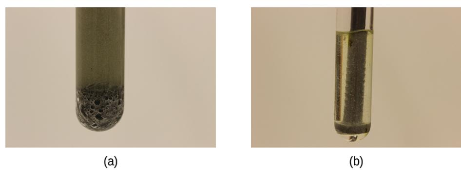
**Figure 12.6** (a) Iron powder reacts rapidly with dilute hydrochloric acid and produces bubbles of hydrogen gas: Fe(s) + HCl(aq) 2FeCl2(aq) + 3H2(g). (b) An iron nail reacts more slowly because the surface area exposed to the acid is much less.

**LINK TO LEARNING**

Watch [this video](http://openstax.org/l/16cesium) to see the reaction of cesium with water in slow motion and a discussion of how the state of reactants and particle size affect reaction rates.

### Temperature of the Reactants

Chemical reactions typically occur faster at higher temperatures. Food can spoil quickly when left on the kitchen counter. However, the lower temperature inside of a refrigerator slows that process so that the same food remains fresh for days. Gas burners, hot plates, and ovens are often used in the laboratory to increase the speed of reactions that proceed slowly at ordinary temperatures. For many chemical processes, reaction rates are approximately doubled when the temperature is raised by 10 °C.

### Concentrations of the Reactants

The rates of many reactions depend on the concentrations of the reactants. Rates usually increase when the concentration of one or more of the reactants increases. For example, calcium carbonate (CaCO₃) deteriorates as a result of its reaction with the pollutant sulfur dioxide. The rate of this reaction depends on the amount of sulfur dioxide in the air (Figure 12.7). An acidic oxide, sulfur dioxide combines with water vapor in the air to produce sulfurous acid in the following reaction:

$$\text{SO}_{2}\text{(g)} + \text{H}_{2}\text{O(g)} \longrightarrow \text{H}_{2}\text{SO}_{3}\text{(aq)}$$

Calcium carbonate reacts with sulfurous acid as follows:

$$\text{CaCO}_{3}\text{(s)} + \text{H}_{2}\text{SO}_{3}\text{(aq)} \longrightarrow \text{CaSO}_{3}\text{(aq)} + \text{CO}_{2}\text{(g)} + \text{H}_{2}\text{O(l)}$$

In a polluted atmosphere where the concentration of sulfur dioxide is high, calcium carbonate deteriorates more rapidly than in less polluted air. Similarly, phosphorus burns much more rapidly in an atmosphere of pure oxygen than in air, which is only about 20% oxygen.

**Figure 12.7** Statues made from carbonate compounds such as limestone and marble typically weather slowly over time due to the actions of water, and thermal expansion and contraction. However, pollutants like sulfur dioxide can accelerate weathering. As the concentration of air pollutants increases, deterioration of limestone occurs more rapidly. (credit: James P Fisher III)

**LINK TO LEARNING**

Phosphorus burns rapidly in air, but it will burn even more rapidly if the concentration of oxygen is higher. Watch this video [(http://openstax.org/l/16phosphor)](http://openstax.org/l/16phosphor) to see an example.

### The Presence of a Catalyst

Relatively dilute aqueous solutions of hydrogen peroxide, H₂O₂, are commonly used as topical antiseptics. Hydrogen peroxide decomposes to yield water and oxygen gas according to the equation:

$$\text{2H}_{2}\text{O}_{2}\text{(aq)} \longrightarrow \text{2H}_{2}\text{O(l)} + \text{O}_{2}\text{(g)}$$

Under typical conditions, this decomposition occurs very slowly. When dilute H₂O₂ (aq) is poured onto an open wound, however, the reaction occurs rapidly and the solution foams because of the vigorous production of oxygen gas. This dramatic difference is caused by the presence of substances within the wound’s exposed tissues that accelerate the decomposition process. Substances that function to increase the rate of a reaction are called **catalysts**, a topic treated in greater detail later in this chapter.

**LINK TO LEARNING**

Chemical reactions occur when molecules collide with each other and undergo a chemical transformation. Before physically performing a reaction in a laboratory, scientists can use molecular modeling simulations to predict how the parameters discussed earlier will influence the rate of a reaction. Use the [PhET Reactions & Rates interactive](http://openstax.org/l/16PHETreaction) [(http://openstax.org/l/16PHETreaction)](http://openstax.org/l/16PHETreaction) to explore how temperature, concentration, and the nature of the reactants affect reaction rates.

## 12.3 Rate Laws

**LEARNING OBJECTIVES**

By the end of this section, you will be able to:

-   Explain the form and function of a rate law
-   Use rate laws to calculate reaction rates
-   Use rate and concentration data to identify reaction orders and derive rate laws

As described in the previous module, the rate of a reaction is often affected by the concentrations of reactants. **Rate laws** (sometimes called differential rate laws) or **rate equations** are mathematical expressions that describe the relationship between the rate of a chemical reaction and the concentration of its reactants. As an example, consider the reaction described by the chemical equation

$$\text{aA} + \text{bB} \longrightarrow \text{products}$$

where *a* and *b* are stoichiometric coefficients. The rate law for this reaction is written as:

$$rate = k[A]^m[B]^n$$

in which \[A\] and \[B\] represent the molar concentrations of reactants, and *k* is the **rate constant**, which is specific for a particular reaction at a particular temperature. The exponents *m* and *n* are the **reaction orders** and are typically positive integers, though they can be fractions, negative, or zero. The rate constant *k* and the reaction orders *m* and *n* must be determined experimentally by observing how the rate of a reaction changes as the concentrations of the reactants are changed. The rate constant *k* is independent of the reactant concentrations, but it does vary with temperature.

The reaction orders in a rate law describe the mathematical dependence of the rate on reactant concentrations. Referring to the generic rate law above, the reaction is *m* order with respect to *A* and *n* order with respect to B. For example, if *m* = 1 and *n* = 2, the reaction is first order in *A* and second order in B. The **overall reaction order** is simply the sum of orders for each reactant. For the example rate law here, the reaction is third order overall (1 + 2 = 3). A few specific examples are shown below to further illustrate this concept.

The rate law:

$$rate = k[H_2O_2]$$

describes a reaction that is first order in hydrogen peroxide and first order overall. The rate law:

$$rate = k[C_4H_6]^2$$

describes a reaction that is second order in C₄H₆ and second order overall. The rate law:

$$rate = k[H^+][OH^-]$$

describes a reaction that is first order in H⁺, first order in OH⁻, and second order overall.

### Example 12.3 Writing Rate Laws from Reaction Orders

An experiment shows that the reaction of nitrogen dioxide with carbon monoxide:

$$\text{NO}_{2}\text{(g)} + \text{CO(g)} \longrightarrow \text{NO(g)} + \text{CO}_{2}\text{(g)}$$

is second order in NO₂ and zero order in CO at 100 °C. What is the rate law for the reaction?

**Solution**

The reaction will have the form:

$$rate = k[NO_2]^m[CO]^n$$

The reaction is second order in NO₂; thus *m* = 2. The reaction is zero order in CO; thus *n* = 0. The rate law is:

$$rate = k[NO_2]^2[CO]^0 = k[NO_2]^2$$

Remember that a number raised to the zero power is equal to 1, thus \[CO\]0 = 1, which is why the CO concentration term may be omitted from the rate law: the rate of reaction is solely dependent on the concentration of NO₂. A later chapter section on reaction mechanisms will explain how a reactant’s concentration can have no effect on a reaction rate despite being involved in the reaction.

**Check Your Learning**

The rate law for the reaction:

$$\text{H}_{2}\text{(g)} + \text{2NO(g)} \longrightarrow \text{N}_{2}\text{O(g)} + \text{H}_{2}\text{O(g)}$$

has been determined to be $$rate = k[NO]^2[H_2]$$. What are the orders with respect to each reactant, and what is the overall order of the reaction?

**Answer:**

order in NO = 2; order in H₂ = 1; overall order = 3

**Check Your Learning**

In a transesterification reaction, a triglyceride reacts with an alcohol to form an ester and glycerol. Many students learn about the reaction between methanol (CH₃OH) and ethyl acetate (CH₃CH₂OCOCH₃) as a sample reaction before studying the chemical reactions that produce biodiesel:

$$\text{CH}_{3}\text{OH} + \text{CH}_{3}\text{CH}_{2}\text{OCOCH}_{3} \longrightarrow \text{CH}_{3}\text{OCOCH}_{3} + \text{CH}_{3}\text{CH}_{2}\text{OH}$$

The rate law for the reaction between methanol and ethyl acetate is, under certain conditions, determined to be:

$$rate = k[CH_3OH]$$

What is the order of reaction with respect to methanol and ethyl acetate, and what is the overall order of reaction?

**Answer:**

order in CH₃OH = 1; order in CH₃CH₂OCOCH₃ = 0; overall order = 1

A common experimental approach to the determination of rate laws is the **method of initial rates**. This method involves measuring reaction rates for multiple experimental trials carried out using different initial reactant concentrations. Comparing the measured rates for these trials permits determination of the reaction orders and, subsequently, the rate constant, which together are used to formulate a rate law. This approach is illustrated in the next two example exercises.

### Example 12.4 Determining a Rate Law from Initial Rates

Ozone in the upper atmosphere is depleted when it reacts with nitrogen oxides. The rates of the reactions of nitrogen oxides with ozone are important factors in deciding how significant these reactions are in the formation of the ozone hole over Antarctica (Figure 12.8). One such reaction is the combination of nitric oxide, NO, with ozone, O₃:

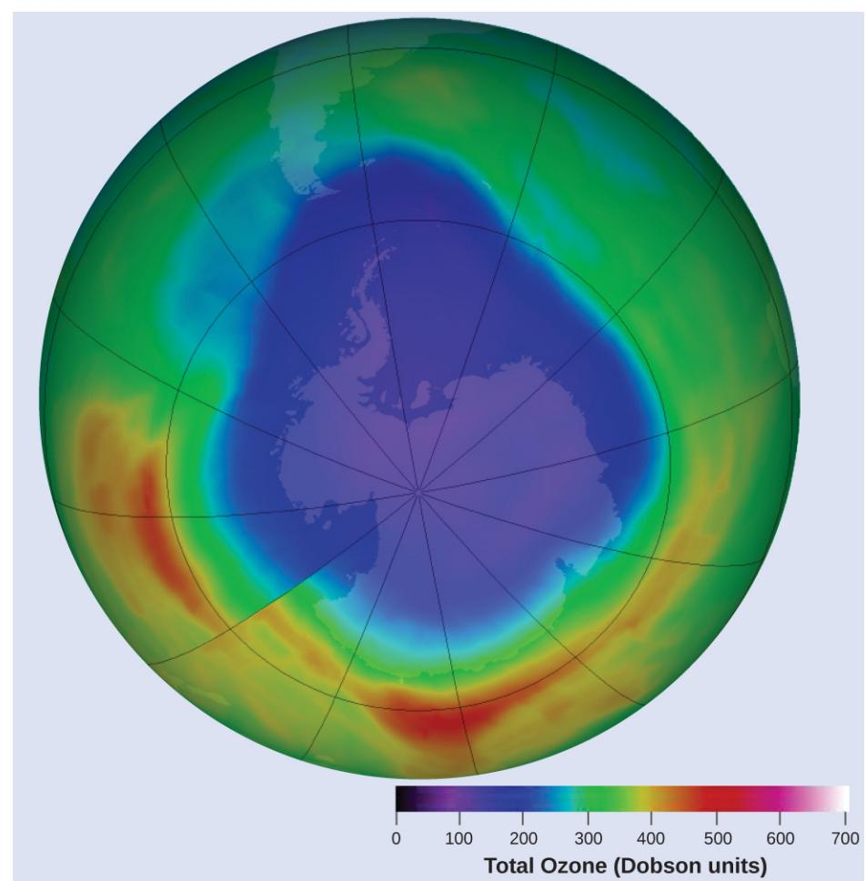
**Figure 12.8** A contour map showing stratospheric ozone concentration and the “ozone hole” that occurs over Antarctica during its spring months. (credit: modification of work by NASA)

$$\text{NO(g)} + \text{O}_{3}\text{(g)} \longrightarrow \text{NO}_{2}\text{(g)} + \text{O}_{2}\text{(g)}$$

This reaction has been studied in the laboratory, and the following rate data were determined at 25 °C.

| trial | [NO] (mol/L) | [O₃] (mol/L) | Δ[NO₂]/Δt (mol L⁻¹ s⁻¹) |
|---|---|---|---|
| 1 | 1.00 × 10⁻⁶ | 3.00 × 10⁻⁶ | 6.60 × 10⁻⁵ |
| 2 | 1.00 × 10⁻⁶ | 6.00 × 10⁻⁶ | 1.32 × 10⁻⁴ |
| 3 | 1.00 × 10⁻⁶ | 9.00 × 10⁻⁶ | 1.98 × 10⁻⁴ |
| 4 | 2.00 × 10⁻⁶ | 9.00 × 10⁻⁶ | 3.96 × 10⁻⁴ |
| 5 | 3.00 × 10⁻⁶ | 9.00 × 10⁻⁶ | 5.94 × 10⁻⁴ |

Determine the rate law and the rate constant for the reaction at 25 °C.

**Solution**

The rate law will have the form:

$$rate = k[NO]^m[O_3]^n$$

Determine the values of m, n, and *k* from the experimental data using the following three-part process:

**Step 1.**

Determine the value of m from the data in which \[NO\] varies and \[O₃\] is constant. In the last three experiments, \[NO\] varies while \[O₃\] remains constant. When \[NO\] doubles from trial 3 to 4, the rate doubles, and when \[NO\] triples from trial 3 to 5, the rate also triples. Thus, the rate is also directly proportional to \[NO\], and *m* in the rate law is equal to 1.

**Step 2.**

Determine the value of n from data in which \[O₃\] varies and \[NO\] is constant. In the first three experiments, \[NO\] is constant and \[O₃\] varies. The reaction rate changes in direct proportion to the change in \[O₃\]. When \[O₃\] doubles from trial 1 to 2, the rate doubles; when \[O₃\] triples from trial 1 to 3, the rate increases also triples. Thus, the rate is directly proportional to \[O₃\], and *n* is equal to 1. The rate law is thus:

$$rate = k[NO]^1[O_3]^1 = k[NO][O_3]$$

**Step 3.**

Determine the value of k from one set of concentrations and the corresponding rate. The data from trial 1 are used below:

$$k = \dfrac{rate}{[NO][O_3]} = \dfrac{6.60\times10^{-5}\ mol\ L^{-1}s^{-1}}{(1.00\times10^{-6}\ mol\ L^{-1})(3.00\times10^{-6}\ mol\ L^{-1})} = 2.20\times10^{7}\ L\ mol^{-1}s^{-1}$$

**Check Your Learning**

Acetaldehyde decomposes when heated to yield methane and carbon monoxide according to the equation:

$$\text{CH}_{3}\text{CHO(g)} \longrightarrow \text{CH}_{4}\text{(g)} + \text{CO(g)}$$

Determine the rate law and the rate constant for the reaction from the following experimental data:

| Trial | [CH₃CHO] (mol/L) | Rate (mol L⁻¹ s⁻¹) |
|---|---|---|
| 1 | 1.75 × 10⁻³ | 2.06 × 10⁻¹¹ |
| 2 | 3.50 × 10⁻³ | 8.24 × 10⁻¹¹ |
| 3 | 7.00 × 10⁻³ | 3.30 × 10⁻¹⁰ |

**Answer:**

$$rate = k[CH_3CHO]^2$$ with $k$ = 6.73 × 10⁻⁶ L/mol/s

### Example 12.5 Determining Rate Laws from Initial Rates

Using the initial rates method and the experimental data, determine the rate law and the value of the rate constant for this reaction:

| Trial | [NO] (mol/L) | [Cl₂] (mol/L) | Rate (mol L⁻¹ s⁻¹) |
|---|---|---|---|
| 1 | 0.10 | 0.10 | 0.00300 |
| 2 | 0.10 | 0.15 | 0.00450 |
| 3 | 0.15 | 0.10 | 0.00675 |

**Solution**

The rate law for this reaction will have the form:

$$rate = k[NO]^m[Cl_2]^n$$

As in Example 12.4, approach this problem in a stepwise fashion, determining the values of *m* and *n* from the experimental data and then using these values to determine the value of k. In this example, however, an explicit algebraic approach (vs. the implicit approach of the previous example) will be used to determine the values of *m* and n:

1. Step 1. Determine the value of m from the data in which \[NO\] varies and \[Cl₂\] is constant. Write the ratios with the subscripts *x* and *y* to indicate data from two different trials:

$$\dfrac{rate_x}{rate_y} = \dfrac{k[NO]_x^m[Cl_2]_x^n}{k[NO]_y^m[Cl_2]_y^n}$$

Using the third trial and the first trial, in which \[Cl₂\] does not vary, gives:

$$\dfrac{rate\ 3}{rate\ 1} = \dfrac{0.00675}{0.00300} = \dfrac{k(0.15)^m(0.10)^n}{k(0.10)^m(0.10)^n}$$

Canceling equivalent terms in the numerator and denominator leaves:

$$\dfrac{0.00675}{0.00300} = \dfrac{(0.15)^m}{(0.10)^m}$$

which simplifies to:

$$2.25 = (1.5)^m$$

Use logarithms to determine the value of the exponent m:

$$\ln(2.25) = m\ln(1.5)$$

$$\dfrac{\ln(2.25)}{\ln(1.5)} = m$$

$$2 = m$$

Confirm the result

$$1.5^2 = 2.25$$

**Step 2.**

Determine the value of n from data in which \[Cl₂\] varies and \[NO\] is constant.

$$\dfrac{rate\ 2}{rate\ 1} = \dfrac{0.00450}{0.00300} = \dfrac{k(0.10)^m(0.15)^n}{k(0.10)^m(0.10)^n}$$

Cancelation gives:

$$\dfrac{0.0045}{0.0030} = \dfrac{(0.15)^n}{(0.10)^n}$$

which simplifies to:

$$1.5 = (1.5)^n$$

Thus *n* must be 1, and the form of the rate law is:

$$rate = k[NO]^m[Cl_2]^n = k[NO]^2[Cl_2]$$

**Step 3.**

Determine the numerical value of the rate constant k with appropriate units. The units for the rate of a reaction are mol/L/s. The units for *k* are whatever is needed so that substituting into the rate law expression affords the appropriate units for the rate. In this example, the concentration units are mol³/L³. The units for *k* should be mol⁻²L²/s so that the rate is in terms of mol/L/s.

To determine the value of *k* once the rate law expression has been solved, simply plug in values from the first experimental trial and solve for k:

$$0.00300\ mol\ L^{-1}\ s^{-1} = k(0.10\ mol\ L^{-1})^2(0.10\ mol\ L^{-1})^1$$

$$k = 3.0\ mol^{-2}\ L^2\ s^{-1}$$

**Check Your Learning**

Use the provided initial rate data to derive the rate law for the reaction whose equation is:

| Trial | [OCl⁻] (mol/L) | [I⁻] (mol/L) | Initial Rate (mol/L/s) |
|---|---|---|---|
| 1 | 0.0040 | 0.0020 | 0.00184 |
| 2 | 0.0020 | 0.0040 | 0.00092 |
| 3 | 0.0020 | 0.0020 | 0.00046 |

Determine the rate law expression and the value of the rate constant *k* with appropriate units for this reaction.

**Answer:**

$$\dfrac{rate\ 2}{rate\ 3} = \dfrac{0.00092}{0.00046} = \dfrac{k(0.0020)^X(0.0040)^Y}{k(0.0020)^X(0.0020)^Y}$$

$$2.00 = 2.00^y$$

y = 1

$$\dfrac{rate\ 1}{rate\ 2} = \dfrac{0.00184}{0.00092} = \dfrac{k(0.0040)^X(0.0020)^Y}{k(0.0020)^X(0.0040)^Y}$$

Substituting the concentration data from trial 1 and solving for *k* yields:

$$rate = k[OCl^-]^2[I^-]^1$$

$$0.00184 = k(0.0040)^2(0.0020)^1$$

$$k = 5.75\times10^4\ mol^{-2}\ L^2\ s^{-1}$$

### Reaction Order and Rate Constant Units

In some of our examples, the reaction orders in the rate law happen to be the same as the coefficients in the chemical equation for the reaction. This is merely a coincidence and very often not the case.

Rate laws may exhibit fractional orders for some reactants, and negative reaction orders are sometimes observed when an increase in the concentration of one reactant causes a decrease in reaction rate. A few examples illustrating these points are provided:

**Sample Rate Laws**

| Reaction | Rate Law |
|---|---|
| NO₂ + CO ⟶ NO + CO₂ | $$rate = k[NO_2]^2$$ |
| CH₃CHO ⟶ CH₄ + CO | $$rate = k[CH_3CHO]^2$$ |
| 2N₂O₅ ⟶ NO₂ + O₂ | $$rate = k[N_2O_5]$$ |
| 2NO₂ + F₂ ⟶ 2NO₂F | $$rate = k[NO_2][F_2]$$ |
| 2NO₂Cl ⟶ 2NO₂ + Cl₂ | $$rate = k[NO_2Cl]$$ |

It is important to note that rate laws are determined by experiment only and are not reliably predicted by reaction stoichiometry.

The units for a rate constant will vary as appropriate to accommodate the overall order of the reaction. The unit of the rate constant for the second-order reaction described in Example 12.4 was determined to be L mol⁻¹ s⁻¹. For the third-order reaction described in Example 12.5, the unit for *k* was derived to be L²mol⁻² s⁻¹. Dimensional analysis requires the rate constant unit for a reaction whose overall order is *x* to be Lˣ⁻¹mol¹⁻ˣs⁻¹. Table 12.1 summarizes the rate constant units for common reaction orders.

**Table 12.1** Rate Constant Units for Common Reaction Orders

| Overall Reaction Order (x) | Rate Constant Unit ($L^{x-1}mol^{1-x}s^{-1}$) |
|---|---|
| 0 (zero) | mol L⁻¹ s⁻¹ |
| 1 (first) | s⁻¹ |
| 2 (second) | L mol⁻¹ s⁻¹ |
| 3 (third) | L² mol⁻² s⁻¹ |

Note that the units in this table were derived using specific units for concentration (mol/L) and time (s), though any valid units for these two properties may be used.

## 12.4 Integrated Rate Laws

**LEARNING OBJECTIVES**

By the end of this section, you will be able to:

-   Explain the form and function of an integrated rate law
-   Perform integrated rate law calculations for zero-, first-, and second-order reactions
-   Define half-life and carry out related calculations
-   Identify the order of a reaction from concentration/time data

The rate laws discussed thus far relate the rate and the concentrations of reactants. We can also determine a second form of each rate law that relates the concentrations of reactants and time. These are called **integrated rate laws**. We can use an integrated rate law to determine the amount of reactant or product present after a period of time or to estimate the time required for a reaction to proceed to a certain extent. For example, an integrated rate law is used to determine the length of time a radioactive material must be stored for its radioactivity to decay to a safe level.

Using calculus, the differential rate law for a chemical reaction can be integrated with respect to time to give an equation that relates the amount of reactant or product present in a reaction mixture to the elapsed time of the reaction. This process can either be very straightforward or very complex, depending on the complexity of the differential rate law. For purposes of discussion, we will focus on the resulting integrated rate laws for first-, second-, and zero-order reactions.

### First-Order Reactions

Integration of the rate law for a simple first-order reaction (rate = k\[A\]) results in an equation describing how the reactant concentration varies with time:

$$[A]_t = [A]_0 e^{-kt}$$

where \[A\]*t* is the concentration of *A* at any time t, \[A\]0 is the initial concentration of A, and *k* is the first-order rate constant.

For mathematical convenience, this equation may be rearranged to other formats, including direct and indirect proportionalities:

$$\ln\left(\dfrac{[A]_t}{[A]_0}\right) = -kt \quad\text{or}\quad \ln\left(\dfrac{[A]_0}{[A]_t}\right) = kt$$

and a format showing a linear dependence of concentration in time:

$$\ln[A]_t = \ln[A]_0 - kt$$

### Example 12.6 The Integrated Rate Law for a First-Order Reaction

The rate constant for the first-order decomposition of cyclobutane, C₄H₈ at 500 °C is 9.2 × 10⁻³ s⁻¹:

$$\text{C}_{4}\text{H}_{8} \longrightarrow \text{2C}_{2}\text{H}_{4}$$

How long will it take for 80.0% of a sample of C₄H₈ to decompose?

**Solution**

Since the relative change in reactant concentration is provided, a convenient format for the integrated rate law is:

$$\ln\left(\dfrac{[A]_0}{[A]_t}\right) = kt$$

The initial concentration of C₄H₈, \[A\]0, is not provided, but the provision that 80.0% of the sample has decomposed is enough information to solve this problem. Let *x* be the initial concentration, in which case the concentration after 80.0% decomposition is 20.0% of *x* or 0.200x. Rearranging the rate law to isolate *t* and substituting the provided

quantities yields:

$$t = \ln\dfrac{[x]}{[0.200x]}\times\dfrac{1}{k} = \ln5\times\dfrac{1}{9.2\times10^{-3}\ s^{-1}} = 1.609\times\dfrac{1}{9.2\times10^{-3}\ s^{-1}} = 1.7\times10^2\ s$$

**Check Your Learning**

Iodine-131 is a radioactive isotope that is used to diagnose and treat some forms of thyroid cancer. Iodine-131 decays to xenon-131 according to the equation:

$$^{131}\text{I} \longrightarrow ^{131}\text{Xe} + \text{electron}$$

The decay is first-order with a rate constant of 0.138 d⁻¹. How many days will it take for 90% of the iodine-131 in a 0.500 *M* solution of this substance to decay to Xe-131?

**Answer:**

16.7 days

In the next example exercise, a linear format for the integrated rate law will be convenient:

$$\ln[A]_t = (-k)(t) + \ln[A]_0$$

$$y = mx + b$$

A plot of ln\[A\]*t* versus *t* for a first-order reaction is a straight line with a slope of −*k* and a y-intercept of ln\[A\]0. If a set of rate data are plotted in this fashion but do not result in a straight line, the reaction is not first order in A.

### Example 12.7 Graphical Determination of Reaction Order and Rate Constant

Show that the data in Figure 12.2 can be represented by a first-order rate law by graphing ln\[H₂O₂\] versus time. Determine the rate constant for the decomposition of H₂O₂ from these data.

**Solution**

The data from Figure 12.2 are tabulated below, and a plot of ln\[H₂O₂\] is shown in Figure 12.9.

| Time (h) | [H₂O₂] (M) | ln[H₂O₂] |
|---|---|---|
| 0.00 | 1.000 | 0.000 |
| 6.00 | 0.500 | −0.693 |
| 12.00 | 0.250 | −1.386 |
| 18.00 | 0.125 | −2.079 |
| 24.00 | 0.0625 | −2.772 |

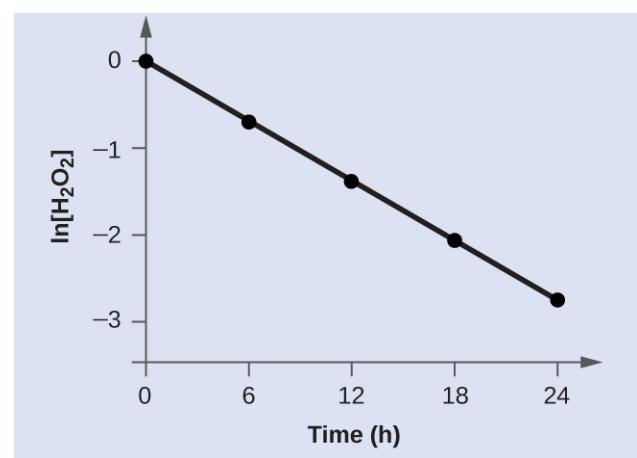
**Figure 12.9** A linear relationship between ln[H₂O₂] and time suggests the decomposition of hydrogen peroxide is a first-order reaction.

The plot of ln\[H₂O₂\] versus time is linear, indicating that the reaction may be described by a first-order rate law.

According to the linear format of the first-order integrated rate law, the rate constant is given by the negative of this plot’s slope.

$$\dfrac{\text{change in }y}{\text{change in }x} = \dfrac{\Delta y}{\Delta x} = \dfrac{\Delta\ln[H_2O_2]}{\Delta t}$$

The slope of this line may be derived from two values of ln\[H₂O₂\] at different values of *t* (one near each end of the line is preferable). For example, the value of ln\[H₂O₂\] when *t* is 0.00 h is 0.000; the value when *t* = 24.00 h is −2.772

$$slope = \dfrac{-2.772 - 0.000}{24.00 - 0.00\ h} = \dfrac{-2.772}{24.00\ h} = -0.116\ h^{-1}$$

$$k = -slope = -(-0.116\ h^{-1}) = 0.116\ h^{-1}$$

**Check Your Learning**

Graph the following data to determine whether the reaction is first order.

| Time (s) | [A] |
|---|---|
| 4.0 | 0.220 |
| 8.0 | 0.144 |
| 12.0 | 0.110 |
| 16.0 | 0.088 |
| 20.0 | 0.074 |

**Answer:**

The plot of ln\[A\]*t* vs. *t* is not linear, indicating the reaction is not first order:

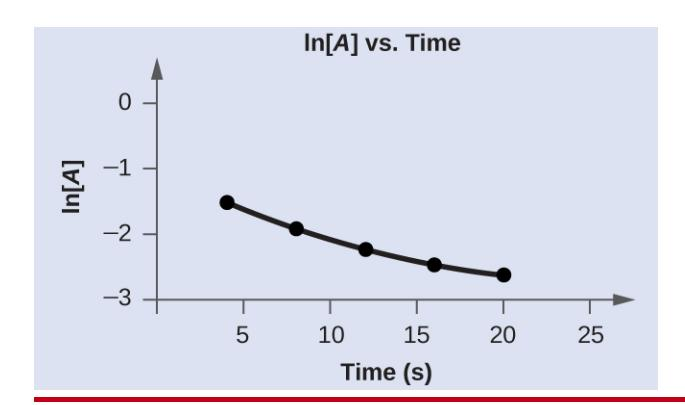

### Second-Order Reactions

The equations that relate the concentrations of reactants and the rate constant of second-order reactions can be fairly complicated. To illustrate the point with minimal complexity, only the simplest second-order reactions will be described here, namely, those whose rates depend on the concentration of just one reactant. For these types of reactions, the differential rate law is written as:

$$rate = k[A]^2$$

For these second-order reactions, the integrated rate law is:

$$\dfrac{1}{[A]_t} = kt + \dfrac{1}{[A]_0}$$

where the terms in the equation have their usual meanings as defined earlier.

### Example 12.8 The Integrated Rate Law for a Second-Order Reaction

The reaction of butadiene gas (C₄H₆) to yield C₈H₁₂ gas is described by the equation:

$$\text{2C}_{4}\text{H}_{6}\text{(g)} \longrightarrow \text{C}_{8}\text{H}_{12}\text{(g)}$$

This “dimerization” reaction is second order with a rate constant equal to 5.76 × 10⁻² L mol⁻¹ min⁻¹ under certain conditions. If the initial concentration of butadiene is 0.200 M, what is the concentration after 10.0 min?

**Solution**

For a second-order reaction, the integrated rate law is written

$$\dfrac{1}{[A]_t} = kt + \dfrac{1}{[A]_0}$$

We know three variables in this equation: \[A\]0 = 0.200 mol/L, *k* = 5.76 × 10⁻² L/mol/min, and *t* = 10.0 min. Therefore, we can solve for \[A\], the fourth variable:

$$\dfrac{1}{[A]_t} = (5.76\times10^{-2}\ L\ mol^{-1}min^{-1})(10\ min) + \dfrac{1}{0.200\ mol^{-1}}$$

$$\dfrac{1}{[A]_t} = (5.76\times10^{-1}\ L\ mol^{-1}) + 5.00\ L\ mol^{-1}$$

$$\dfrac{1}{[A]_t} = 5.58\ L\ mol^{-1}$$

$$[A]_t = 1.79\times10^{-1}\ mol\ L^{-1}$$

Therefore 0.179 mol/L of butadiene remain at the end of 10.0 min, compared to the 0.200 mol/L that was originally present.

**Check Your Learning**

If the initial concentration of butadiene is 0.0200 M, what is the concentration remaining after 20.0 min?

**Answer:**

0.0195 mol/L

The integrated rate law for second-order reactions has the form of the equation of a straight line:

$$\dfrac{1}{[A]_t} = kt + \dfrac{1}{[A]_0}$$

y = mx + b

A plot of 1/\[A\]ₜ versus *t* for a second-order reaction is a straight line with a slope of *k* and a y-intercept of 1/\[A\]₀. If the plot is not a straight line, then the reaction is not second order.

### Example 12.9 Graphical Determination of Reaction Order and Rate Constant

The data below are for the same reaction described in Example 12.8. Prepare and compare two appropriate data plots to identify the reaction as being either first or second order. After identifying the reaction order, estimate a value for the rate constant.

**Solution**

| Time (s) | [C₄H₆] (M) |
|---|---|
| 0 | 1.00 × 10⁻² |
| 1600 | 5.04 × 10⁻³ |
| 3200 | 3.37 × 10⁻³ |
| 4800 | 2.53 × 10⁻³ |
| 6200 | 2.08 × 10⁻³ |

In order to distinguish a first-order reaction from a second-order reaction, prepare a plot of ln[C₄H₆]*t* versus *t* and compare it to a plot of 1/[C₄H₆]ₜ versus t. The values needed for these plots follow.

| Time (s) | 1/[C₄H₆] (M⁻¹) | ln[C₄H₆] |
|---|---|---|
| 0 | 100 | −4.605 |
| 1600 | 198 | −5.289 |
| 3200 | 296 | −5.692 |
| 4800 | 395 | −5.978 |
| 6200 | 481 | −6.175 |

The plots are shown in Figure 12.10, which clearly shows the plot of ln\[C₄H₆\]*t* versus *t* is not linear, therefore the reaction is not first order. The plot of 1/\[C₄H₆\]ₜ versus *t* is linear, indicating that the reaction is second order.

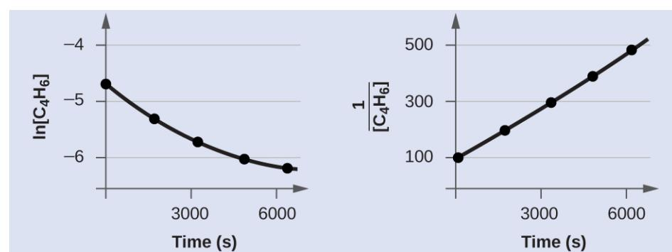
**Figure 12.10** These two graphs show first-and second-order plots for the dimerization of C₄H₆. The linear trend in the second-order plot (right) indicates that the reaction follows second-order kinetics.

According to the second-order integrated rate law, the rate constant is equal to the slope of the 1/\[A\]ₜ versus *t* plot.

Using the data for *t* = 0 *s* and *t* = 6200 s, the rate constant is estimated as follows:

$$k = slope = \dfrac{(481M^{-1} - 100M^{-1})}{(6200\ s - 0\ s)} = 0.0614\ M^{-1}\ s^{-1}$$

**Check Your Learning**

Do the following data fit a second-order rate law?

| Time (s) | [A] (M) |
|---|---|
| 5 | 0.952 |
| 10 | 0.625 |
| 15 | 0.465 |
| 20 | 0.370 |
| 25 | 0.308 |
| 35 | 0.230 |

**Answer:**

Yes. The plot of 1/\[A\]ₜ vs. *t* is linear:

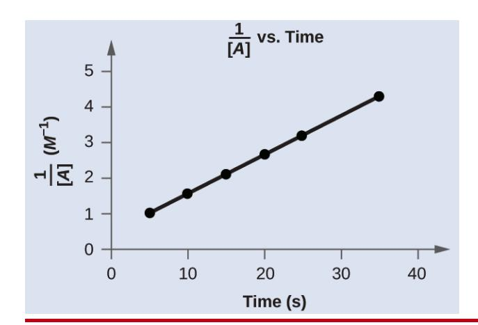

### Zero-Order Reactions

For zero-order reactions, the differential rate law is:

$$rate = k$$

A zero-order reaction thus exhibits a constant reaction rate, regardless of the concentration of its reactant(s). This may seem counterintuitive, since the reaction rate certainly can’t be finite when the reactant concentration is zero. For purposes of this introductory text, it will suffice to note that zero-order kinetics are observed for some reactions only under certain specific conditions. These same reactions exhibit different kinetic behaviors when the specific conditions aren’t met, and for this reason the more prudent term pseudo-zero-order is sometimes used.

The integrated rate law for a zero-order reaction is a linear function:

$$[A]_t = -kt + [A]_0$$

$$y = mx + b$$

A plot of \[A\] versus *t* for a zero-order reaction is a straight line with a slope of −k and a y-intercept of \[A\]0. Figure 12.11 shows a plot of \[NH₃\] versus *t* for the thermal decomposition of ammonia at the surface of two different heated solids. The decomposition reaction exhibits first-order behavior at a quartz (SiO₂) surface, as suggested by the exponentially decaying plot of concentration versus time. On a tungsten surface, however, the plot is linear, indicating zero-order kinetics.

### Example 12.10 Graphical Determination of Zero-Order Rate Constant

Use the data plot in Figure 12.11 to graphically estimate the zero-order rate constant for ammonia decomposition at a tungsten surface.

**Solution**

The integrated rate law for zero-order kinetics describes a linear plot of reactant concentration, \[A\]t, versus time, t, with a slope equal to the negative of the rate constant, −k. Following the mathematical approach of previous examples, the slope of the linear data plot (for decomposition on W) is estimated from the graph. Using the ammonia concentrations at *t* = 0 and *t* = 1000 s:

$$k = -slope = -\dfrac{(0.0015\ mol\ L^{-1} - 0.0028\ mol\ L^{-1})}{(1000\ s - 0\ s)} = 1.3\times10^{-6}\ mol\ L^{-1}\ s^{-1}$$

**Check Your Learning**

The zero-order plot in Figure 12.11 shows an initial ammonia concentration of 0.0028 mol L⁻¹ decreasing linearly with time for 1000 s. Assuming no change in this zero-order behavior, at what time (min) will the concentration reach 0.0001 mol L⁻¹?

**Answer:**
35 min

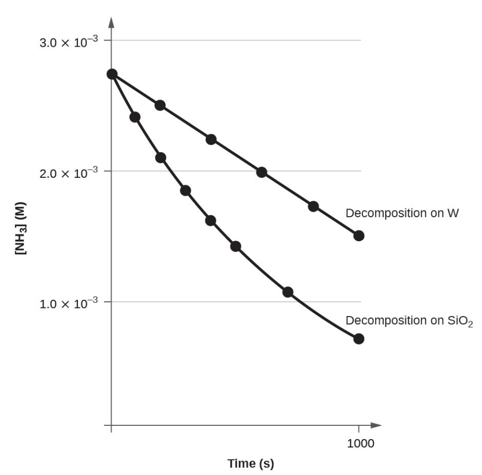
**Figure 12.11** The decomposition of NH₃ on a tungsten (W) surface is a zero-order reaction, whereas on a quartz (SiO₂) surface, the reaction is first order.

### The Half-Life of a Reaction

The **half-life of a reaction (t1/2)** is the time required for one-half of a given amount of reactant to be consumed. In each succeeding half-life, half of the remaining concentration of the reactant is consumed. Using the decomposition of hydrogen peroxide (Figure 12.2) as an example, we find that during the first half-life (from 0.00 hours to 6.00 hours), the concentration of H₂O₂ decreases from 1.000 *M* to 0.500 M. During the second half-life (from 6.00 hours to 12.00 hours), it decreases from 0.500 *M* to 0.250 M; during the third half-life, it decreases from 0.250 *M* to 0.125 *M*. The concentration of H₂O₂ decreases by half during each successive period of 6.00 hours. The decomposition of hydrogen peroxide is a first-order reaction, and, as can be shown, the half-life of a first-order reaction is independent of the concentration of the reactant. However, half-lives of reactions with other orders depend on the concentrations of the reactants.

#### First-Order Reactions

An equation relating the half-life of a first-order reaction to its rate constant may be derived from the integrated rate law as follows:

$$\ln\dfrac{[A]_0}{[A]_t} = kt$$

$$t = \ln\dfrac{[A]_0}{[A]_t}\times\dfrac{1}{k}$$

Invoking the definition of half-life, symbolized t₁⁄₂, requires that the concentration of *A* at this point is one-half its initial concentration: $$t = t_{1/2},\ [A]_t = \dfrac{1}{2}[A]_0$$

Substituting these terms into the rearranged integrated rate law and simplifying yields the equation for half-life:

$$t_{1/2} = \ln\dfrac{[A_0]}{\frac{1}{2}[A_0]}\times\dfrac{1}{k} = \ln2\times\dfrac{1}{k} = 0.693\times\dfrac{1}{k}$$

$$t_{1/2} = \dfrac{0.693}{k}$$

This equation describes an expected inverse relation between the half-life of the reaction and its rate constant, k. Faster reactions exhibit larger rate constants and correspondingly shorter half-lives. Slower reactions exhibit smaller rate constants and longer half-lives.

### Example 12.11 Calculation of a First-order Rate Constant using Half-Life

Calculate the rate constant for the first-order decomposition of hydrogen peroxide in water at 40 °C, using the data given in Figure 12.12.

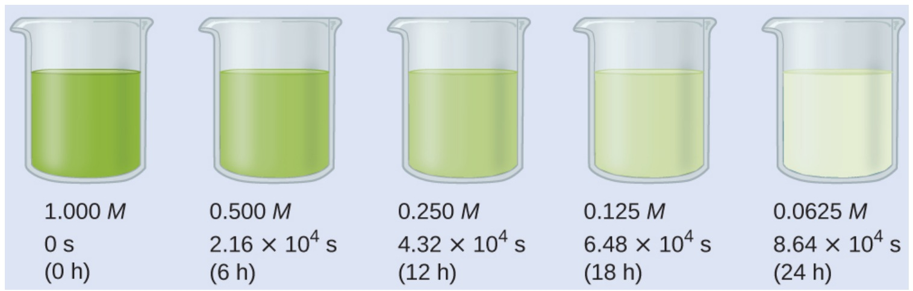
**Figure 12.12** The decomposition of H₂O₂ at 40 °C is illustrated. The intensity of the color symbolizes the concentration of H₂O₂ at the indicated times; H₂O₂ is actually colorless.

**Solution**

Inspecting the concentration/time data in Figure 12.12 shows the half-life for the decomposition of H₂O₂ is 2.16 × 10⁴ s:

$$t_{1/2} = \dfrac{0.693}{k}$$

$$k = \dfrac{0.693}{t_{1/2}} = \dfrac{0.693}{2.16\times10^4\ s} = 3.21\times10^{-5}\ s^{-1}$$

**Check Your Learning**

The first-order radioactive decay of iodine-131 exhibits a rate constant of 0.138 d⁻¹. What is the half-life for this decay?

**Answer:**

5.02 d.

$$\ln\dfrac{[A]_0}{[A]_t} = kt \quad\quad t = \ln\dfrac{[A]_0}{[A]_t}\times\dfrac{1}{k}$$

#### Second-Order Reactions

Following the same approach as used for first-order reactions, an equation relating the half-life of a second-order reaction to its rate constant and initial concentration may be derived from its integrated rate law:

$$\dfrac{1}{[A]_t} = kt + \dfrac{1}{[A]_0}$$

or

$$\dfrac{1}{[A]} - \dfrac{1}{[A]_0} = kt$$

Restrict *t* to *t*1/2

$$t = t_{1/2}$$

Define \[A\]*t* as one-half \[A\]0

$$[A]_t = \dfrac{1}{2}[A]_0$$

and then substitute into the integrated rate law and simplify:

$$\dfrac{1}{2[A_0]} - \dfrac{1}{[A_0]} = kt_{1/2}$$

$$\dfrac{2}{[A_0]} - \dfrac{1}{[A_0]} = kt_{1/2}$$

$$\dfrac{1}{[A_0]} = kt_{1/2}$$

$$t_{1/2} = \dfrac{1}{k[A_0]}$$

For a second-order reaction, t₁⁄₂ is inversely proportional to the concentration of the reactant, and the half-life increases as the reaction proceeds because the concentration of reactant decreases. Unlike with first-order reactions, the rate constant of a second-order reaction cannot be calculated directly from the half-life unless the initial concentration is known.

#### Zero-Order Reactions

As for other reaction orders, an equation for zero-order half-life may be derived from the integrated rate law:

$$[A] = -kt + [A]_0$$

Restricting the time and concentrations to those defined by half-life: t = t₁⁄₂ and \[A\] = \[A\]₀/2. Substituting these terms into the zero-order integrated rate law yields:

$$\dfrac{[A]_0}{2} = -kt_{1/2} + [A]_0$$

$$kt_{1/2} = \dfrac{[A]_0}{2}$$

$$t_{1/2} = \dfrac{[A]_0}{2k}$$

As for all reaction orders, the half-life for a zero-order reaction is inversely proportional to its rate constant. However, the half-life of a zero-order reaction increases as the initial concentration increases.

Equations for both differential and integrated rate laws and the corresponding half-lives for zero-, first-, and second-order reactions are summarized in Table 12.2.

Summary of Rate Laws for Zero-, First-, and Second-Order Reactions

**Table 12.2** Summary of Rate Laws for Zero-, First-, and Second-Order Reactions

| | Zero-Order | First-Order | Second-Order |
|---|---|---|---|
| rate law | $rate = k$ | $rate = k[A]$ | $rate = k[A]^2$ |
| units of rate constant | M s⁻¹ | s⁻¹ | M⁻¹ s⁻¹ |
| integrated rate law | $[A] = -kt + [A]_0$ | $\ln[A] = -kt + \ln[A]_0$ | $1/[A] = kt + (1/[A]_0)$ |
| plot needed for linear fit of rate data | [A] vs. t | ln[A] vs. t | 1/[A] vs. t |
| relationship between slope of linear plot and rate constant | k = −slope | k = −slope | k = slope |
| half-life | $t_{1/2} = [A]_0/2k$ | $t_{1/2} = 0.693/k$ | $t_{1/2} = 1/([A]_0k)$ |

### Example 12.12 Half-Life for Zero-Order and Second-Order Reactions

What is the half-life for the butadiene dimerization reaction described in Example 12.8?

**Solution**

The reaction in question is second order, is initiated with a 0.200 mol L⁻¹ reactant solution, and exhibits a rate constant of 0.0576 L mol⁻¹ min⁻¹. Substituting these quantities into the second-order half-life equation:

$$t_{1/2} = \dfrac{1}{[(0.0576\ L\ mol^{-1}\ min^{-1})(0.200\ mol\ L^{-1})]} = 86.8\ min$$

**Check Your Learning**

What is the half-life (min) for the thermal decomposition of ammonia on tungsten (see Example 12.10)?

**Answer:**

18 min

## 12.5 Collision Theory

**LEARNING OBJECTIVES**

By the end of this section, you will be able to:

-   Use the postulates of collision theory to explain the effects of physical state, temperature, and concentration on reaction rates
-   Define the concepts of activation energy and transition state
-   Use the Arrhenius equation in calculations relating rate constants to temperature

We should not be surprised that atoms, molecules, or ions must collide before they can react with each other. Atoms must be close together to form chemical bonds. This simple premise is the basis for a very powerful theory that explains many observations regarding chemical kinetics, including factors affecting reaction rates.

**Collision theory** is based on the following postulates:

1. The rate of a reaction is proportional to the rate of reactant collisions:

2. The reacting species must collide in an orientation that allows contact between the atoms that will become bonded together in the product.

3. The collision must occur with adequate energy to permit mutual penetration of the reacting species’ valence shells so that the electrons can rearrange and form new bonds (and new chemical species).

We can see the importance of the two physical factors noted in postulates 2 and 3, the orientation and energy of collisions, when we consider the reaction of carbon monoxide with oxygen:

$$\text{2} \text{CO(g)} + \text{O}_{2}\text{(g)} \longrightarrow \text{2} \text{CO}_{2}\text{(g)}$$

Carbon monoxide is a pollutant produced by the combustion of hydrocarbon fuels. To reduce this pollutant, automobiles have catalytic converters that use a catalyst to carry out this reaction. It is also a side reaction of the combustion of gunpowder that results in muzzle flash for many firearms. If carbon monoxide and oxygen are present in sufficient amounts, the reaction will occur at high temperature and pressure.

The first step in the gas-phase reaction between carbon monoxide and oxygen is a collision between the two molecules:

$$\text{CO(g)} + \text{O}_{2}\text{(g)} \longrightarrow \text{CO}_{2}\text{(g)} + \text{O(g)}$$

Although there are many different possible orientations the two molecules can have relative to each other, consider the two presented in Figure 12.13. In the first case, the oxygen side of the carbon monoxide molecule collides with the oxygen molecule. In the second case, the carbon side of the carbon monoxide molecule collides with the oxygen molecule. The second case is clearly more likely to result in the formation of carbon dioxide, which has a central carbon atom bonded to two oxygen atoms (O=C=O). This is a rather simple example of how important the orientation of the collision is in terms of creating the desired product of the reaction.

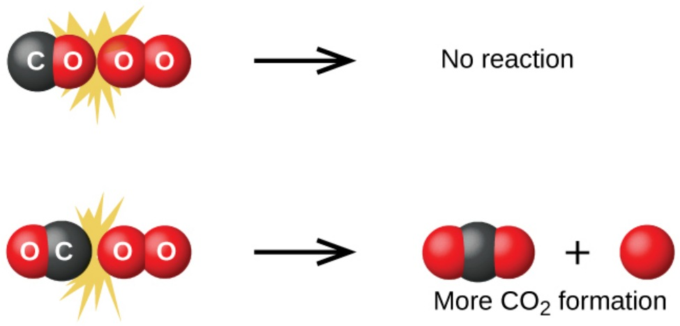
**Figure 12.13** Illustrated are two collisions that might take place between carbon monoxide and oxygen molecules. The orientation of the colliding molecules partially determines whether a reaction between the two molecules will occur.

If the collision does take place with the correct orientation, there is still no guarantee that the reaction will proceed to form carbon dioxide. In addition to a proper orientation, the collision must also occur with sufficient energy to result in product formation. When reactant species collide with both proper orientation and adequate energy, they combine to form an unstable species called an **activated complex** or a **transition state**. These species are very short lived and usually undetectable by most analytical instruments. In some cases, sophisticated spectral measurements have been used to observe transition states.

Collision theory explains why most reaction rates increase as concentrations increase. With an increase in the concentration of any reacting substance, the chances for collisions between molecules are increased because there are more molecules per unit of volume. More collisions mean a faster reaction rate, assuming the energy of the collisions is adequate.

### Activation Energy and the Arrhenius Equation

The minimum energy necessary to form a product during a collision between reactants is called the **activation energy (Eₐ)**. How this energy compares to the kinetic energy provided by colliding reactant molecules is a primary factor affecting the rate of a chemical reaction. If the activation energy is much larger than the average kinetic energy of the molecules, the reaction will occur slowly since only a few fast-moving molecules will have enough

reaction rate

$$rate \propto \dfrac{\text{number of collisions}}{\text{time}}$$

energy to react. If the activation energy is much smaller than the average kinetic energy of the molecules, a large fraction of molecules will be adequately energetic and the reaction will proceed rapidly.

Figure 12.14 shows how the energy of a chemical system changes as it undergoes a reaction converting reactants to products according to the equation

$$\text{A} + \text{B} \longrightarrow \text{C} + \text{D}$$

These **reaction diagrams** are widely used in chemical kinetics to illustrate various properties of the reaction of interest. Viewing the diagram from left to right, the system initially comprises reactants only, *A* + B. Reactant molecules with sufficient energy can collide to form a high-energy activated complex or transition state. The unstable transition state can then subsequently decay to yield stable products, *C* + D. The diagram depicts the reaction’s activation energy, Eₐ, as the energy difference between the reactants and the transition state. Using a specific energy, the enthalpy (see chapter on thermochemistry), the enthalpy change of the reaction, ΔH, is estimated as the energy difference between the reactants and products. In this case, the reaction is exothermic (ΔH < 0) since it yields a decrease in system enthalpy.

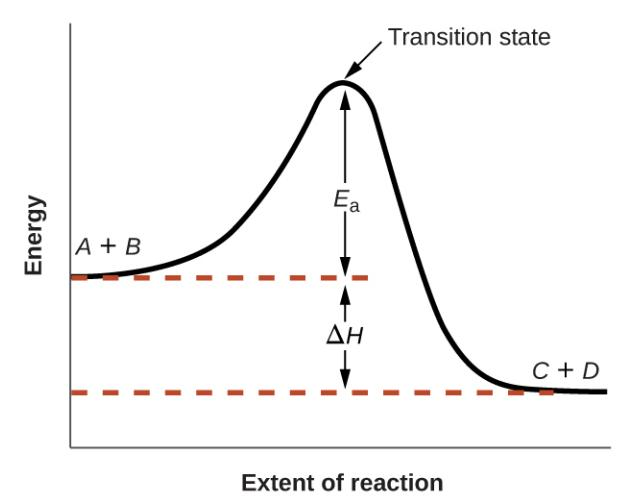
**Figure 12.14** Reaction diagram for the exothermic reaction

The **Arrhenius equation** relates the activation energy and the rate constant, k, for many chemical reactions:

$$k = Ae^{-E_a/RT}$$

In this equation, *R* is the ideal gas constant, which has a value 8.314 J/mol/K, T is temperature on the Kelvin scale, Eₐ is the activation energy in joules per mole, *e* is the constant 2.7183, and *A* is a constant called the **frequency factor**, which is related to the frequency of collisions and the orientation of the reacting molecules.

Postulates of collision theory are nicely accommodated by the Arrhenius equation. The frequency factor, A, reflects how well the reaction conditions favor properly oriented collisions between reactant molecules. An increased probability of effectively oriented collisions results in larger values for *A* and faster reaction rates.

The exponential term, e−Eₐ/RT, describes the effect of activation energy on reaction rate. According to kinetic molecular theory (see chapter on gases), the temperature of matter is a measure of the average kinetic energy of its constituent atoms or molecules. The distribution of energies among the molecules composing a sample of matter at any given temperature is described by the plot shown in Figure 12.15(**a**). Two shaded areas under the curve represent the numbers of molecules possessing adequate energy (RT) to overcome the activation barriers (Eₐ). A lower activation energy results in a greater fraction of adequately energized molecules and a faster reaction.

The exponential term also describes the effect of temperature on reaction rate. A higher temperature represents a correspondingly greater fraction of molecules possessing sufficient energy (RT) to overcome the activation barrier (Eₐ), as shown in Figure 12.15(**b**). This yields a greater value for the rate constant and a correspondingly faster reaction rate.

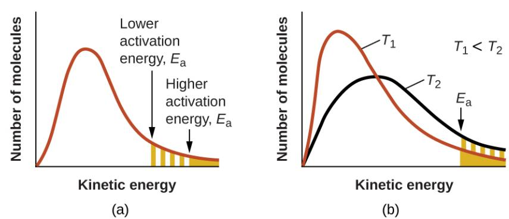
**Figure 12.15** Molecular energy distributions showing numbers of molecules with energies exceeding (a) two different activation energies at a given temperature, and (b) a given activation energy at two different temperatures.

A convenient approach for determining Eₐ for a reaction involves the measurement of *k* at two or more different temperatures and using an alternate version of the Arrhenius equation that takes the form of a linear equation

$$\ln k = \left(\dfrac{-E_a}{R}\right)\left(\dfrac{1}{T}\right) + \ln A$$

$$y = mx + b$$

A plot of ln *k* versus 1/T is linear with a slope equal to −Eₐ/R and a y-intercept equal to ln A.

### Example 12.13 Determination of Eₐ

The variation of the rate constant with temperature for the decomposition of HI(g) to H₂(g) and I₂(g) is given here. What is the activation energy for the reaction?

| T (K) | k (L/mol/s) |
|---|---|
| 555 | 3.52 × 10⁻⁷ |
| 575 | 1.22 × 10⁻⁶ |
| 645 | 8.59 × 10⁻⁵ |
| 700 | 1.16 × 10⁻³ |
| 781 | 3.95 × 10⁻² |

**Solution**

Use the provided data to derive values of 1/T and ln k:

| 1/T (K⁻¹) | ln k |
|---|---|
| 1.80 × 10⁻³ | −14.860 |
| 1.74 × 10⁻³ | −13.617 |
| 1.55 × 10⁻³ | −9.362 |
| 1.43 × 10⁻³ | −6.759 |
| 1.28 × 10⁻³ | −3.231 |

Figure 12.16 is a graph of ln *k* versus 1/T. In practice, the equation of the line (slope and y-intercept) that best fits these plotted data points would be derived using a statistical process called regression. This is helpful for most experimental data because a perfect fit of each data point with the line is rarely encountered. For the data here, the fit is nearly perfect and the slope may be estimated using any two of the provided data pairs. Using the first and last data points permits estimation of the slope.

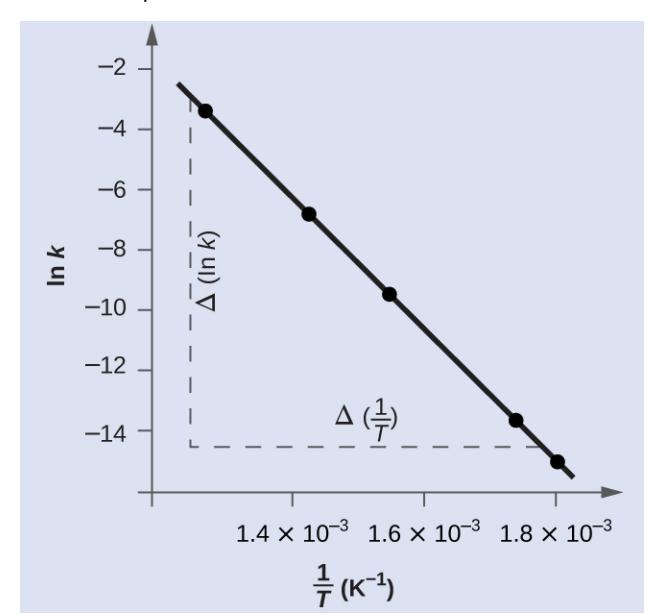
**Figure 12.16** This graph shows the linear relationship between ln k and

$$Slope = \dfrac{\Delta(\ln k)}{\Delta\left(\frac{1}{T}\right)} = \dfrac{(-14.860) - (-3.231)}{(1.80\times10^{-3}\ K^{-1}) - (1.28\times10^{-3}\ K^{-1})} = \dfrac{-11.629}{0.52\times10^{-3}\ K^{-1}} = -2.2\times10^4\ K = -\dfrac{E_a}{R}$$

$$E_a = -slope\times R = -(-2.2\times10^4\ K\times8.314\ J\ mol^{-1}K^{-1})$$

$$= 1.8\times10^5\ J\ mol^{-1}\ \text{or}\ 180\ kJ\ mol^{-1}$$

Alternative approach: A more expedient approach involves deriving activation energy from measurements of the rate constant at just two temperatures. In this approach, the Arrhenius equation is rearranged to a convenient two-point form:

$$\ln\dfrac{k_1}{k_2} = \dfrac{E_a}{R}\left(\dfrac{1}{T_2} - \dfrac{1}{T_1}\right)$$

Rearranging this equation to isolate activation energy yields:

$$E_a = -R\left(\dfrac{\ln k_2 - \ln k_1}{\left(\frac{1}{T_2}\right) - \left(\frac{1}{T_1}\right)}\right)$$

Any two data pairs may be substituted into this equation—for example, the first and last entries from the above data table:

$$E_a = -8.314\ J\ mol^{-1}\ K^{-1}\left(\dfrac{-3.231 - (-14.860)}{1.28\times10^{-3}\ K^{-1} - 1.80\times10^{-3}\ K^{-1}}\right)$$

and the result is Eₐ = 1.8 × 10⁵ J mol⁻¹ or 180 kJ mol⁻¹

This approach yields the same result as the more rigorous graphical approach used above, as expected. In practice, the graphical approach typically provides more reliable results when working with actual experimental data.

**Check Your Learning**

The rate constant for the rate of decomposition of N₂O₅ to NO and O₂ in the gas phase is 1.66 L/mol/s at 650 K and 7.39 L/mol/s at 700 K:

$$\text{2N}_{2}\text{O}_{5}\text{(g)} \longrightarrow \text{4NO(g)} + \text{3O}_{2}\text{(g)}$$

Assuming the kinetics of this reaction are consistent with the Arrhenius equation, calculate the activation energy for this decomposition.

**Answer:**

1.1 × 10⁵ J mol⁻¹ or 110 kJ mol⁻¹

## 12.6 Reaction Mechanisms

**LEARNING OBJECTIVES**

By the end of this section, you will be able to:

-   Distinguish net reactions from elementary reactions (steps)
-   Identify the molecularity of elementary reactions
-   Write a balanced chemical equation for a process given its reaction mechanism
-   Derive the rate law consistent with a given reaction mechanism

Chemical reactions very often occur in a step-wise fashion, involving two or more distinct reactions taking place in sequence. A balanced equation indicates what is reacting and what is produced, but it reveals no details about how the reaction actually takes place. The **reaction mechanism** (or reaction path) provides details regarding the precise, step-by-step process by which a reaction occurs.

The decomposition of ozone, for example, appears to follow a mechanism with two steps:

$$\text{O}_{3}\text{(g)} \longrightarrow \text{O}_{2}\text{(g)} + \text{O}$$

$$\text{O} + \text{O}_{3}\text{(g)} \longrightarrow \text{2O}_{2}\text{(g)}$$

Each of the steps in a reaction mechanism is an **elementary reaction**. These elementary reactions occur precisely as represented in the step equations, and they must sum to yield the balanced chemical equation representing the overall reaction:

$$\text{2O}_{3}\text{(g)} \longrightarrow \text{3O}_{2}\text{(g)}$$

Notice that the oxygen atom produced in the first step of this mechanism is consumed in the second step and therefore does not appear as a product in the overall reaction. Species that are produced in one step and consumed in a subsequent step are called **intermediates**.

While the overall reaction equation for the decomposition of ozone indicates that two molecules of ozone react to give three molecules of oxygen, the mechanism of the reaction does not involve the direct collision and reaction of two ozone molecules. Instead, one O₃ decomposes to yield O₂ and an oxygen atom, and a second O₃ molecule subsequently reacts with the oxygen atom to yield two additional O₂ molecules.

Unlike balanced equations representing an overall reaction, the equations for elementary reactions are explicit representations of the chemical change taking place. The reactant(s) in an elementary reaction’s equation undergo only the bond-breaking and/or making events depicted to yield the product(s). For this reason, the rate law for an elementary reaction may be derived directly from the balanced chemical equation describing the reaction. This is not the case for typical chemical reactions, for which rate laws may be reliably determined only via experimentation.

### Unimolecular Elementary Reactions

The **molecularity** of an elementary reaction is the number of reactant entities (atoms, molecules, or ions). For example, a **unimolecular reaction** involves the reaction of a single reactant entities to produce one or more molecules of product:

$$\text{A} \longrightarrow \text{products}$$

The rate law for a unimolecular reaction is first order:

$$\text{rate} = \text{k[A]}$$

A unimolecular reaction may be one of several elementary reactions in a complex mechanism. For example, the reaction:

$$\text{O}_{3} \longrightarrow \text{O}_{2} + \text{O}$$

illustrates a unimolecular elementary reaction that occurs as one part of a two-step reaction mechanism as described above. However, some unimolecular reactions may be the only step of a single-step reaction mechanism. (In other words, an “overall” reaction may also be an elementary reaction in some cases.) For example, the gas phase decomposition of cyclobutane, C₄H₈, to ethylene, C₂H₄, is represented by the following chemical equation:

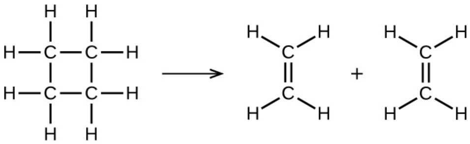

This equation represents the overall reaction observed, and it might also represent a legitimate unimolecular elementary reaction. The rate law predicted from this equation, assuming it is an elementary reaction, turns out to be the same as the rate law derived experimentally for the overall reaction, namely, one showing first-order behavior:

$$rate = -\dfrac{\Delta[C_4H_8]}{\Delta t} = k[C_4H_8]$$

This agreement between observed and predicted rate laws is interpreted to mean that the proposed unimolecular, single-step process is a reasonable mechanism for the butadiene reaction.

### Bimolecular Elementary Reactions

A **bimolecular reaction** involves two reactant entities, for example:

$$\text{A} + \text{B} \longrightarrow \text{products}$$

and

$$\text{2A} \longrightarrow \text{products}$$

For the first type, in which the two reactant molecules are different, the rate law is first-order in *A* and first order in *B* (second-order overall):

$$\text{rate} = \text{k[A][B]}$$

For the second type, in which two identical molecules collide and react, the rate law is second order in A:

$$\text{rate} = \text{k[A][A]} = \text{k[A]}^{2}$$

example is the reaction of nitrogen dioxide with carbon monoxide:

$$\text{NO}_{2}\text{(g)} + \text{CO(g)} \longrightarrow \text{NO(g)} + \text{CO}_{2}\text{(g)}$$

(see Figure 12.17)

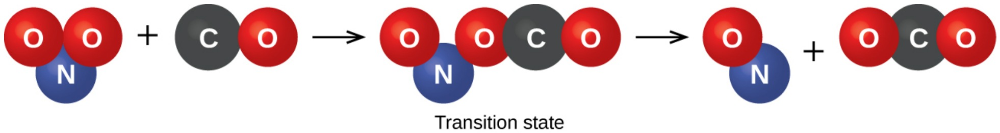
**Figure 12.17** The probable mechanism for the reaction between NO₂ and CO to yield NO and CO₂.

Bimolecular elementary reactions may also be involved as steps in a multistep reaction mechanism. The reaction of atomic oxygen with ozone is the second step of the two-step ozone decomposition mechanism discussed earlier in this section:

$$\text{O(g)} + \text{O}_{3}\text{(g)} \longrightarrow \text{2O}_{2}\text{(g)}$$

### Termolecular Elementary Reactions

An elementary **termolecular reaction** involves the simultaneous collision of three atoms, molecules, or ions. Termolecular elementary reactions are uncommon because the probability of three particles colliding simultaneously is less than one one-thousandth of the probability of two particles colliding. There are, however, a few established termolecular elementary reactions. The reaction of nitric oxide with oxygen appears to involve termolecular steps:

$$\text{2NO} + \text{O}_{2} \longrightarrow \text{2NO}_{2}$$

$$\text{rate} = \text{k[NO]}^{2}\text{[O}_{2}\text{]}$$

Likewise, the reaction of nitric oxide with chlorine appears to involve termolecular steps:

$$\text{2NO} + \text{Cl}_{2} \longrightarrow \text{2NOCl}$$

$$\text{rate} = \text{k[NO]}^{2}\text{[Cl}_{2}\text{]}$$

### Relating Reaction Mechanisms to Rate Laws

It’s often the case that one step in a multistep reaction mechanism is significantly slower than the others. Because a reaction cannot proceed faster than its slowest step, this step will limit the rate at which the overall reaction occurs. The slowest step is therefore called the **rate-limiting step** (or rate-determining step) of the reaction.

**Figure 12.18** A cattle chute is a nonchemical example of a rate-determining step. Cattle can only be moved from one holding pen to another as quickly as one animal can make its way through the chute. (credit: Loren Kerns)

As described earlier, rate laws may be derived directly from the chemical equations for elementary reactions. This is not the case, however, for ordinary chemical reactions. The balanced equations most often encountered represent the overall change for some chemical system, and very often this is the result of some multistep reaction mechanisms. In every case, the rate law must be determined from experimental data and the reaction mechanism

subsequently deduced from the rate law (and sometimes from other data). The reaction of NO₂ and CO provides an illustrative example:

$$\text{NO}_{2}\text{(g)} + \text{CO(g)} \longrightarrow \text{CO}_{2}\text{(g)} + \text{NO(g)}$$

For temperatures above 225 °C, the rate law has been found to be:

$$\text{rate} = \text{k[NO}_{2}\text{][CO]}$$

The reaction is first order with respect to NO₂ and first-order with respect to CO. This is consistent with a single-step bimolecular mechanism and it is possible that this is the mechanism for this reaction at high temperatures.

At temperatures below 225 °C, the reaction is described by a rate law that is second order with respect to NO₂:

$$\text{rate} = \text{k[NO}_{2}\text{]}^{2}$$

This rate law is not consistent with the single-step mechanism, but is consistent with the following two-step mechanism:

$$\text{NO}_{2}\text{(g)} + \text{NO}_{2}\text{(g)} \longrightarrow \text{NO}_{3}\text{(g)} + \text{NO(g)} \text{(slow)}$$

$$\text{NO}_{3}\text{(g)} + \text{CO(g)} \longrightarrow \text{NO}_{2}\text{(g)} + \text{CO}_{2}\text{(g)} \text{(fast)}$$

The rate-determining (slower) step gives a rate law showing second-order dependence on the NO₂ concentration, and the sum of the two equations gives the net overall reaction.

In general, when the rate-determining (slower) step is the first step in a mechanism, the rate law for the overall reaction is the same as the rate law for this step. However, when the rate-determining step is preceded by a step involving a rapidly reversible reaction the rate law for the overall reaction may be more difficult to derive.

As discussed in several chapters of this text, a reversible reaction is at equilibrium when the rates of the forward and reverse processes are equal. Consider the reversible elementary reaction in which NO dimerizes to yield an intermediate species N₂O₂. When this reaction is at equilibrium:

$$NO + NO \rightleftharpoons N_2O_2$$

$$rate_{forward} = rate_{reverse}$$

$$k_1[NO]^2 = k_{-1}[N_2O_2]$$

This expression may be rearranged to express the concentration of the intermediate in terms of the reactant NO:

$$\left(\dfrac{k_1[NO]^2}{k_{-1}}\right) = [N_2O_2]$$

Since intermediate species concentrations are not used in formulating rate laws for overall reactions, this approach is sometimes necessary, as illustrated in the following example exercise.

### Example 12.14 Deriving a Rate Law from a Reaction Mechanism

The two-step mechanism below has been proposed for a reaction between nitrogen monoxide and molecular chlorine:

$$\text{Step} \text{1:} \text{NO(g)} + \text{Cl}_{2}\text{(g)} \rightleftharpoons \text{NOCl}_{2}\text{(g)} \text{(fast)}$$

$$\text{Step} \text{2:} \text{NOCl}_{2}\text{(g)} + \text{NO(g)} \longrightarrow \text{2NOCl(g)} \text{(slow)}$$

Use this mechanism to derive the equation and predicted rate law for the overall reaction.

**Solution**

The equation for the overall reaction is obtained by adding the two elementary reactions:

$$\text{2NO(g)} + \text{Cl}_{2}\text{(g)} \longrightarrow \text{2NOCl(g)}$$

To derive a rate law from this mechanism, first write rate laws for each of the two steps.

$$\text{rate}_{1} = \text{k}_{1}\text{[NO][Cl}_{2}\text{]} \text{for} \text{the} \text{forward} \text{reaction} \text{of} \text{step} \text{1}$$

$$\text{rate}_{-1} = \text{k}_{-1}\text{[NOCl}_{2}\text{]} \text{for} \text{the} \text{reverse} \text{reaction} \text{of} \text{step} \text{1}$$

$$\text{rate}_{2} = \text{k}_{2}\text{[NOCl}_{2}\text{][NO]} \text{for} \text{step} \text{2}$$

Step 2 is the rate-determining step, and so the rate law for the overall reaction should be the same as for this step. However, the step 2 rate law, as written, contains an intermediate species concentration, \[NOCl₂\]. To remedy this, use the first step’s rate laws to derive an expression for the intermediate concentration in terms of the reactant concentrations.

Assuming step 1 is at equilibrium:

$$rate_1 = rate_{-1}$$

$$k_1[NO][Cl_2] = k_{-1}[NOCl_2]$$

$$[NOCl_2] = \left(\dfrac{k_1}{k_{-1}}\right)[NO][Cl_2]$$

Substituting this expression into the rate law for step 2 yields:

$$rate_2 = rate_{overall} = \left(\dfrac{k_2k_1}{k_{-1}}\right)[NO]^2[Cl_2]$$

**Check Your Learning**

The first step of a proposed multistep mechanism is:

$$\text{F}_{2}\text{(g)} \rightleftharpoons \text{2F(g)} \text{(fast)}$$

Derive the equation relating atomic fluorine concentration to molecular fluorine concentration.

**Answer:**

$$[F] = \sqrt{\dfrac{k_1[F_2]}{k_{-1}}}$$

## 12.7 Catalysis

**LEARNING OBJECTIVES**

By the end of this section, you will be able to:

-   Explain the function of a catalyst in terms of reaction mechanisms and potential energy diagrams
-   List examples of catalysis in natural and industrial processes

Among the factors affecting chemical reaction rates discussed earlier in this chapter was the presence of a catalyst, a substance that can increase the reaction rate without being consumed in the reaction. The concepts introduced in the previous section on reaction mechanisms provide the basis for understanding how catalysts are able to accomplish this very important function.

Figure 12.19 shows reaction diagrams for a chemical process in the absence and presence of a catalyst. Inspection of the diagrams reveals several traits of these reactions. Consistent with the fact that the two diagrams represent the same overall reaction, both curves begin and end at the same energies (in this case, because products are more energetic than reactants, the reaction is endothermic). The reaction mechanisms, however, are clearly different. The uncatalyzed reaction proceeds via a one-step mechanism (one transition state observed), whereas the catalyzed reaction follows a two-step mechanism (two transition states observed) with a notably lesser activation energy. This difference illustrates the means by which a catalyst functions to accelerate reactions, namely, by providing an alternative reaction mechanism with a lower activation energy. Although the catalyzed reaction mechanism for a reaction needn’t necessarily involve a different number of steps than the uncatalyzed mechanism, it must provide a reaction path whose rate determining step is faster (lower Eₐ).

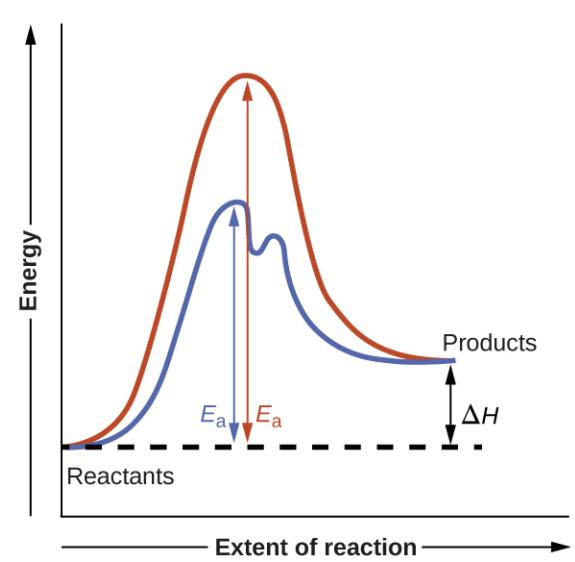
**Figure 12.19** Reaction diagrams for an endothermic process in the absence (red curve) and presence (blue curve) of a catalyst. The catalyzed pathway involves a two-step mechanism (note the presence of two transition states) and an intermediate species (represented by the valley between the two transitions states).

### Example 12.15 Reaction Diagrams for Catalyzed Reactions

The two reaction diagrams here represent the same reaction: one without a catalyst and one with a catalyst. Estimate the activation energy for each process, and identify which one involves a catalyst.

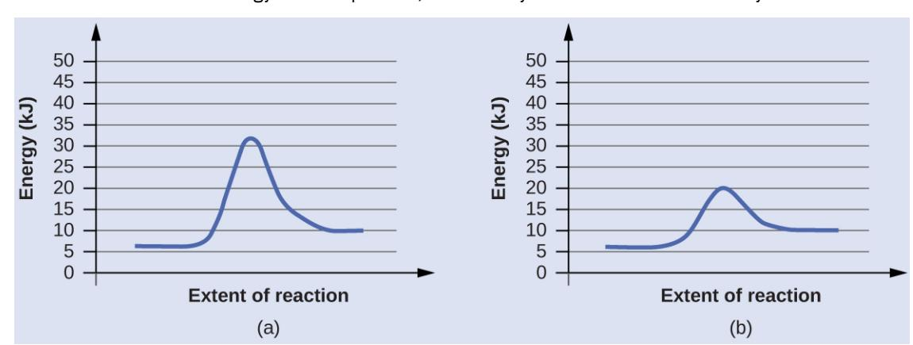

**Solution**

Activation energies are calculated by subtracting the reactant energy from the transition state energy.

$$\text{diagram (a): } E_a = 32\ \text{kJ} - 6\ \text{kJ} = 26\ \text{kJ}$$

$$\text{diagram (b): } E_a = 20\ \text{kJ} - 6\ \text{kJ} = 14\ \text{kJ}$$

The catalyzed reaction is the one with lesser activation energy, in this case represented by diagram b.

**Check Your Learning**

Reaction diagrams for a chemical process with and without a catalyst are shown below. Both reactions involve a two-step mechanism with a rate-determining first step. Compute activation energies for the first step of each mechanism, and identify which corresponds to the catalyzed reaction. How do the second steps of these two mechanisms compare?

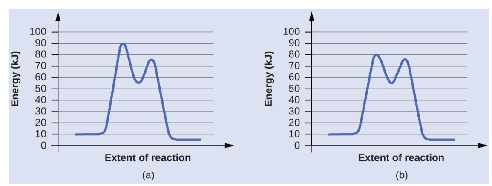

**Answer:**

For the first step, Eₐ = 80 kJ for (a) and 70 kJ for (b), so diagram (b) depicts the catalyzed reaction. Activation energies for the second steps of both mechanisms are the same, 20 kJ.

### Homogeneous Catalysts

A **homogeneous catalyst** is present in the same phase as the reactants. It interacts with a reactant to form an intermediate substance, which then decomposes or reacts with another reactant in one or more steps to regenerate the original catalyst and form product.

As an important illustration of homogeneous catalysis, consider the earth’s ozone layer. Ozone in the upper atmosphere, which protects the earth from ultraviolet radiation, is formed when oxygen molecules absorb ultraviolet light and undergo the reaction:

$$\text{3O}_{2}\text{(g)} \xrightarrow{\text{hν}} \text{2O}_{3}\text{(g)}$$

Ozone is a relatively unstable molecule that decomposes to yield diatomic oxygen by the reverse of this equation. This decomposition reaction is consistent with the following two-step mechanism:

$$\text{O}_{3} \longrightarrow \text{O}_{2} + \text{O}$$

$$\text{O} + \text{O}_{3} \longrightarrow \text{2O}_{2}$$

A number of substances can catalyze the decomposition of ozone. For example, the nitric oxide-catalyzed decomposition of ozone is believed to occur via the following three-step mechanism:

$$\text{NO(g)} + \text{O}_{3}\text{(g)} \longrightarrow \text{NO}_{2}\text{(g)} + \text{O}_{2}\text{(g)}$$

$$\text{O}_{3}\text{(g)} \longrightarrow \text{O}_{2}\text{(g)} + \text{O(g)}$$

$$\text{NO}_{2}\text{(g)} + \text{O(g)} \longrightarrow \text{NO(g)} + \text{O}_{2}\text{(g)}$$

As required, the overall reaction is the same for both the two-step uncatalyzed mechanism and the three-step NO catalyzed mechanism:

$$\text{2O}_{3}\text{(g)} \longrightarrow \text{3O}_{2}\text{(g)}$$

Notice that NO is a reactant in the first step of the mechanism and a product in the last step. This is another characteristic trait of a catalyst: Though it participates in the chemical reaction, it is not consumed by the reaction.

### PORTRAIT OF A CHEMIST
**Mario J. Molina**

The 1995 Nobel Prize in Chemistry was shared by Paul J. Crutzen, Mario J. Molina (Figure 12.20), and F. Sherwood Rowland “for their work in atmospheric chemistry, particularly concerning the formation and decomposition of ozone.” ¹ Molina, a Mexican citizen, carried out the majority of his work at the Massachusetts Institute of Technology (MIT).

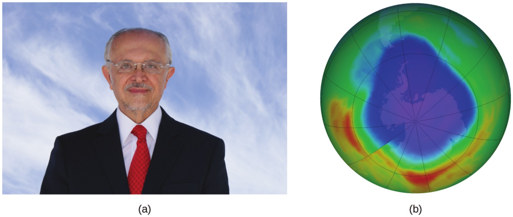
**Figure 12.20** (a) Mexican chemist Mario Molina (1943 – 2020) shared the Nobel Prize in Chemistry in 1995 for his research on (b) the Antarctic ozone hole. (credit a: courtesy of Mario Molina; credit b: modification of work by NASA)

In 1974, Molina and Rowland published a paper in the journal Nature detailing the threat of chlorofluorocarbon gases to the stability of the ozone layer in earth’s upper atmosphere. The ozone layer protects earth from solar radiation by absorbing ultraviolet light. As chemical reactions deplete the amount of ozone in the upper atmosphere, a measurable “hole” forms above Antarctica, and an increase in the amount of solar ultraviolet radiation— strongly linked to the prevalence of skin cancers—reaches earth’s surface. The work of Molina and Rowland was instrumental in the adoption of the Montreal Protocol, an international treaty signed in 1987 that successfully began phasing out production of chemicals linked to ozone destruction.

Molina and Rowland demonstrated that chlorine atoms from human-made chemicals can catalyze ozone destruction in a process similar to that by which NO accelerates the depletion of ozone. Chlorine atoms are generated when chlorocarbons or chlorofluorocarbons—once widely used as refrigerants and propellants—are photochemically decomposed by ultraviolet light or react with hydroxyl radicals. A sample mechanism is shown here using methyl chloride:

CH₃Cl + OH ⟶ Cl + other products

Chlorine radicals break down ozone and are regenerated by the following catalytic cycle:

$$\text{Cl} + \text{O}_{3} \longrightarrow \text{ClO} + \text{O}_{2}$$

$$\text{ClO} + \text{O} \longrightarrow \text{Cl} + \text{O}_{2}$$

$$\text{overall} \text{Reaction:} \text{O}_{3} + \text{O} \longrightarrow \text{2O}_{2}$$

A single monatomic chlorine can break down thousands of ozone molecules. Luckily, the majority of atmospheric chlorine exists as the catalytically inactive forms Cl₂ and ClONO₂.

After receiving his portion of the Nobel Prize, Molina continued his work in atmospheric chemistry at MIT.

¹ “The Nobel Prize in Chemistry 1995,” NobelPrize.org, accessed February 18, 2015, http://www.nobelprize.org/nobel_prizes/chemistry/laureates/1995/.

### HOW SCIENCES INTERCONNECT
**Glucose-6-Phosphate Dehydrogenase Deficiency**

Enzymes in the human body act as catalysts for important chemical reactions in cellular metabolism. As such, a deficiency of a particular enzyme can translate to a life-threatening disease. G6PD (glucose-6-phosphate dehydrogenase) deficiency, a genetic condition that results in a shortage of the enzyme glucose-6-phosphate dehydrogenase, is the most common enzyme deficiency in humans. This enzyme, shown in Figure 12.21, is the rate-limiting enzyme for the metabolic pathway that supplies NADPH to cells (Figure 12.22).

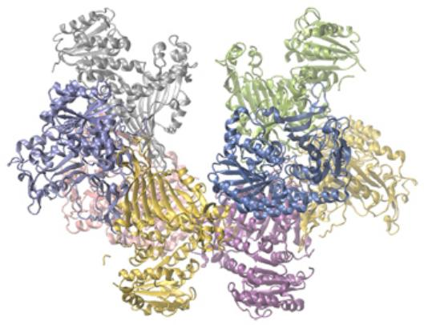
**Figure 12.21** Glucose-6-phosphate dehydrogenase is a rate-limiting enzyme for the metabolic pathway that supplies NADPH to cells.

A disruption in this pathway can lead to reduced glutathione in red blood cells; once all glutathione is consumed, enzymes and other proteins such as hemoglobin are susceptible to damage. For example, hemoglobin can be metabolized to bilirubin, which leads to jaundice, a condition that can become severe. People who suffer from G6PD deficiency must avoid certain foods and medicines containing chemicals that can trigger damage their glutathione deficient red blood cells.

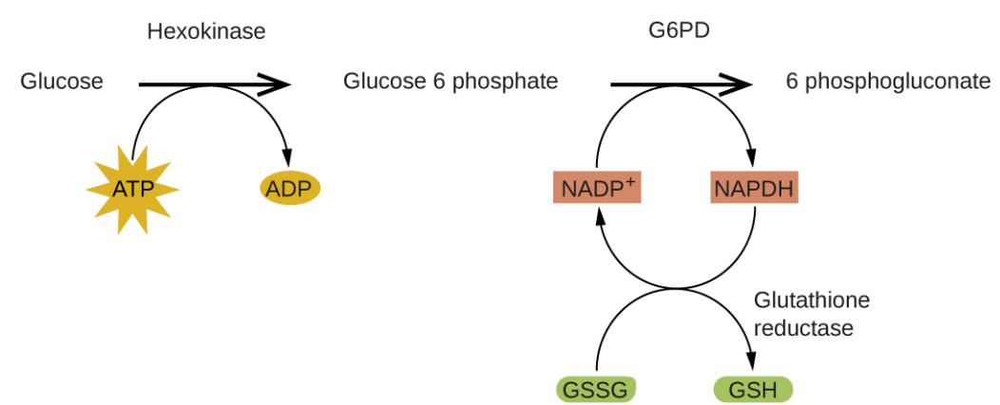
**Figure 12.22** In the mechanism for the pentose phosphate pathway, G6PD catalyzes the reaction that regulates NADPH, a co-enzyme that regulates glutathione, an antioxidant that protects red blood cells and other cells from oxidative damage.

### Heterogeneous Catalysts

A **heterogeneous catalyst** is a catalyst that is present in a different phase (usually a solid) than the reactants. Such catalysts generally function by furnishing an active surface upon which a reaction can occur. Gas and liquid phase reactions catalyzed by heterogeneous catalysts occur on the surface of the catalyst rather than within the gas or liquid phase.

Heterogeneous catalysis typically involves the following processes:

1. Adsorption of the reactant(s) onto the surface of the catalyst

2. Activation of the adsorbed reactant(s)

3. Reaction of the adsorbed reactant(s)

4. Desorption of product(s) from the surface of the catalyst

Figure 12.23 illustrates the steps of a mechanism for the reaction of compounds containing a carbon–carbon double bond with hydrogen on a nickel catalyst. Nickel is the catalyst used in the hydrogenation of polyunsaturated fats and oils (which contain several carbon–carbon double bonds) to produce saturated fats and oils (which contain only carbon–carbon single bonds).

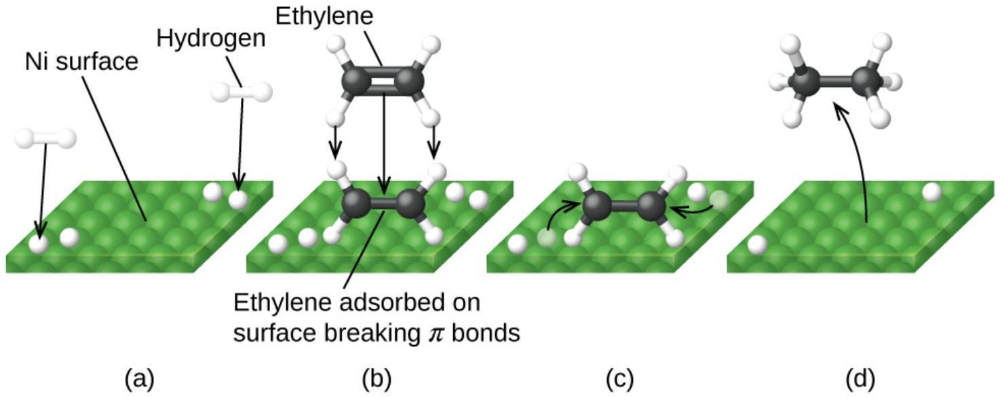
**Figure 12.23** Mechanism for the Ni-catalyzed reaction (a) Hydrogen is adsorbed on the surface, breaking the H–H bonds and forming Ni–H bonds. (b) Ethylene is adsorbed on the surface, breaking the C–C π-bond and forming Ni–C bonds. (c) Atoms diffuse across the surface and form new C–H bonds when they collide. (d) C₂H₆ molecules desorb from the Ni surface.

Many important chemical products are prepared via industrial processes that use heterogeneous catalysts, including ammonia, nitric acid, sulfuric acid, and methanol. Heterogeneous catalysts are also used in the catalytic converters found on most gasoline-powered automobiles (Figure 12.24).

### CHEMISTRY IN EVERYDAY LIFE
**Automobile Catalytic Converters**

Scientists developed catalytic converters to reduce the amount of toxic emissions produced by burning gasoline in internal combustion engines. By utilizing a carefully selected blend of catalytically active metals, it is possible to effect complete combustion of all carbon-containing compounds to carbon dioxide while also reducing the output of nitrogen oxides. This is particularly impressive when we consider that one step involves adding more oxygen to the molecule and the other involves removing the oxygen (Figure 12.24).

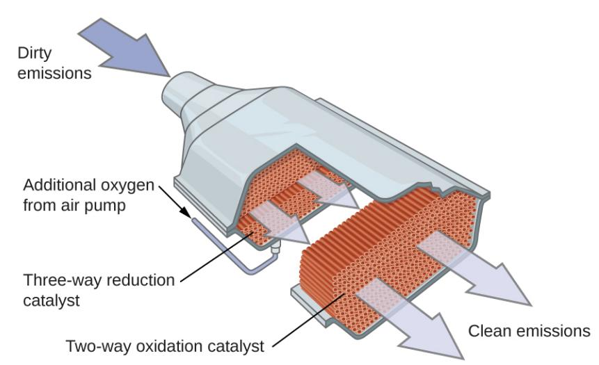
**Figure 12.24** A catalytic converter allows for the combustion of all carbon-containing compounds to carbon dioxide, while at the same time reducing the output of nitrogen oxide and other pollutants in emissions from gasoline-burning engines.

Most modern, three-way catalytic converters possess a surface impregnated with a platinum-rhodium catalyst, which catalyzes the conversion of nitric oxide into dinitrogen and oxygen as well as the conversion of carbon monoxide and hydrocarbons such as octane into carbon dioxide and water vapor:

$$\text{2NO}_{2}\text{(g)} \longrightarrow \text{N}_{2}\text{(g)} + \text{2O}_{2}\text{(g)}$$

$$\text{2CO(g)} + \text{O}_{2}\text{(g)} \longrightarrow \text{2CO}_{2}\text{(g)}$$

$$\text{2C}_{8}\text{H}_{18}\text{(g)} + \text{25O}_{2}\text{(g)} \longrightarrow \text{16CO}_{2}\text{(g)} + \text{18H}_{2}\text{O(g)}$$

In order to be as efficient as possible, most catalytic converters are preheated by an electric heater. This ensures that the metals in the catalyst are fully active even before the automobile exhaust is hot enough to maintain appropriate reaction temperatures.

**LINK TO LEARNING**

The University of California at Davis’ “ChemWiki” provides a thorough explanation [(http://openstax.org/l/](http://openstax.org/l/16catconvert) [16catconvert)](http://openstax.org/l/16catconvert) of how catalytic converters work.

### HOW SCIENCES INTERCONNECT

### Enzyme Structure and Function

The study of enzymes is an important interconnection between biology and chemistry. Enzymes are usually proteins (polypeptides) that help to control the rate of chemical reactions between biologically important compounds, particularly those that are involved in cellular metabolism. Different classes of enzymes perform a variety of functions, as shown in Table 12.3.

**Table 12.3** Classes of Enzymes and Their Functions

| Class | Function |
|---|---|
| oxidoreductases | redox reactions |
| transferases | transfer of functional groups |
| hydrolases | hydrolysis reactions |
| lyases | group elimination to form double bonds |
| isomerases | isomerization |
| ligases | bond formation with ATP hydrolysis |

Enzyme molecules possess an active site, a part of the molecule with a shape that allows it to bond to a specific substrate (a reactant molecule), forming an enzyme-substrate complex as a reaction intermediate. There are two models that attempt to explain how this active site works. The most simplistic model is referred to as the lock-and-key hypothesis, which suggests that the molecular shapes of the active site and substrate are complementary, fitting together like a key in a lock. The induced fit hypothesis, on the other hand, suggests that the enzyme molecule is flexible and changes shape to accommodate a bond with the substrate. This is not to suggest that an enzyme’s active site is completely malleable, however. Both the lock-and-key model and the induced fit model account for the fact that enzymes can only bind with specific substrates, since in general a particular enzyme only catalyzes a particular reaction (Figure 12.25).

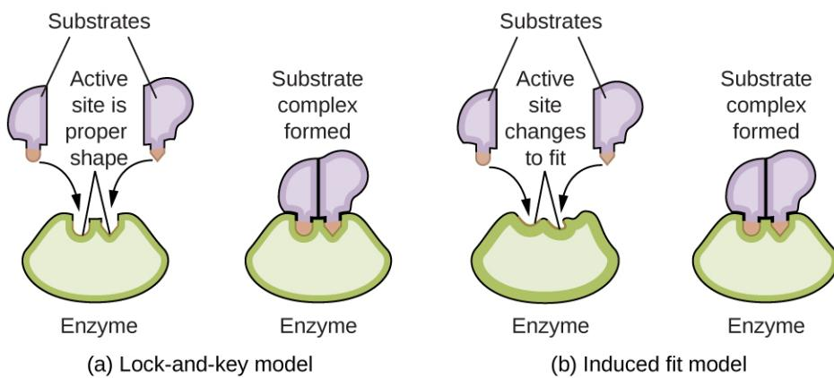
**Figure 12.25** (a) According to the lock-and-key model, the shape of an enzyme’s active site is a perfect fit for the substrate. (b) According to the induced fit model, the active site is somewhat flexible, and can change shape in order to bond with the substrate.

**LINK TO LEARNING**

The Royal Society of Chemistry [(http://openstax.org/l/16enzymes)](http://openstax.org/l/16enzymes) provides an excellent introduction to enzymes for students and teachers.

## Key Terms

**activated complex** (also, transition state) unstable combination of reactant species formed during a chemical reaction

**activation energy (Eₐ)** minimum energy necessary in order for a reaction to take place

**Arrhenius equation** mathematical relationship between a reaction’s rate constant, activation energy, and temperature

**average rate** rate of a chemical reaction computed as the ratio of a measured change in amount or concentration of substance to the time interval over which the change occurred

**bimolecular reaction** elementary reaction involving two reactant entities

**catalyst** substance that increases the rate of a reaction without itself being consumed by the reaction

**collision theory** model that emphasizes the energy and orientation of molecular collisions to explain and predict reaction kinetics

**elementary reaction** reaction that takes place in a single step, precisely as depicted in its chemical equation

**frequency factor (A)** proportionality constant in the Arrhenius equation, related to the relative number of collisions having an orientation capable of leading to product formation

**half-life of a reaction (t₁/₂)** time required for half of a given amount of reactant to be consumed

**heterogeneous catalyst** catalyst present in a different phase from the reactants, furnishing a surface at which a reaction can occur

**homogeneous catalyst** catalyst present in the same phase as the reactants

**initial rate** instantaneous rate of a chemical reaction at *t* = 0 s (immediately after the reaction has begun)

**instantaneous rate** rate of a chemical reaction at any instant in time, determined by the slope of the line tangential to a graph of concentration as a function of time

**integrated rate law** equation that relates the concentration of a reactant to elapsed time of reaction

**intermediate** entities produced in one step of a reaction mechanism and consumed in a subsequent step

**method of initial rates** common experimental approach to determining rate laws that involves measuring reaction rates at varying initial reactant concentrations

**molecularity** number of reactant entities involved in an elementary reaction

**overall reaction order** sum of the reaction orders for each substance represented in the rate law

**rate constant (k)** proportionality constant in a rate law

**rate expression** mathematical representation defining reaction rate as change in amount, concentration, or pressure of reactant or product species per unit time

**rate law** (also, rate equation) (also, differential rate laws) mathematical equation showing the dependence of reaction rate on the rate constant and the concentration of one or more reactants

**rate of reaction** measure of the speed at which a chemical reaction takes place

**rate-determining step** (also, rate-limiting step) slowest elementary reaction in a reaction mechanism; determines the rate of the overall reaction

**reaction diagram** used in chemical kinetics to illustrate various properties of a reaction

**reaction mechanism** stepwise sequence of elementary reactions by which a chemical change takes place

**reaction order** value of an exponent in a rate law (for example, zero order for 0, first order for 1, second order for 2, and so on)

**termolecular reaction** elementary reaction involving three reactant entities

**unimolecular reaction** elementary reaction involving a single reactant entity

## Key Equations

relative reaction rates for $a\text{A} \longrightarrow b\text{B}$: $-\frac{1}{a}\frac{\Delta[A]}{\Delta t} = \frac{1}{b}\frac{\Delta[B]}{\Delta t}$

integrated rate law for zero-order reactions: $[A]_t = -kt + [A]_0$,

half-life for a zero-order reaction $t_{1/2} = \frac{[A]_0}{2k}$

integrated rate law for first-order reactions: $\ln[A]_t = -kt + \ln[A]_0$,

half-life for a first-order reaction $t_{1/2} = \frac{0.693}{k}$

integrated rate law for second-order reactions: $\frac{1}{[A]_t} = kt + \frac{1}{[A]_0}$,

half-life for a second-order reaction $t_{1/2} = \frac{1}{[A]_0 k}$

$$k = Ae^{-E_a/RT}$$

$$\ln k = \left(\frac{-E_a}{R}\right)\left(\frac{1}{T}\right) + \ln A$$

$$\ln\frac{k_1}{k_2} = \frac{E_a}{R}\left(\frac{1}{T_2} - \frac{1}{T_1}\right)$$

## Summary

### 12.1 Chemical Reaction Rates

The rate of a reaction can be expressed either in terms of the decrease in the amount of a reactant or the increase in the amount of a product per unit time. Relations between different rate expressions for a given reaction are derived directly from the stoichiometric coefficients of the equation representing the reaction.

### 12.2 Factors Affecting Reaction Rates

The rate of a chemical reaction is affected by several parameters. Reactions involving two phases proceed more rapidly when there is greater surface area contact. If temperature or reactant concentration is increased, the rate of a given reaction generally increases as well. A catalyst can increase the rate of a reaction by providing an alternative pathway with a lower activation energy.

### 12.3 Rate Laws

Rate laws (differential rate laws) provide a mathematical description of how changes in the concentration of a substance affect the rate of a chemical reaction. Rate laws are determined experimentally and cannot be predicted by reaction stoichiometry. The order of reaction describes how much a change in the concentration of each substance affects the overall rate, and the overall order of a reaction is the sum of the orders for each substance present in the reaction. Reaction orders are typically first order, second order, or zero order, but fractional and even negative orders are possible.

### 12.4 Integrated Rate Laws

Integrated rate laws are mathematically derived from differential rate laws, and they describe the time dependence of reactant and product concentrations.

The half-life of a reaction is the time required to decrease the amount of a given reactant by one-half. A reaction’s half-life varies with rate constant and, for some reaction orders, reactant concentration. The half-life of a zero-order reaction decreases as the initial concentration of the reactant in the reaction decreases. The half-life of a first-order reaction is independent of concentration, and the half-life of a second-order reaction decreases as the concentration increases.

### 12.5 Collision Theory

Chemical reactions typically require collisions between reactant species. These reactant collisions must be of proper orientation and sufficient energy in order to result in product formation. Collision theory provides a simple but effective explanation for the effect of many experimental parameters on reaction rates. The Arrhenius equation describes the relation between a reaction’s rate constant, activation energy, temperature, and dependence on collision orientation.

### 12.6 Reaction Mechanisms

The sequence of individual steps, or elementary reactions, by which reactants are converted into products during the course of a reaction is called the reaction mechanism. The molecularity of an elementary reaction is the number of reactant entities involved, typically one (unimolecular), two (bimolecular), or, less commonly, three (termolecular). The overall rate of a reaction is determined by the rate of the slowest in its mechanism, called the rate-determining step. Unimolecular elementary reactions have first-order rate laws, while bimolecular elementary reactions have second-order rate laws. By comparing the rate laws derived from a reaction mechanism to that determined experimentally, the mechanism may be deemed either incorrect or plausible.

### 12.7 Catalysis

Catalysts affect the rate of a chemical reaction by altering its mechanism to provide a lower activation energy. Catalysts can be homogenous (in the same phase as the reactants) or heterogeneous (a different phase than the reactants).

## Exercises

### 12.1 Chemical Reaction Rates

**1.** What is the difference between average rate, initial rate, and instantaneous rate?

**2.** Ozone decomposes to oxygen according to the equation $\text{2O}_{3}\text{(g)} \longrightarrow \text{3O}_{2}\text{(g)}$. Write the equation that relates the rate expressions for this reaction in terms of the disappearance of O₃ and the formation of oxygen.

**3.** In the nuclear industry, chlorine trifluoride is used to prepare uranium hexafluoride, a volatile compound of uranium used in the separation of uranium isotopes. Chlorine trifluoride is prepared by the reaction $\text{Cl}_{2}\text{(g)} + \text{3F}_{2}\text{(g)} \longrightarrow \text{2ClF}_{3}\text{(g)}$. Write the equation that relates the rate expressions for this reaction in terms of the disappearance of Cl₂ and F₂ and the formation of ClF₃.

**4.** A study of the rate of dimerization of C₄H₆ gave the data shown in the table:

$\text{2C}_{4}\text{H}_{6} \longrightarrow \text{C}_{8}\text{H}_{12}$

| Time (s) | 0 | 1600 | 3200 | 4800 | 6200 |
|---|---|---|---|---|---|
| [C₄H₆] (*M*) | $1.00 \times 10^{-2}$ | $5.04 \times 10^{-3}$ | $3.37 \times 10^{-3}$ | $2.53 \times 10^{-3}$ | $2.08 \times 10^{-3}$ |
  - (a) Determine the average rate of dimerization between 0 s and 1600 s, and between 1600 s and 3200 s.
  - (b) Estimate the instantaneous rate of dimerization at 3200 s from a graph of time versus [C₄H₆]. What are the units of this rate?
  - (c) Determine the average rate of formation of C₈H₁₂ at 1600 s and the instantaneous rate of formation at 3200 s from the rates found in parts (a) and (b).

**5.** A study of the rate of the reaction represented as $\text{2A} \longrightarrow \text{B}$ gave the following data:

| Time (s) | 0.0 | 5.0 | 10.0 | 15.0 | 20.0 | 25.0 | 35.0 |
|---|---|---|---|---|---|---|---|
| [*A*] (*M*) | 1.00 | 0.775 | 0.625 | 0.465 | 0.360 | 0.285 | 0.230 |
  - (a) Determine the average rate of disappearance of *A* between 0.0 s and 10.0 s, and between 10.0 s and 20.0 s.
  - (b) Estimate the instantaneous rate of disappearance of *A* at 15.0 s from a graph of time versus [*A*]. What are the units of this rate?
  - (c) Use the rates found in parts (a) and (b) to determine the average rate of formation of *B* between 0.00 s and 10.0 s, and the instantaneous rate of formation of *B* at 15.0 s.

**6.** Consider the following reaction in aqueous solution:

$\text{5Br}^{-}\text{(aq)} + \text{BrO}_{3}^{-}\text{(aq)} + \text{6H}^{+}\text{(aq)} \longrightarrow \text{3Br}_{2}\text{(aq)} + \text{3H}_{2}\text{O(l)}$

If the rate of disappearance of Br⁻(aq) at a particular moment during the reaction is 3.5 × 10⁻⁴ mol L⁻¹ s⁻¹, what is the rate of appearance of Br₂(aq) at that moment?

### 12.2 Factors Affecting Reaction Rates

**7.** Describe the effect of each of the following on the rate of the reaction of magnesium metal with a solution of hydrochloric acid: the molarity of the hydrochloric acid, the temperature of the solution, and the size of the pieces of magnesium.

**8.** Explain why an egg cooks more slowly in boiling water in Denver than in New York City. (Hint: Consider the effect of temperature on reaction rate and the effect of pressure on boiling point.)

**9.** Go to the PhET Reactions & Rates (http://openstax.org/l/16PHETreaction) interactive. Use the Single Collision tab to represent how the collision between monatomic oxygen (O) and carbon monoxide (CO) results in the breaking of one bond and the formation of another. Pull back on the red plunger to release the atom and observe the results. Then, click on “Reload Launcher” and change to “Angled shot” to see the difference.
  - (a) What happens when the angle of the collision is changed?
  - (b) Explain how this is relevant to rate of reaction.

**10.** In the PhET Reactions & Rates (http://openstax.org/l/16PHETreaction) interactive, use the “Many Collisions” tab to observe how multiple atoms and molecules interact under varying conditions. Select a molecule to pump into the chamber. Set the initial temperature and select the current amounts of each reactant. Select “Show bonds” under Options. How is the rate of the reaction affected by concentration and temperature?

**11.** In the PhET Reactions & Rates (http://openstax.org/l/16PHETreaction) interactive, on the Many Collisions tab, set up a simulation with 15 molecules of A and 10 molecules of BC. Select “Show Bonds” under Options.
  - (a) Leave the Initial Temperature at the default setting. Observe the reaction. Is the rate of reaction fast or slow?
  - (b) Click “Pause” and then “Reset All,” and then enter 15 molecules of A and 10 molecules of BC once again. Select “Show Bonds” under Options. This time, increase the initial temperature until, on the graph, the total average energy line is completely above the potential energy curve. Describe what happens to the reaction.

### 12.3 Rate Laws

**12.** How do the rate of a reaction and its rate constant differ?

**13.** Doubling the concentration of a reactant increases the rate of a reaction four times. With this knowledge, answer the following questions:
  - (a) What is the order of the reaction with respect to that reactant?
  - (b) Tripling the concentration of a different reactant increases the rate of a reaction three times. What is the order of the reaction with respect to that reactant?

**14.** Tripling the concentration of a reactant increases the rate of a reaction nine-fold. With this knowledge, answer the following questions:
  - (a) What is the order of the reaction with respect to that reactant?
  - (b) Increasing the concentration of a reactant by a factor of four increases the rate of a reaction four-fold. What is the order of the reaction with respect to that reactant?

**15.** How will the rate of reaction change for the process: $\text{CO(g)} + \text{NO}_{2}\text{(g)} \longrightarrow \text{CO}_{2}\text{(g)} + \text{NO(g)}$ if the rate law for the reaction is $\text{rate} = k[\text{NO}_2]^2$?
  - (a) Decreasing the pressure of NO₂ from 0.50 atm to 0.250 atm.
  - (b) Increasing the concentration of CO from 0.01 *M* to 0.03 *M*.

**16.** How will each of the following affect the rate of the reaction: $\text{CO(g)} + \text{NO}_{2}\text{(g)} \longrightarrow \text{CO}_{2}\text{(g)} + \text{NO(g)}$ if the rate law for the reaction is $\text{rate} = k[\text{NO}_2][\text{CO}]$?
  - (a) Increasing the pressure of NO₂ from 0.1 atm to 0.3 atm
  - (b) Increasing the concentration of CO from 0.02 *M* to 0.06 *M*.

**17.** Regular flights of supersonic aircraft in the stratosphere are of concern because such aircraft produce nitric oxide, NO, as a byproduct in the exhaust of their engines. Nitric oxide reacts with ozone, and it has been suggested that this could contribute to depletion of the ozone layer. The reaction $\text{NO} + \text{O}_{3} \longrightarrow \text{NO}_{2} + \text{O}_{2}$ is first order with respect to both NO and O₃ with a rate constant of 2.20 × 10⁷ L/mol/s. What is the instantaneous rate of disappearance of NO when [NO] = 3.3 × 10⁻⁶ *M* and [O₃] = 5.9 × 10⁻⁷ *M*?

**18.** Radioactive phosphorus is used in the study of biochemical reaction mechanisms because phosphorus atoms are components of many biochemical molecules. The location of the phosphorus (and the location of the molecule it is bound in) can be detected from the electrons (beta particles) it produces:

$${}^{32}_{15}\text{P} \longrightarrow {}^{32}_{16}\text{S} + \text{e}^-$$

$$\text{rate} = 4.85 \times 10^{-2}\ \text{day}^{-1}\ [{}^{32}\text{P}]$$

What is the instantaneous rate of production of electrons in a sample with a phosphorus concentration of 0.0033 *M*?

**19.** The rate constant for the radioactive decay of ¹⁴C is 1.21 × 10⁻⁴ year⁻¹. The products of the decay are nitrogen atoms and electrons (beta particles):

$${}^{14}_{6}\text{C} \longrightarrow {}^{14}_{7}\text{N} + \text{e}^-$$

$$\text{rate} = k[{}^{14}_{6}\text{C}]$$

What is the instantaneous rate of production of N atoms in a sample with a carbon-14 content of 6.5 × 10⁻⁹ *M*?

**20.** The decomposition of acetaldehyde is a second order reaction with a rate constant of 4.71 × 10⁻⁸ L mol⁻¹ s⁻¹. What is the instantaneous rate of decomposition of acetaldehyde in a solution with a concentration of 5.55 × 10⁻⁴ *M*?

**21.** Alcohol is removed from the bloodstream by a series of metabolic reactions. The first reaction produces acetaldehyde; then other products are formed. The following data have been determined for the rate at which alcohol is removed from the blood of an average male, although individual rates can vary by 25–30%. Women metabolize alcohol a little more slowly than men:

| [C₂H₅OH] (*M*) | $4.4 \times 10^{-2}$ | $3.3 \times 10^{-2}$ | $2.2 \times 10^{-2}$ |
|---|---|---|---|
| Rate (mol L⁻¹ h⁻¹) | $2.0 \times 10^{-2}$ | $2.0 \times 10^{-2}$ | $2.0 \times 10^{-2}$ |

Determine the rate law, the rate constant, and the overall order for this reaction.

**22.** Under certain conditions the decomposition of ammonia on a metal surface gives the following data:

| [NH₃] (*M*) | $1.0 \times 10^{-3}$ | $2.0 \times 10^{-3}$ | $3.0 \times 10^{-3}$ |
|---|---|---|---|
| Rate (mol L⁻¹ h⁻¹) | $1.5 \times 10^{-6}$ | $1.5 \times 10^{-6}$ | $1.5 \times 10^{-6}$ |

Determine the rate law, the rate constant, and the overall order for this reaction.

**23.** Nitrosyl chloride, NOCl, decomposes to NO and Cl₂.

$\text{2NOCl(g)} \longrightarrow \text{2NO(g)} + \text{Cl}_{2}\text{(g)}$

Determine the rate law, the rate constant, and the overall order for this reaction from the following data:

| [NOCl] (*M*) | 0.10 | 0.20 | 0.30 |
|---|---|---|---|
| Rate (mol L⁻¹ h⁻¹) | $8.0 \times 10^{-10}$ | $3.2 \times 10^{-9}$ | $7.2 \times 10^{-9}$ |

**24.** From the following data, determine the rate law, the rate constant, and the order with respect to *A* for the reaction $\text{A} \longrightarrow \text{2C}$.

| [*A*] (*M*) | $1.33 \times 10^{-2}$ | $2.66 \times 10^{-2}$ | $3.99 \times 10^{-2}$ |
|---|---|---|---|
| Rate (mol L⁻¹ h⁻¹) | $3.80 \times 10^{-7}$ | $1.52 \times 10^{-6}$ | $3.42 \times 10^{-6}$ |

**25.** Nitrogen monoxide reacts with chlorine according to the equation:

$\text{2NO(g)} + \text{Cl}_{2}\text{(g)} \longrightarrow \text{2NOCl(g)}$

The following initial rates of reaction have been observed for certain reactant concentrations:

| [NO] (mol/L) | [Cl₂] (mol/L) | Rate (mol L⁻¹ h⁻¹) |
|---|---|---|
| 0.50 | 0.50 | 1.14 |
| 1.00 | 0.50 | 4.56 |
| 1.00 | 1.00 | 9.12 |

What is the rate law that describes the rate’s dependence on the concentrations of NO and Cl₂? What is the rate constant? What are the orders with respect to each reactant?

**26.** Hydrogen reacts with nitrogen monoxide to form dinitrogen monoxide (laughing gas) according to the equation:

$\text{H}_{2}\text{(g)} + \text{2NO(g)} \longrightarrow \text{N}_{2}\text{O(g)} + \text{H}_{2}\text{O(g)}$

Determine the rate law, the rate constant, and the orders with respect to each reactant from the following data:

| [NO] (*M*) | 0.30 | 0.60 | 0.60 |
|---|---|---|---|
| [H₂] (*M*) | 0.35 | 0.35 | 0.70 |
| Rate (mol L⁻¹ s⁻¹) | $2.835 \times 10^{-3}$ | $1.134 \times 10^{-2}$ | $2.268 \times 10^{-2}$ |

**27.** For the reaction $\text{A} \longrightarrow \text{B} + \text{C}$, the following data were obtained at 30 °C:

| [*A*] (*M*) | 0.230 | 0.356 | 0.557 |
|---|---|---|---|
| Rate (mol L⁻¹ s⁻¹) | $4.17 \times 10^{-4}$ | $9.99 \times 10^{-4}$ | $2.44 \times 10^{-3}$ |
  - (a) What is the order of the reaction with respect to [*A*], and what is the rate law?
  - (b) What is the rate constant?

**28.** For the reaction $\text{Q} \longrightarrow \text{W} + \text{X}$, the following data were obtained at 30 °C:

| [*Q*]initial (*M*) | 0.170 | 0.212 | 0.357 |
|---|---|---|---|
| Rate (mol L⁻¹ s⁻¹) | $6.68 \times 10^{-3}$ | $1.04 \times 10^{-2}$ | $2.94 \times 10^{-2}$ |
  - (a) What is the order of the reaction with respect to [*Q*], and what is the rate law?
  - (b) What is the rate constant?

**29.** The rate constant for the first-order decomposition at 45 °C of dinitrogen pentoxide, N₂O₅, dissolved in chloroform, CHCl₃, is 6.2 × 10⁻⁴ min⁻¹.

$\text{2N}_{2}\text{O}_{5} \longrightarrow \text{4NO}_{2} + \text{O}_{2}$

What is the rate of the reaction when [N₂O₅] = 0.40 *M*?

**30.** The annual production of HNO₃ in 2013 was 60 million metric tons. Most of that was prepared by the following sequence of reactions, each run in a separate reaction vessel.

(a) $\text{4NH}_{3}\text{(g)} + \text{5O}_{2}\text{(g)} \longrightarrow \text{4NO(g)} + \text{6H}_{2}\text{O(g)}$

(b) $\text{2NO(g)} + \text{O}_{2}\text{(g)} \longrightarrow \text{2NO}_{2}\text{(g)}$

(c) $\text{3NO}_{2}\text{(g)} + \text{H}_{2}\text{O(l)} \longrightarrow \text{2HNO}_{3}\text{(aq)} + \text{NO(g)}$

The first reaction is run by burning ammonia in air over a platinum catalyst. This reaction is fast. The reaction in equation (c) is also fast. The second reaction limits the rate at which nitric acid can be prepared from ammonia. If equation (b) is second order in NO and first order in O₂, what is the rate of formation of NO₂ when the oxygen concentration is 0.50 *M* and the nitric oxide concentration is 0.75 *M*? The rate constant for the reaction is 5.8 × 10⁻⁶ L² mol⁻² s⁻¹.

**31.** The following data have been determined for the reaction:

$\text{I}^{-} + \text{OCl}^{-} \longrightarrow \text{IO}^{-} + \text{Cl}^{-}$

|  | 1 | 2 | 3 |
|---|---|---|---|
| [I⁻]initial (*M*) | 0.10 | 0.20 | 0.30 |
| [OCl⁻]initial (*M*) | 0.050 | 0.050 | 0.010 |
| Rate (mol L⁻¹ s⁻¹) | $3.05 \times 10^{-4}$ | $6.20 \times 10^{-4}$ | $1.83 \times 10^{-4}$ |

Determine the rate law and the rate constant for this reaction.

### 12.4 Integrated Rate Laws

**32.** Describe how graphical methods can be used to determine the order of a reaction and its rate constant from a series of data that includes the concentration of *A* at varying times.

**33.** Use the data provided to graphically determine the order and rate constant of the following reaction:

$\text{SO}_{2}\text{Cl}_{2} \longrightarrow \text{SO}_{2} + \text{Cl}_{2}$

| Time (s) | 0 | $5.00 \times 10^{3}$ | $1.00 \times 10^{4}$ | $1.50 \times 10^{4}$ |
|---|---|---|---|---|
| [SO₂Cl₂] (*M*) | 0.100 | 0.0896 | 0.0802 | 0.0719 |

| Time (s) | $2.50 \times 10^{4}$ | $3.00 \times 10^{4}$ | $4.00 \times 10^{4}$ |
|---|---|---|---|
| [SO₂Cl₂] (*M*) | 0.0577 | 0.0517 | 0.0415 |

**34.** Pure ozone decomposes slowly to oxygen, $\text{2O}_{3}\text{(g)} \longrightarrow \text{3O}_{2}\text{(g)}$. Use the data provided in a graphical method and determine the order and rate constant of the reaction.

| Time (h) | 0 | $2.0 \times 10^{3}$ | $7.6 \times 10^{3}$ | $1.00 \times 10^{4}$ |
|---|---|---|---|---|
| [O₃] (*M*) | $1.00 \times 10^{-5}$ | $4.98 \times 10^{-6}$ | $2.07 \times 10^{-6}$ | $1.66 \times 10^{-6}$ |

| Time (h) | $1.23 \times 10^{4}$ | $1.43 \times 10^{4}$ | $1.70 \times 10^{4}$ |
|---|---|---|---|
| [O₃] (*M*) | $1.39 \times 10^{-6}$ | $1.22 \times 10^{-6}$ | $1.05 \times 10^{-6}$ |

**35.** From the given data, use a graphical method to determine the order and rate constant of the following reaction:

$\text{2X} \longrightarrow \text{Y} + \text{Z}$

| Time (s) | 5.0 | 10.0 | 15.0 | 20.0 | 25.0 | 30.0 | 35.0 | 40.0 |
|---|---|---|---|---|---|---|---|---|
| [*X*] (*M*) | 0.0990 | 0.0497 | 0.0332 | 0.0249 | 0.0200 | 0.0166 | 0.0143 | 0.0125 |

**36.** What is the half-life for the first-order decay of phosphorus-32? (${}^{32}_{15}\text{P} \longrightarrow {}^{32}_{16}\text{S} + \text{e}^-$) The rate constant for the decay is 4.85 × 10⁻² day⁻¹.

**37.** What is the half-life for the first-order decay of carbon-14? (${}^{14}_{6}\text{C} \longrightarrow {}^{14}_{7}\text{N} + \text{e}^-$) The rate constant for the decay is 1.21 × 10⁻⁴ year⁻¹.

**38.** What is the half-life for the decomposition of NOCl when the concentration of NOCl is 0.15 *M*? The rate constant for this second-order reaction is 8.0 × 10⁻⁸ L mol⁻¹ s⁻¹.

**39.** What is the half-life for the decomposition of O₃ when the concentration of O₃ is 2.35 × 10⁻⁶ *M*? The rate constant for this second-order reaction is 50.4 L mol⁻¹ h⁻¹.

**40.** The reaction of compound *A* to give compounds *C* and *D* was found to be second-order in *A*. The rate constant for the reaction was determined to be 2.42 L mol⁻¹ s⁻¹. If the initial concentration is 0.500 mol/L, what is the value of t₁/₂?

**41.** The half-life of a reaction of compound *A* to give compounds *D* and *E* is 8.50 min when the initial concentration of *A* is 0.150 M. How long will it take for the concentration to drop to 0.0300 M if the reaction is (a) first order with respect to *A* or (b) second order with respect to *A*?

**42.** Some bacteria are resistant to the antibiotic penicillin because they produce penicillinase, an enzyme with a molecular weight of 3 × 10⁴ g/mol that converts penicillin into inactive molecules. Although the kinetics of enzyme-catalyzed reactions can be complex, at low concentrations this reaction can be described by a rate law that is first order in the catalyst (penicillinase) and that also involves the concentration of penicillin. From the following data: 1.0 L of a solution containing 0.15 µg (0.15 × 10⁻⁶ g) of penicillinase, determine the order of the reaction with respect to penicillin and the value of the rate constant.

| [Penicillin] (*M*) | Rate (mol L⁻¹ min⁻¹) |
|---|---|
| $2.0 \times 10^{-6}$ | $1.0 \times 10^{-10}$ |
| $3.0 \times 10^{-6}$ | $1.5 \times 10^{-10}$ |
| $4.0 \times 10^{-6}$ | $2.0 \times 10^{-10}$ |

**43.** Both technetium-99 and thallium-201 are used to image heart muscle in patients with suspected heart problems. The half-lives are 6 h and 73 h, respectively. What percent of the radioactivity would remain for each of the isotopes after 2 days (48 h)?

**44.** There are two molecules with the formula C₃H₆. Propene, $\text{CH}_3\text{CH}=\text{CH}_2$, is the monomer of the polymer polypropylene, which is used for indoor-outdoor carpets. Cyclopropane is used as an anesthetic:

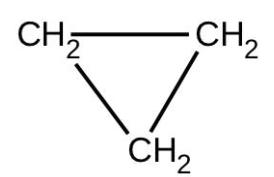

When heated to 499 °C, cyclopropane rearranges (isomerizes) and forms propene with a rate constant of 5.95 × 10⁻⁴ s⁻¹. What is the half-life of this reaction? What fraction of the cyclopropane remains after 0.75 h at 499 °C?

**45.** Fluorine-18 is a radioactive isotope that decays by positron emission to form oxygen-18 with a half-life of 109.7 min. (A positron is a particle with the mass of an electron and a single unit of positive charge; the equation is ${}^{18}_{9}\text{F} \longrightarrow {}^{18}_{8}\text{O} + {}^{0}_{+1}\text{e}$) Physicians use ¹⁸F to study the brain by injecting a quantity of fluoro-substituted glucose into the blood of a patient. The glucose accumulates in the regions where the brain is active and needs nourishment.
  - (a) What is the rate constant for the decomposition of fluorine-18?
  - (b) If a sample of glucose containing radioactive fluorine-18 is injected into the blood, what percent of the radioactivity will remain after 5.59 h?
  - (c) How long does it take for 99.99% of the ¹⁸F to decay?

**46.** Suppose that the half-life of steroids taken by an athlete is 42 days. Assuming that the steroids biodegrade by a first-order process, how long would it take for $\frac{1}{64}$ of the initial dose to remain in the athlete’s body?

**47.** Recently, the skeleton of King Richard III was found under a parking lot in England. If tissue samples from the skeleton contain about 93.79% of the carbon-14 expected in living tissue, what year did King Richard III die? The half-life of carbon-14 is 5730 years.

**48.** Nitroglycerine is an extremely sensitive explosive. In a series of carefully controlled experiments, samples of the explosive were heated to 160 °C and their first-order decomposition studied. Determine the average rate constants for each experiment using the following data:

| Initial [C₃H₅N₃O₉] (*M*) | 4.88 | 3.52 | 2.29 | 1.81 | 5.33 | 4.05 | 2.95 | 1.72 |
|---|---|---|---|---|---|---|---|---|
| *t* (s) | 300 | 300 | 300 | 300 | 180 | 180 | 180 | 180 |
| % Decomposed | 52.0 | 52.9 | 53.2 | 53.9 | 34.6 | 35.9 | 36.0 | 35.4 |

**49.** For the past 10 years, the unsaturated hydrocarbon 1,3-butadiene ($\text{CH}_2=\text{CH}\text{–}\text{CH}=\text{CH}_2$) has ranked 38th among the top 50 industrial chemicals. It is used primarily for the manufacture of synthetic rubber. An isomer exists also as cyclobutene:

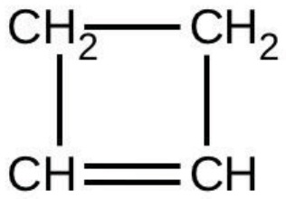

The isomerization of cyclobutene to butadiene is first-order and the rate constant has been measured as 2.0 × 10⁻⁴ s⁻¹ at 150 °C in a 0.53-L flask. Determine the partial pressure of cyclobutene and its concentration after 30.0 minutes if an isomerization reaction is carried out at 150 °C with an initial pressure of 55 torr.

### 12.5 Collision Theory

**50.** Chemical reactions occur when reactants collide. What are two factors that may prevent a collision from producing a chemical reaction?

**51.** When every collision between reactants leads to a reaction, what determines the rate at which the reaction occurs?

**52.** What is the activation energy of a reaction, and how is this energy related to the activated complex of the reaction?

**53.** Account for the relationship between the rate of a reaction and its activation energy.

**54.** Describe how graphical methods can be used to determine the activation energy of a reaction from a series of data that includes the rate of reaction at varying temperatures.

**55.** How does an increase in temperature affect rate of reaction? Explain this effect in terms of the collision theory of the reaction rate.

**56.** The rate of a certain reaction doubles for every 10 °C rise in temperature.
  - (a) How much faster does the reaction proceed at 45 °C than at 25 °C?
  - (b) How much faster does the reaction proceed at 95 °C than at 25 °C?

**57.** In an experiment, a sample of NaClO₃ was 90% decomposed in 48 min. Approximately how long would this decomposition have taken if the sample had been heated 20 °C higher? (Hint: Assume the rate doubles for each 10 °C rise in temperature.)

**58.** The rate constant at 325 °C for the decomposition reaction $\text{C}_{4}\text{H}_{8} \longrightarrow \text{2C}_{2}\text{H}_{4}$ is 6.1 × 10⁻⁸ s⁻¹, and the activation energy is 261 kJ per mole of C₄H₈. Determine the frequency factor for the reaction.

**59.** The rate constant for the decomposition of acetaldehyde, CH₃CHO, to methane, CH₄, and carbon monoxide, CO, in the gas phase is 1.1 × 10⁻² L mol⁻¹ s⁻¹ at 703 K and 4.95 L mol⁻¹ s⁻¹ at 865 K. Determine the activation energy for this decomposition.

**60.** An elevated level of the enzyme alkaline phosphatase (ALP) in human serum is an indication of possible liver or bone disorder. The level of serum ALP is so low that it is very difficult to measure directly. However, ALP catalyzes a number of reactions, and its relative concentration can be determined by measuring the rate of one of these reactions under controlled conditions. One such reaction is the conversion of p-nitrophenyl phosphate (PNPP) to p-nitrophenoxide ion (PNP) and phosphate ion. Control of temperature during the test is very important; the rate of the reaction increases 1.47 times if the temperature changes from 30 °C to 37 °C. What is the activation energy for the ALP–catalyzed conversion of PNPP to PNP and phosphate?

**61.** In terms of collision theory, to which of the following is the rate of a chemical reaction proportional?
  - (a) the change in free energy per second
  - (b) the change in temperature per second
  - (c) the number of collisions per second
  - (d) the number of product molecules

**62.** Hydrogen iodide, HI, decomposes in the gas phase to produce hydrogen, H₂, and iodine, I₂. The value of the rate constant, *k*, for the reaction was measured at several different temperatures and the data are shown here:

| Temperature (K) | *k* (L mol⁻¹ s⁻¹) |
|---|---|
| 555 | $6.23 \times 10^{-7}$ |
| 575 | $2.42 \times 10^{-6}$ |
| 645 | $1.44 \times 10^{-4}$ |
| 700 | $2.01 \times 10^{-3}$ |

What is the value of the activation energy (in kJ/mol) for this reaction?

**63.** The element Co exists in two oxidation states, Co(II) and Co(III), and the ions form many complexes. The rate at which one of the complexes of Co(III) was reduced by Fe(II) in water was measured. Determine the activation energy of the reaction from the following data:

| *T* (K) | *k* (s⁻¹) |
|---|---|
| 293 | 0.054 |
| 298 | 0.100 |

**64.** The hydrolysis of the sugar sucrose to the sugars glucose and fructose,

$\text{C}_{12}\text{H}_{22}\text{O}_{11} + \text{H}_{2}\text{O} \longrightarrow \text{C}_{6}\text{H}_{12}\text{O}_{6} + \text{C}_{6}\text{H}_{12}\text{O}_{6}$

follows a first-order rate law for the disappearance of sucrose: $\text{rate} = k[\text{C}_{12}\text{H}_{22}\text{O}_{11}]$ (The products of the reaction, glucose and fructose, have the same molecular formulas but differ in the arrangement of the atoms in their molecules.)
  - (a) In neutral solution, *k* = 2.1 × 10⁻¹¹ s⁻¹ at 27 °C and 8.5 × 10⁻¹¹ s⁻¹ at 37 °C. Determine the activation energy, the frequency factor, and the rate constant for this equation at 47 °C (assuming the kinetics remain consistent with the Arrhenius equation at this temperature).
  - (b) When a solution of sucrose with an initial concentration of 0.150 *M* reaches equilibrium, the concentration of sucrose is 1.65 × 10⁻⁷ *M*. How long will it take the solution to reach equilibrium at 27 °C in the absence of a catalyst? Because the concentration of sucrose at equilibrium is so low, assume that the reaction is irreversible.
  - (c) Why does assuming that the reaction is irreversible simplify the calculation in part (b)?

**65.** Use the PhET Reactions & Rates interactive simulation (http://openstax.org/l/16PHETreaction) to simulate a system. On the “Single collision” tab of the simulation applet, enable the “Energy view” by clicking the “+” icon. Select the first $A + BC \longrightarrow AB + C$ reaction (A is yellow, B is purple, and C is navy blue). Using the “straight shot” default option, try launching the *A* atom with varying amounts of energy. What changes when the Total Energy line at launch is below the transition state of the Potential Energy line? Why? What happens when it is above the transition state? Why?

**66.** Use the PhET Reactions & Rates interactive simulation (http://openstax.org/l/16PHETreaction) to simulate a system. On the “Single collision” tab of the simulation applet, enable the “Energy view” by clicking the “+” icon. Select the first $A + BC \longrightarrow AB + C$ reaction (A is yellow, B is purple, and C is navy blue). Using the “angled shot” option, try launching the *A* atom with varying angles, but with more Total energy than the transition state. What happens when the *A* atom hits the *BC* molecule from different directions? Why?

### 12.6 Reaction Mechanisms

**67.** Why are elementary reactions involving three or more reactants very uncommon?

**68.** In general, can we predict the effect of doubling the concentration of *A* on the rate of the overall reaction $\text{A} + \text{B} \longrightarrow \text{C}$? Can we predict the effect if the reaction is known to be an elementary reaction?

**69.** Define these terms:
  - (a) unimolecular reaction
  - (b) bimolecular reaction
  - (c) elementary reaction
  - (d) overall reaction

**70.** What is the rate law for the elementary termolecular reaction $\text{A} + \text{2B} \longrightarrow \text{products}$? For $\text{3A} \longrightarrow \text{products}$?

**71.** Given the following reactions and the corresponding rate laws, in which of the reactions might the elementary reaction and the overall reaction be the same?
  - (a) $\text{Cl}_{2} + \text{CO} \longrightarrow \text{Cl}_{2}\text{CO}$ $\text{rate} = k[\text{Cl}_2]^{3/2}[\text{CO}]$
  - (b) $\text{PCl}_{3} + \text{Cl}_{2} \longrightarrow \text{PCl}_{5}$ $\text{rate} = k[\text{PCl}_3][\text{Cl}_2]$
  - (c) $\text{2NO} + \text{H}_{2} \longrightarrow \text{N}_{2} + \text{H}_{2}\text{O}_{2}$ $\text{rate} = k[\text{NO}][\text{H}_2]$
  - (d) $\text{2NO} + \text{O}_{2} \longrightarrow \text{2NO}_{2}$ $\text{rate} = k[\text{NO}]^2[\text{O}_2]$
  - (e) $\text{NO} + \text{O}_{3} \longrightarrow \text{NO}_{2} + \text{O}_{2}$ $\text{rate} = k[\text{NO}][\text{O}_3]$

**72.** Write the rate law for each of the following elementary reactions:
  - (a) $\text{O}_3 \xrightarrow{\text{sunlight}} \text{O}_2 + \text{O}$
  - (b) $\text{O}_{3} + \text{Cl} \longrightarrow \text{O}_{2} + \text{ClO}$
  - (c) $\text{ClO} + \text{O} \longrightarrow \text{Cl} + \text{O}_{2}$
  - (d) $\text{O}_{3} + \text{NO} \longrightarrow \text{NO}_{2} + \text{O}_{2}$
  - (e) $\text{NO}_{2} + \text{O} \longrightarrow \text{NO} + \text{O}_{2}$

**73.** Nitrogen monoxide, NO, reacts with hydrogen, H₂, according to the following equation:

$\text{2NO} + \text{2H}_{2} \longrightarrow \text{N}_{2} + \text{2H}_{2}\text{O}$

What would the rate law be if the mechanism for this reaction were:

$\text{2NO} + \text{H}_{2} \longrightarrow \text{N}_{2} + \text{H}_{2}\text{O}_{2}$ (slow)

$\text{H}_{2}\text{O}_{2} + \text{H}_{2} \longrightarrow \text{2H}_{2}\text{O}$ (fast)

**74.** Experiments were conducted to study the rate of the reaction represented by this equation.² 

$\text{2NO(g)} + \text{2H}_{2}\text{(g)} \longrightarrow \text{N}_{2}\text{(g)} + \text{2H}_{2}\text{O(g)}$

Initial concentrations and rates of reaction are given here.

| Experiment | Initial Concentration [NO] (mol L⁻¹) | Initial Concentration, [H₂] (mol L⁻¹) | Initial Rate of Formation of N₂ (mol L⁻¹ min⁻¹) |
|---|---|---|---|
| 1 | 0.0060 | 0.0010 | $1.8 \times 10^{-4}$ |
| 2 | 0.0060 | 0.0020 | $3.6 \times 10^{-4}$ |
| 3 | 0.0010 | 0.0060 | $0.30 \times 10^{-4}$ |
| 4 | 0.0020 | 0.0060 | $1.2 \times 10^{-4}$ |

Consider the following questions:
  - (a) Determine the order for each of the reactants, NO and H₂, from the data given and show your reasoning.
  - (b) Write the overall rate law for the reaction.
  - (c) Calculate the value of the rate constant, *k*, for the reaction. Include units.
  - (d) For experiment 2, calculate the concentration of NO remaining when exactly one-half of the original amount of H₂ had been consumed.
  - (e) The following sequence of elementary steps is a proposed mechanism for the reaction. Step 1: $\text{NO} + \text{NO} \rightleftharpoons \text{N}_{2}\text{O}_{2}$ Step 2: $\text{N}_{2}\text{O}_{2} + \text{H}_{2} \rightleftharpoons \text{H}_{2}\text{O} + \text{N}_{2}\text{O}$ Step 3: $\text{N}_{2}\text{O} + \text{H}_{2} \rightleftharpoons \text{N}_{2} + \text{H}_{2}\text{O}$ Based on the data presented, which of these is the rate determining step? Show that the mechanism is consistent with the observed rate law for the reaction and the overall stoichiometry of the reaction.

² This question is taken from the Chemistry Advanced Placement Examination and is used with the permission of the Educational Testing Service.

**75.** The reaction of CO with Cl₂ gives phosgene (COCl₂), a poisonous gas used as a chemical weapon during World War I. Use the mechanism shown here to complete the following exercises:

$\text{Cl}_{2}\text{(g)} \rightleftharpoons \text{2Cl(g)}$ (fast, $k_1$ represents the forward rate constant, $k_{-1}$ the reverse rate constant)

$\text{CO(g)} + \text{Cl(g)} \longrightarrow \text{COCl(g)}$ (slow, $k_2$ the rate constant)

$\text{COCl(g)} + \text{Cl(g)} \longrightarrow \text{COCl}_{2}\text{(g)}$ (fast, $k_3$ the rate constant)
  - (a) Write the overall reaction.
  - (b) Identify all intermediates.
  - (c) Write the rate law for each elementary reaction.
  - (d) Write the overall rate law expression.

### 12.7 Catalysis

**76.** Account for the increase in reaction rate brought about by a catalyst.

**77.** Compare the functions of homogeneous and heterogeneous catalysts.

**78.** Consider this scenario and answer the following questions: Chlorine atoms resulting from decomposition of chlorofluoromethanes, such as CCl₂F₂, catalyze the decomposition of ozone in the atmosphere. One simplified mechanism for the decomposition is:

$$\text{O}_3 \xrightarrow{\text{sunlight}} \text{O}_2 + \text{O}$$

$$\text{O}_{3} + \text{Cl} \longrightarrow \text{O}_{2} + \text{ClO}$$

$$\text{ClO} + \text{O} \longrightarrow \text{Cl} + \text{O}_{2}$$
  - (a) Explain why chlorine atoms are catalysts in the gas-phase transformation: $\text{2O}_{3} \longrightarrow \text{3O}_{2}$
  - (b) Nitric oxide is also involved in the decomposition of ozone by the mechanism:

  $$\text{O}_3 \xrightarrow{\text{sunlight}} \text{O}_2 + \text{O}$$

  $$\text{O}_{3} + \text{NO} \longrightarrow \text{NO}_{2} + \text{O}_{2}$$

  $$\text{NO}_{2} + \text{O} \longrightarrow \text{NO} + \text{O}_{2}$$

  Is NO a catalyst for the decomposition? Explain your answer.

**79.** For each of the following pairs of reaction diagrams, identify which of the pair is catalyzed:
  - (a)

  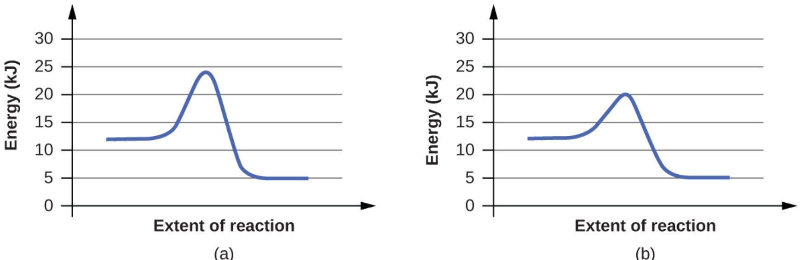
  - (b)

  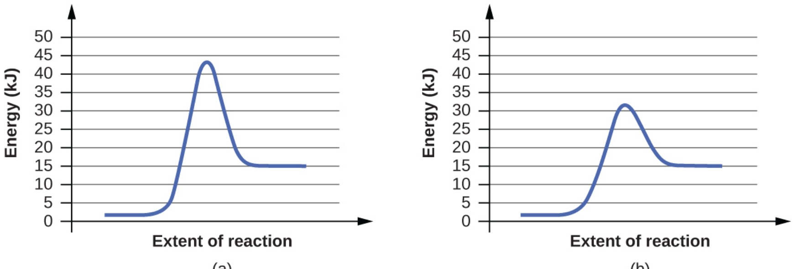

**80.** For each of the following pairs of reaction diagrams, identify which of the pairs is catalyzed:
  - (a)

  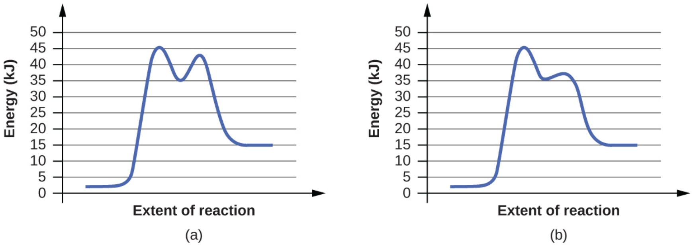
  - (b)

  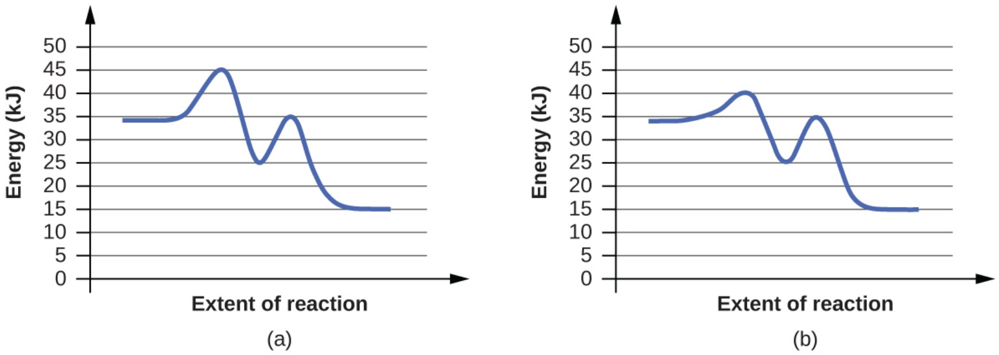

**81.** For each of the following reaction diagrams, estimate the activation energy (*E*ₐ) of the reaction:
  - (a)

  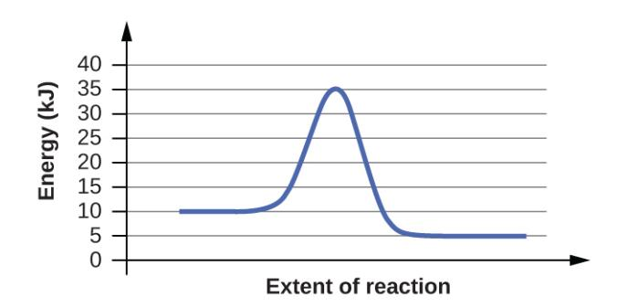
  - (b)

  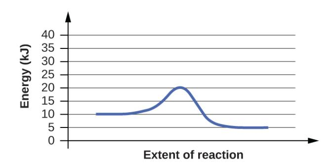

**82.** For each of the following reaction diagrams, estimate the activation energy (*E*ₐ) of the reaction:
  - (a)

  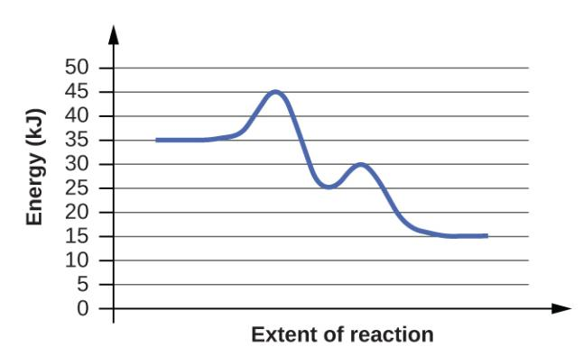
  - (b)

  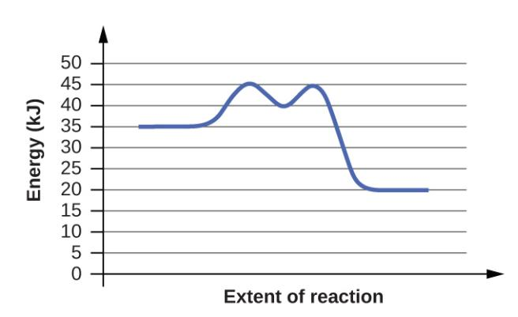

**83.** Assuming the diagrams in Exercise 12.81 represent different mechanisms for the same reaction, which of the reactions has the faster rate?

**84.** Consider the similarities and differences in the two reaction diagrams shown in Exercise 12.82. Do these diagrams represent two different overall reactions, or do they represent the same overall reaction taking place by two different mechanisms? Explain your answer.
